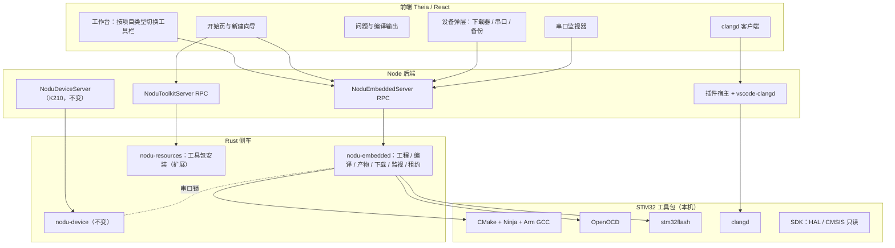
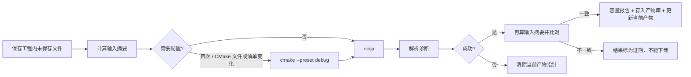
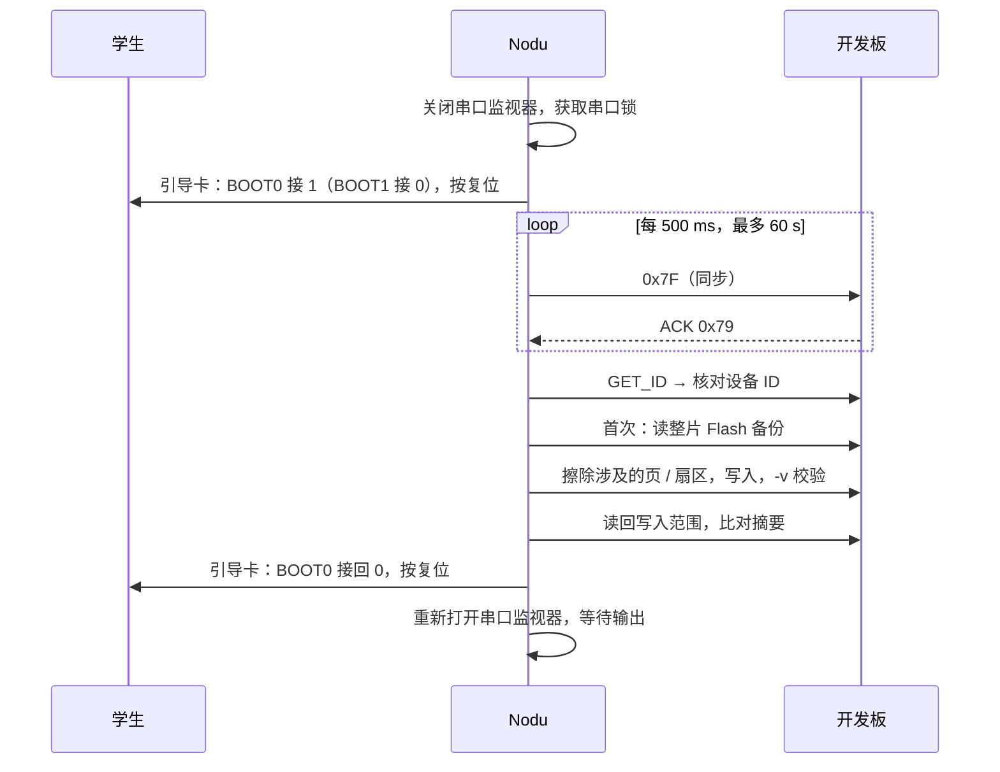

# Nodu 0.2.1 功能与技术设计：STM32 HAL C 开发

日期：2026-10-22。状态：**待评审，未实现。** 需求编号见 [PRD.md](PRD.md)。

## 1. 总体架构



设计要点：

- **新服务，不扩展 K210 状态机。** `nodu-embedded` 是独立侧车，沿用 `nodu-device` 的 JSON 行协议、优先级队列和代次取消机制，但模型是“工程 → 产物 → 下载”，没有 REPL 会话。
- **串口锁共用。** 现有 `PortLock` 定义在 `nodu-device/src/lib.rs`（`$TMPDIR/nodu-device-locks/<sha256>.lock`，flock，`/dev/tty.*` 规范化为 `/dev/cu.*`），`nodu-terminal` 已在使用。把它移到 `nodu-serial`，K210 侧车、终端和 `nodu-embedded` 共用同一份实现。
- **ST-LINK 也有锁。** 下载器按 USB 序列号上锁（同目录，`probe-<serial>.lock`），防止两个窗口同时写同一块板。
- **前端只发意图。** 前端调用 `build`、`flash`、`openMonitor` 等方法；进程生命周期、超时、清理都由 Rust 负责。
- **工具调用都是独立进程。** GCC、OpenOCD、stm32flash、clangd 都作为外部程序调用，不链接进 Nodu（许可边界，见 PRD §6）。

## 2. 工程模型

### 2.1 目录结构

```
blink-f407/
├── nodu.json              清单：目标、板卡包、下载方式、串口
├── nodu.lock.json         版本锁：SDK、工具包、模板版本与摘要
├── CMakeLists.txt         普通 CMake；include(cmake/nodu.cmake)
├── CMakePresets.json      debug / release，供终端与 VS Code 使用
├── cmake/
│   ├── nodu.cmake         读取 SDK 路径、源文件收集、产物与容量
│   └── arm-gcc.cmake      工具链文件（来自 P0，含 try_compile 变量传递）
├── Core/
│   ├── Inc/  main.h  stm32f4xx_hal_conf.h  stm32f4xx_it.h
│   └── Src/  main.c  stm32f4xx_it.c  stm32f4xx_hal_msp.c  system_stm32f4xx.c  syscalls.c
├── Board/                 板卡包展开：board.h（引脚宏）、board_clock.c、board_uart.c
├── App/                   学生自己的模块（空）
├── Startup/startup_stm32f407xx.s
├── Linker/STM32F407ZGTx_FLASH.ld
├── .clang-format          Nodu 风格（可改）
├── .clangd                CompilationDatabase: build/debug；关闭自动插入头文件
├── .gitignore             build/  .nodu/
└── .nodu/                 本机状态，不入库：信任标记、运行记录、产物指针
```

- 目录名沿用 CubeMX 习惯（`Core/Inc`、`Core/Src`），学生以后转到 CubeIDE 不会陌生（P2）。
- 启动文件、系统文件、链接脚本、`hal_conf.h` 进入工程：它们是学习内容，学生会读、会改。HAL 驱动与 CMSIS 头文件留在共享 SDK（D2）。
- `system_stm32f4xx.c` 保持官方原文，不加 Nodu 修改；时钟配置写在 `Board/board_clock.c` 的 `SystemClock_Config()` 中，与 CubeMX 生成的代码结构一致。
- `syscalls.c` 提供 `_write()`，把 `printf` 重定向到板卡包声明的调试串口；`_sbrk` 等桩函数用 newlib nano 自带的 nosys。
- `.nodu/` 被 `.gitignore` 忽略。现有 `nodu-tutor-plan.ts` 已经把教学计划放在 `.nodu-tutor/` 而非 `.nodu/`，两者不冲突。

### 2.2 `nodu.json`

```jsonc
{
  "schema": 1,
  "kind": "stm32-hal",
  "name": "blink-f407",
  "target": { "mcu": "STM32F407ZGTx", "board": "alientek-explorer-f407@1" },
  "sdk": "stm32cube-f4@1.28.3",
  "build": { "preset": "debug", "printfFloat": false },
  "flash": { "method": "stlink" },            // "stlink" | "uart"
  "monitor": { "baud": 115200, "encoding": "utf-8", "lineEnding": "lf" }
}
```

- `kind` 决定工作台切换到哪套界面（P5）。缺少 `nodu.json` 的文件夹按 K210 项目处理，与 0.1.4 一致。
- 板卡包与 SDK 用 `id@version` 引用；完整摘要写在 `nodu.lock.json` 中。
- 清单 schema 用 JSON Schema 定义，Nodu 内置；编辑 `nodu.json` 时有补全和校验（Theia JSON 支持）。
- 清单与 CMake 不一致时（例如有人手改 CMake 的 MCU 宏），编译后核对 ELF 的架构属性与 `target.mcu`；不一致时拒绝下载并说明。

### 2.3 `nodu.lock.json`

```jsonc
{
  "schema": 1,
  "sdk": { "id": "stm32cube-f4", "version": "1.28.3",
           "cube": "94cae6e8…", "hal": "b6f0ed38…", "device": "3c77349c…", "sha256": "…" },
  "toolkit": { "id": "nodu-stm32-toolkit", "version": "2026.11.0", "sha256": "…" },
  "board": { "id": "alientek-explorer-f407", "version": 1, "sha256": "…" },
  "template": { "id": "blink", "version": 1, "files": { "Core/Src/main.c": "sha256…" } }
}
```

- 打开工程时，缺少锁定的 SDK 或工具包版本 → 提示安装该版本（T5）；不自动换成新版本。
- `template.files` 记录生成时每个文件的摘要，用于以后的模板升级差异显示（P2），不覆盖学生修改。

### 2.4 源文件收集与 CMake

`cmake/nodu.cmake` 的职责：

1. 从 `NODU_SDK_ROOT`（Nodu 编译时传入；导出工程中指向 `Drivers/`）找到 HAL 和 CMSIS。
2. 按 `hal_conf.h` 中启用的 `HAL_xxx_MODULE_ENABLED` 宏选择 HAL 源文件：解析头文件，生成 HAL 源列表。P0 已证明不能只看 `main.c` 中的调用来裁剪 HAL（RCC 依赖 GPIO 类型），所以按配置宏全量加入对应模块，再加上依赖关系表（例如 RCC 依赖 GPIO、CORTEX）。
3. `file(GLOB_RECURSE … CONFIGURE_DEPENDS)` 收集 `Core/Src`、`Board`、`App` 下的 `.c` 与 `.s`（P4）。新增文件在下次编译时被 CMake 自动发现。
4. 编译选项：`-mcpu`、`-mfpu`、`-mfloat-abi`（来自板卡包的芯片定义），`-Og -g3 -Wall -Wextra -ffunction-sections -fdata-sections`，`-fdiagnostics-plain-output -fdiagnostics-column-unit=byte`（见 §5.3），链接 `--specs=nano.specs --specs=nosys.specs -Wl,--gc-sections -Wl,--print-memory-usage`。`printfFloat` 为 true 时加 `-u _printf_float`。
5. 产物：`firmware.elf`、`.bin`、`.hex`、`.map`；`CMAKE_EXPORT_COMPILE_COMMANDS=ON`。
6. SDK 目录作为 `SYSTEM` 包含路径，SDK 内部警告不显示给学生（B3）。

导出独立工程（P7）：复制工程用到的 HAL 源与头文件、CMSIS 头文件和许可文件到 `Drivers/`，把 `NODU_SDK_ROOT` 默认值改成 `${CMAKE_SOURCE_DIR}/Drivers`，并写一份 `README.md` 说明需要的工具版本。导出结果不依赖 Nodu。

### 2.5 外部工程（P8）

打开不含 `nodu.json` 但包含 `CMakeLists.txt` 和 `*.ioc`（或 `startup_stm32*.s`）的文件夹时，提示“作为 STM32 工程打开”。确认后：

1. 显示 Theia 工作区信任对话框（`security.workspace.trust.*`，`@theia/workspace` 已内置）。未信任时只提供编辑，不执行 CMake：CMake 配置会执行工程里的脚本。
2. 信任后，根据启动文件名推断 MCU，生成最小 `nodu.json`（不改动工程其他文件），使用工程自带的 Drivers 和工具链文件；工具链路径通过 `-DCMAKE_TOOLCHAIN_FILE` 或环境变量指向 Nodu 工具包。
3. 推断失败时提示手动选择芯片。外部工程的编译错误照常显示，但中文解释和容量报告可能不完整。

## 3. 芯片定义与板卡包

### 3.1 芯片定义（随应用发布）

芯片定义描述芯片本身，与板子无关。0.2.1 只有两份：

| 字段 | STM32F407ZGTx | STM32F103C8Tx | 来源 |
| --- | --- | --- | --- |
| 内核 / 浮点 | Cortex-M4，`-mfpu=fpv4-sp-d16 -mfloat-abi=hard` | Cortex-M3，`-mfloat-abi=soft` | P0 CMakeLists |
| Flash | 1 MB @ 0x08000000，扇区 4×16 KB + 64 KB + 7×128 KB | 64 KB @ 0x08000000，1 KB 页 | P0 OpenOCD 扇区表；RM0008 |
| RAM | 128 KB @ 0x20000000；CCM 64 KB @ 0x10000000（DMA 不可用） | 20 KB @ 0x20000000 | P0 链接脚本 |
| 设备 ID（DBGMCU_IDCODE 低 12 位） | 0x413 | 0x410 | F407 实测 `0x101f6413`；F103 待 M0 实测 |
| Flash 容量寄存器 | 0x1FFF7A22 | 0x1FFFF7E0 | CMSIS 头文件 `FLASHSIZE_BASE` |
| 唯一 ID（96 位） | 0x1FFF7A10 | 0x1FFFF7E8 | CMSIS 头文件 `UID_BASE` |
| 读保护寄存器 | FLASH_OPTCR 0x40023C14，RDP 位 15:8，0xAA 为 0 级 | FLASH_OBR 0x4002201C，RDPRT 位 1 | CMSIS 头文件推算 |
| OpenOCD 目标 | `target/stm32f4x.cfg` | `target/stm32f1x.cfg` | OpenOCD 0.12.0 |
| 启动文件 / 链接模板 | `startup_stm32f407xx.s` / P0 `f407zg.ld` | `startup_stm32f103xb.s` / P0 `f103c8.ld` | CubeF4 1.28.3 / CubeF1 1.8.7 |
| ROM 引导串口 | USART1 PA9/PA10，或 USART3 PB10/PB11、PC10/PC11（按 AN2606，M0 实测） | USART1 PA9/PA10 | AN2606、P0 README |

F103C8 的 Flash 容量寄存器在不少芯片上报告 128 KB；容量核对只要求“不小于工程需要”，不要求与型号完全相等。

### 3.2 板卡包

板卡包描述一块具体的板子：时钟源、调试串口、LED、按键、BOOT 跳线和下载电路。板卡包随应用发布，按 `id@version` 引用，旧版本也保留在应用内（每个包只有几十 KB）。

```jsonc
// boards/alientek-explorer-f407/1/board.json
{
  "schema": 1,
  "id": "alientek-explorer-f407", "version": 1,
  "name": "正点原子 探索者 F407", "mcu": "STM32F407ZGTx",
  "revisions": ["V3"],                         // 适用的板子修订版，M0 填写
  "clock": { "hse": 8000000, "sysclk": 168000000, "verified": null },
  "debugUart": { "instance": "USART1", "tx": "PA9", "rx": "PA10", "via": "板载 USB 转串口",
                 "verified": null, "note": "需要跳线连接 USB_UART，M0 核对" },
  "leds": [{ "name": "LED0", "pin": null, "activeLow": true, "verified": null }],
  "keys": [],
  "boot": { "boot0": "跳线", "boot1": "跳线", "image": "boot-jumpers.svg", "verified": null },
  "flash": {
    "stlink": { "speedKhz": 1800, "resetConfig": "none" },
    "uart": { "port": "debugUart", "baud": 115200, "autoBoot": null }
  },
  "templates": ["empty", "uart-hello", "blink"],
  "sources": [{ "title": "探索者 F407 原理图", "revision": "待填", "note": "M0 实物核对" }]
}
```

- 每个板级事实带 `verified` 字段：`null` 表示未核对，否则记录核对日期与依据。
- 模板声明它依赖的事实（例如 `blink` 依赖 `leds[0].pin`）。依赖的事实未核对时，向导不显示该模板。这样未核对的引脚不会出现在学生工程里。
- `autoBoot` 描述一键下载电路的 DTR/RTS 序列，只有实测通过的板子才填写（F12）。
- 新建工程时，板卡包的模板文件展开到 `Board/` 与 `Core/`。之后板卡包升级不会改动已有工程。

上表中 F407 的 LED 引脚、调试串口跳线和 BOOT 跳线都是 `null`：P0 刻意没有假设这些引脚（调研 §6 “不猜 PC13/PF9/PF10”）。M0 用实物和原理图核对后填写，`blink` 模板才会显示。

### 3.3 模板

| 模板 | 内容 | 依赖的板卡事实 | 现象 |
| --- | --- | --- | --- |
| `empty` | `main()`、时钟、HAL 初始化、空主循环 | 时钟 | 无 |
| `uart-hello` | 调试串口初始化、`printf` 重定向、每秒打印一行 | 时钟、调试串口 | 串口监视器每秒出现 `Hello from Nodu #n` |
| `blink` | 在 `uart-hello` 基础上让 LED0 每 500 ms 翻转 | 时钟、调试串口、LED0 | LED 闪烁，串口同步打印 |

F103C8 通用板卡包只提供 `empty` 和 `uart-hello`，时钟用 HSI 加 PLL，不假设外部晶振（与 P0 一致）。用户提供具体板型后（D6），再新增对应板卡包。

模板代码只调用 HAL，不封装 Nodu 自己的外设 API（调研 §1）。模板不使用 CubeMX 的 `/* USER CODE BEGIN */` 标记：Nodu 不会重新生成代码，这些标记对学生没有意义。

## 4. STM32 工具包

### 4.1 组成

| 组件 | 版本 | 来源 | 处理 |
| --- | --- | --- | --- |
| Arm GNU 工具链 | 14.2.Rel1 | Arm 官方归档，SHA-256 与官方值比对（P0 已核对 darwin-arm64） | 裁剪：只保留 C 前端、binutils、GDB（为调试阶段预留）、`thumb/v7-m/nofp` 与 `thumb/v7e-m+fp/hard` 多库；去掉 C++ / Fortran 前端、LTO 工具和文档。P0 机器实测裁剪后约 141 MB（完整安装 976 MB） |
| CMake | 4.4.3 | Kitware 官方归档 | 去掉文档与 GUI |
| Ninja | 1.13.2 | 官方归档 | 原样 |
| OpenOCD | 0.12.0 | 按固定上游源码与 libusb 版本自行构建（与 `build-media.cjs` 构建 ffmpeg 的做法一致）；xPack 0.12.0 为备选 | P0 用的是 Homebrew 构建；换成分发版本后，需重跑 SWD 实物验证 |
| stm32flash | 0.7 | 固定源码（SHA-256 `c4c9cd8b…`）自行构建 | P0 已核对源码行为 |
| clangd | 23.1.0 | clangd 官方发布（mac 95.4 MB / windows 28.3 MB 压缩包） | macOS 按架构拆分 |
| SDK：CubeF4 | 1.28.3 | P0 锁定的 Cube / HAL / Device 三个 commit | 只保留 HAL、CMSIS Core 与 F405/F407 设备头文件和许可文件 |
| SDK：CubeF1 | 1.8.7 | 同上 | 只保留 HAL、CMSIS Core 与 F103 设备头文件和许可文件 |

以上版本与 P0 锁定的一致。**包含的工具版本一旦发布就不变**；升级工具链等于发布新的工具包版本，旧工程继续使用锁定的旧版本（T5）。

体积估算：裁剪后的工具链、clangd、CMake、OpenOCD 合计安装后约 300–400 MB，压缩后每平台约 120–150 MB。这是按 P0 机器测量和官方包大小推算的，M1 打包后实测；超出 PRD 体积目标时，优先压缩 clangd（单架构）和工具链多库。

### 4.2 安装位置与清单

```
<工具根目录>/
├── manifest-installed.json      已安装组件、版本、摘要、安装时间
└── components/<组件>/<版本>/     只读
```

- 工具根目录默认 macOS `~/.nodu/toolkits/`，Windows `%LOCALAPPDATA%\Nodu\toolkits\`。Windows 用户名含中文时，默认改用系统盘根目录下的 `Nodu\toolkits`（ASCII 路径），可在设置中修改。GCC 与 Ninja 在非 ASCII 路径下的行为需要在 Windows 实测（M5）。
- **工具包清单随应用发布**（`resources/toolkits/stm32.json`），列出每个组件在每个平台的归档名、大小、SHA-256、文件数上限和镜像地址。下载源只是传输通道：无论从哪个镜像、还是从离线包取得，都按应用内的清单校验。
- 不修改系统 PATH，不写注册表。Nodu 调用工具时传入完整路径，并为子进程构造只含工具包目录的 PATH，避免学生电脑上其他 GCC 或 CMake 混入。

### 4.3 安装流程

扩展现有的 `nodu-resources` CLI（已有 URL 安全检查、SHA-256 校验、条目数与解压大小上限、暂存目录后整体换入、失败回滚），新增：

| 新增 | 说明 |
| --- | --- |
| `install-toolkit` 命令 | 按清单逐个组件下载、校验、解压、换入；进度事件沿用 `{"event":"progress"}` |
| 断点续传 | HTTP Range；临时文件按组件摘要命名，重启后继续 |
| 强制 SHA-256 | 工具包组件必须校验，不提供跳过选项（现有资源包的校验是可选的） |
| 可执行权限 | 解压时按清单恢复可执行位；拒绝符号链接与硬链接（打包时已展开） |
| 上限来自清单 | 单文件与总大小上限由清单给出，同时不超过代码里的硬上限 |
| 离线包导入 | `.nodupack` 是 zip，内含各组件归档；按应用内清单逐个校验，不信任包内自带的清单。应用清单里没有的版本拒绝导入 |
| macOS 隔离属性 | 下载的可执行文件带 `com.apple.quarantine` 时，在校验通过后移除；ad-hoc 签名与公证问题见 [PLAN.md](PLAN.md) 风险 |

Windows 上，下载器使用 ST 官方驱动。安装工具包时不安装驱动；第一次检测下载器失败时，检查 USB 设备列表里是否有 VID 0483 的设备，没有驱动时给出 ST 官方驱动页面和安装步骤（T9）。

### 4.4 工具包管理界面（T7，P1）

设置 → STM32 工具包：版本列表、占用空间、被哪些最近工程使用、修复（重新校验所有文件）、删除。删除正在被打开工程锁定的版本时要求确认。

## 5. 编译

### 5.1 流程



- **输入摘要**：工程内源文件（排除 `build/`、`.nodu/`、`.cache/`）、`nodu.json`、`nodu.lock.json`、SDK 与工具包版本的组合摘要。编译前后各算一次，不一致说明编译期间有文件被修改，结果不能用于下载（P0 最佳实践）。“运行”会自动重新编译。
- **失败即失效**：编译失败时删除 `.nodu/current-build.json`，“运行”不能拿旧的成功产物去下载（B7）。
- **并发**：每个工程同时只有一个编译。编译进行中再次请求时，若输入摘要相同则合并为同一次，否则排在当前编译之后。
- **超时**：配置 120 s，编译 600 s。
- **取消**：macOS 用进程组、Windows 用 Job 对象（`JOB_OBJECT_LIMIT_KILL_ON_JOB_CLOSE`），杀掉 ninja 和它启动的所有编译器进程，避免残留进程继续写产物目录。
- **子进程环境**：PATH 只含工具包目录与系统必需目录（Windows 的 `System32`）；`LC_ALL=C`、`LANG=C`，保证编译器输出英文原文，便于规则匹配；`CMAKE_*` 等外部环境变量被清除。

### 5.2 产物库

```
.nodu/artifacts/<bundleSha256>/   firmware.elf .bin .hex .map（只读） + artifact.json
.nodu/current-build.json          { bundle, inputDigest, finishedAt, size }
```

- `bundleSha256` 是 ELF / BIN / HEX / MAP 四个文件摘要的组合摘要。BIN 相同而调试信息不同时是不同的产物（P0 负样本 2）。
- `artifact.json` 记录目标 MCU、ELF 架构属性、初始栈指针与复位向量、容量、源码与 SDK 身份，格式沿用 P0 的 `*-artifact.json`。
- 下载前重新核对要写入文件的摘要；ELF 被改动、BIN 未变时也拒绝（P0 负样本 3）。
- 保留最近 5 个产物；正在等待下载（例如串口 ISP 等待 BOOT0）的产物不被清理，也不被新的编译覆盖。

### 5.3 诊断解析

编译选项加 `-fdiagnostics-plain-output`（关闭颜色、换行和超链接）与 `-fdiagnostics-column-unit=byte`，按经典格式逐行解析：

```
<file>:<line>:<col>: (error|warning|note|fatal error): <message> [-W<flag>]
<object>: in function `<fn>':  /  <file>:<line>: undefined reference to `<sym>'   ← 链接器
region `FLASH' overflowed by <n> bytes                                            ← 链接器
CMake Error at <file>:<line> …                                                     ← 配置
```

- 列号是字节偏移，前端按文件内容换算成 UTF-16 列，中文注释不会让列号错位。
- `note` 附在前一条错误下面，在“问题”中作为子项显示。
- 路径在 SDK 目录内的警告丢弃，错误保留，并标注“来自 HAL，通常由工程代码的用法引起”。
- GCC 14 的 SARIF 输出已在本机验证可用（`-fdiagnostics-format=sarif-stderr`），但链接器和 CMake 的错误仍是文本，ninja 还会把多个编译单元的输出与进度行混在一起。所以统一使用文本解析；SARIF 留作以后获取修复建议（fix-it）时再用。

### 5.4 中文解释规则

规则文件随应用发布（`resources/stm32/diagnostics.zh-CN.json`），每条规则包含：匹配条件（正则加可选的工程检查）、中文标题、解释、修改方向和规则 ID。原文始终保留在解释下方。

| 规则 | 匹配 | 解释与方向 |
| --- | --- | --- |
| `hal-module-disabled` | `implicit declaration of function 'HAL_<MOD>_…'`，并且 `hal_conf.h` 中 `HAL_<MOD>_MODULE_ENABLED` 被注释 | HAL 的 `<MOD>` 模块没有启用。打开 `Core/Inc/…_hal_conf.h`，取消 `#define HAL_<MOD>_MODULE_ENABLED` 的注释 |
| `implicit-declaration` | `implicit declaration of function '<f>'` | 使用 `<f>` 之前没有看到它的声明。检查拼写，或包含声明它的头文件 |
| `undeclared` | `'<x>' undeclared` | `<x>` 没有定义。检查拼写和大小写，或确认定义它的头文件已包含 |
| `missing-semicolon` | `expected ';' before` | 上一条语句末尾可能缺少分号。错误常报在下一行 |
| `undefined-reference` | `undefined reference to '<sym>'` | 声明找到了，实现没有参与链接。若 `<sym>` 是自己的函数，确认 `.c` 文件位于 `Core/Src`、`App` 或 `Board`；若是 HAL 函数，检查模块是否启用 |
| `multiple-definition` | `multiple definition of '<sym>'` | 同一个函数或变量在两个 `.c` 文件中都有定义。头文件里只放声明，全局变量在头文件中用 `extern` |
| `flash-overflow` | `region 'FLASH' overflowed by <n> bytes` | 程序比芯片 Flash 大 `<n>` 字节。检查大数组是否应加 `const`，或是否启用了 `printf` 浮点 |
| `ram-overflow` | `region 'RAM' overflowed` | 全局变量与栈超过 RAM。大缓冲区改为 `const`，或缩小数组 |
| `include-not-found` | `fatal error: <h>: No such file or directory` | 找不到头文件 `<h>`。自己的头文件放在 `Core/Inc` 或模块所在目录；HAL 头文件由 `main.h` 统一包含 |
| `conflicting-types` | `conflicting types for '<f>'` | 函数的声明与定义不一致，或使用前未声明导致编译器按默认类型推断 |
| `int-pointer` | `makes integer from pointer`、`makes pointer from integer` | 指针和整数混用。HAL 函数需要地址时，传 `&变量` 或数组名 |
| `unused-variable` | `[-Wunused-variable]` | 变量定义了但没有使用。删除，或确认是否忘了使用它 |

规则用采集到的真实编译器输出做单元测试。规则 ID 随诊断一起记录，也是以后 AI 教学审阅的输入。

### 5.5 容量报告

解析链接器 `--print-memory-usage` 的输出：

```
Memory region         Used Size  Region Size  %age Used
           FLASH:        3592 B         1 MB      0.34%
             RAM:        1960 B       128 KB      1.50%
```

编译结果显示 Flash 与 RAM 的用量和占比，状态栏显示 Flash 占比。占比超过 90 % 时显示琥珀色提示。F407 的 CCM 只在链接脚本定义并实际使用时显示。

## 6. 编辑与 clangd

### 6.1 接入方式（D4）

| 方案 | 做法 | 优点 | 代价 |
| --- | --- | --- | --- |
| A：插件宿主 + vscode-clangd（推荐） | 引入 `@theia/plugin-ext` 与 `@theia/plugin-ext-vscode`（固定 1.76.0），内置 vscode-clangd 0.6.0（MIT，Open VSX）与 `vscode.cpp` 内置扩展（TextMate 语法） | 功能完整（补全、悬停、跳转、引用、内嵌提示、切换头文件），上游维护；后续调试适配器（cortex-debug 等）也需要插件宿主 | 安装包增大；多一个插件宿主进程；需要隐藏扩展自带的命令和设置，避免干扰简洁界面 |
| B：自写精简 LSP 客户端 | Node 端启动 clangd，前端用 Monaco 的 provider 接口转发 LSP 请求 | 体积小，界面完全可控 | 需要自己实现并维护 LSP 同步、补全、悬停、跳转、诊断等约 10 个功能，估计多两周 |

Arduino IDE 2 依赖 `@theia/plugin-ext`、`plugin-ext-vscode` 与 `@theia/debug`（1.57.0），并内置 `vscode.cpp` 1.88.1 与 cortex-debug 1.5.1 两个 VSIX，说明“Theia 插件宿主 + 内置 VSIX”在桌面 IDE 中可行。它的 C++ 语言服务如何接入 clangd 未核对；它用的是 Theia 1.57，Nodu 是 1.76，M2 需要实测。

M2 原型的通过条件：

1. 安装包增量不超过 30 MB（PRD §6）。
2. 打开 F407 LED 工程到补全可用 ≤ 10 s，插件宿主常驻内存增量 ≤ 300 MB。
3. 简洁模式下，扩展贡献的状态栏项、命令和菜单可以全部隐藏。
4. K210 项目不启动 clangd，应用启动时间与 0.1.4 相比增加不超过 0.5 s。

任一条件不满足时改用方案 B。两种方案对前端其他部分透明：诊断都进入 Theia 的 marker 系统，“问题”面板统一显示。

### 6.2 clangd 配置

- 启动参数：`--compile-commands-dir=build/debug --header-insertion=never --background-index --clang-tidy=false --log=error -j=2`。
- `--query-driver=<工具包>/arm-gnu/*/bin/arm-none-eabi-gcc`：让 clangd 从交叉编译器读取内置头文件路径与宏，否则会找不到 `<stdint.h>` 等 newlib 头文件。
- `--header-insertion=never` 满足 E5：补全 HAL 函数时不自动插入 `#include`，由学生自己写。
- 工程模板内放 `.clangd`，用 `CompileFlags.Remove` 去掉 clang 不认识的 GCC 参数（如 `-fcyclomatic-complexity`、`-mthumb-interwork`），防止出现误报。
- clangd 只读取编译数据库，**不会执行 CMake**（调研 §6）。编译数据库由 Nodu 在打开工程时生成：已信任的工程执行一次 `cmake --preset debug`（只配置，不编译，约 1–2 s），满足 E6；未信任的工程不生成，clangd 只做单文件分析。
- 背景索引存放在 `build/.cache/clangd`，与工程一起被 `.gitignore` 忽略。

### 6.3 诊断来源

| 来源 | 时机 | 显示 |
| --- | --- | --- |
| clangd | 编辑时 | 编辑器波浪线；“问题”中标“实时” |
| 编译 | 点击编译或运行 | 编辑器波浪线；“问题”中标“编译”，附中文解释 |

clang 与 GCC 的诊断不完全相同。编译通过后，某行仍有 clangd 错误时，“问题”中保留该项并标“仅编辑器提示”。判断能不能下载以编译结果为准（E3）。

### 6.4 SDK 文件只读

SDK 目录通过 Theia 的文件系统提供者以只读方式挂载：跳转定义打开的 HAL 文件不可编辑，标签显示“只读 · HAL F4 1.28.3”（E4）。学生需要修改 HAL 行为时，正确做法是在工程中实现弱函数（`HAL_GPIO_EXTI_Callback` 等）或修改 `hal_conf.h`，这一点写进中文解释和课程。

### 6.5 C 语法与格式化

- 方案 A：使用 `vscode.cpp` 的 TextMate 语法。现有工作区已为 T1 原型在 `scope-languages.ts` 中加了 C 的 Monarch 着色，在插件不可用时作为后备。
- 格式化：clangd 内置 clang-format，工程模板附带 `.clang-format`（4 空格缩进，与 CubeMX 生成代码风格相近）。保存时格式化默认关闭，避免学生看到代码突然被改；“格式化文件”（`⇧⌥F`）手动执行。

## 7. 下载（烧写）

### 7.1 共同规则

1. **先核对，再擦除。** 每次写入前读取芯片设备 ID、Flash 容量和 96 位唯一 ID，与工程目标比较（F3）。家族 ID 只能说明是 F4 或 F1，不能区分封装；容量只要求不小于程序需要。
2. **首次备份。** 某颗芯片（按唯一 ID）第一次被 Nodu 写入前，读出整片 Flash 保存为备份（F4）。之后再写同一颗芯片不再备份。
3. **只写需要的范围。** 只擦除 BIN 覆盖的扇区或页，界面显示擦除范围；F407 的扇区大小不均匀（前 4 个 16 KB），小程序只擦第 0 扇区。
4. **写后读回。** 写入后对写入范围独立读回，比对 SHA-256（F5）。OpenOCD 的 `verify` 与读回比对都要通过。
5. **不改选项字节。** 不解除读保护，不改写保护、BOR 或看门狗配置。检测到读保护时停止，说明原因（F8）。
6. **产物不可变。** 写入的文件来自产物库，写入前再次核对摘要；等待用户操作（例如设置 BOOT0）期间，新的编译不能覆盖它。
7. **运行记录。** 每次下载生成一条运行记录（§7.5），旧的“运行中”结论在新一轮开始时失效。

### 7.2 ST-LINK（OpenOCD）

| 步骤 | OpenOCD 操作 | 失败时 |
| --- | --- | --- |
| 1 检测下载器 | 枚举 USB VID 0483（PID 3744 / 3748 / 374B / 374D / 374E / 374F / 3752 / 3753 / 3754，与 `interface/stlink.cfg` 一致），读序列号；多个时要求选择 | 诊断：USB 未检测到下载器 → 换数据线或 USB 口（Windows 检查驱动） |
| 2 连接目标 | `-f interface/stlink.cfg -f target/stm32f4x.cfg`，`adapter speed` 取板卡包值，`init` | 读目标电压：< 1.8 V → 开发板未供电；有电压但无应答 → 检查 SWDIO / SWCLK / GND 接线 |
| 3 读身份 | `halt`；读 DBGMCU_IDCODE、Flash 容量、唯一 ID、读保护寄存器 | 设备 ID 不符 → 拒绝；读保护已开 → 停止 |
| 4 首次备份 | `dump_image <备份文件> 0x08000000 <容量>`；计算 SHA-256，写备份清单 | 备份失败则不写入；用户可明确确认跳过 |
| 5 写入 | `program <ELF> verify`（只擦除涉及的扇区） | 保留错误原文；提示芯片程序可能不完整 |
| 6 读回 | `dump_image <读回文件> 0x08000000 <BIN 长度>`，比对 BIN 的 SHA-256 | 不一致 → 写入失败 |
| 7 复位运行 | `reset run`；`shutdown` | — |

- 一次下载在同一个 OpenOCD 进程内完成，使用 TCL 端口（仅监听 127.0.0.1、随机端口）逐条发命令，按回复判定每一步，不依赖解析人类可读日志的进度。第 3 步与第 5 步之间复核唯一 ID，防止中途换板（P0 做法）。
- P0 在 F407 上遇到写入前 `reset device failed`，之后下载器从 USB 消失，原因未定（M0 排查）。设计上 `reset_config` 默认 `none`：不依赖 NRST 接线，由 OpenOCD 通过 SYSRESETREQ 软件复位；接了 NRST 的板子在实测后可在板卡包中改为 `srst_only`。
- 兼容芯片（F11）：CKS32、GD32、APM32 等芯片的 IDCODE 或设备 ID 可能与 ST 原厂不同，OpenOCD 的 `stm32f1x.cfg` 也按 CPUTAPID 区分（`0x1ba01477` 与 `0x2ba01477`）。识别为非原厂时提示风险，默认拒绝；用户确认后用 `set CPUTAPID 0` 继续。
- OpenOCD 返回 0 但读回不一致时，按失败处理。

### 7.3 串口 ISP（stm32flash）



- 调用：`stm32flash -b 115200 -m 8e1 -w <BIN> -v -S 0x08000000:<BIN 长度> <port>`。固定 stm32flash 0.7 中，`-S` 长度短于文件时会截断写入而仍返回成功，所以长度必须等于 BIN 的实际大小；`-S` 不与 `-e`、`-s` 混用（P0 源码核查）。
- 检测 ROM 应答由 `nodu-embedded` 自己实现（发 0x7F、等 0x79，偶校验），而不是让 stm32flash 反复尝试。这样学生按下复位的那一刻，界面能立即显示“已检测到芯片”。检测成功后关闭串口，再交给 stm32flash。
- 不传 `-i`，不执行 DTR/RTS 序列。打开和关闭串口时操作系统仍可能改变控制线，有一键下载电路的板子可能因此复位；这一点写进板卡包的说明，不对未实测的板子承诺无影响。
- 一键下载（F12）：板卡包 `autoBoot` 给出 DTR/RTS 序列后，Nodu 用 `-i` 传入，跳过两张引导卡；只对实测通过的板卡包启用。
- 不发送 GO 命令：引导学生把 BOOT0 接回 0 再按复位，这本身是需要学会的流程；GO 跳转后外设和时钟状态与正常复位不同，容易造成困惑。
- F407 的 ROM 引导串口和板载 USB 转串口的跳线由 M0 核对，结果写入板卡包。

### 7.4 备份与恢复

```
<数据目录>/stm32/backups/<设备 ID>-<唯一 ID>/<ISO 时间>/
    flash.bin             整片 Flash
    backup.json           设备 ID、唯一 ID、容量、SHA-256、方式、Nodu 版本
```

- 数据目录：macOS `~/.nodu/`，Windows `%LOCALAPPDATA%\Nodu\`。备份属于本机数据，不放进工程，也不入库（原始程序可能属于别人）。
- 恢复（F7）：只列出与当前连接芯片唯一 ID 相同的备份；写回前再次核对唯一 ID 与容量；恢复是整片写入，确认对话框说明会覆盖当前程序。
- 删除备份要求确认。同一颗芯片的首次备份标为“出厂程序”。

### 7.5 运行记录

```jsonc
// .nodu/runs/<runId>.json
{
  "runId": "r-20261022-153012-7c1e",
  "bundle": "f86281…", "inputDigest": "…",
  "target": { "deviceId": "0x413", "uid": "…", "flashKiB": 1024 },
  "method": "stlink", "probe": { "serial": "…", "firmware": "V2J37S7" },
  "steps": [{ "id": "identify", "ok": true, "ms": 410 }, { "id": "program", "ok": true, "ms": 2210 }],
  "readbackSha256": "…", "result": "running",
  "monitor": { "port": "/dev/cu.usbserial-110", "log": "runs/r-…-serial.log" }
}
```

运行记录关联源码身份、产物、目标芯片、下载器和串口日志。AI 教学的 `serialMatch` 检查按 `runId` 读取本次串口输出，不会用旧运行的结果判断新修改（[AI 教学设计 §7](../0.2/AI-TUTOR-DESIGN.md)）。

## 8. 串口监视器

- 由 `nodu-embedded` 打开串口（`serialport` crate，与 `nodu-serial` 一致），前端只收发数据块。数据按 40 ms 或 4 KiB 合并后推送，避免高速打印时 RPC 过载；前端保留最近 10 000 行，完整日志写入当前运行记录的 `serial.log`（上限 8 MiB，超出后滚动）。
- 解码在前端完成：UTF-8 用 `TextDecoder` 的流式模式，GBK 用 `TextDecoder('gbk')`；非法字节显示为 `�`（M3）。十六进制视图直接显示原始字节（M5）。
- 默认参数来自 `nodu.json` 的 `monitor`；修改后写回清单（M1）。
- **运行分隔**：每次运行成功后，监视器插入一行 `── 运行 #12 · 15:30:12 · f862810 ──`，之后的输出属于这次运行（M2）。
- **自动重连**（M6）：串口消失后显示“开发板已断开”，每秒检查一次同名端口；重新出现后自动打开，不清空之前的输出。
- 打开串口时，DTR 与 RTS 的初始状态由板卡包声明，默认都不置位，避免 F103 小板上的自动下载电路把芯片拉进引导模式。

## 9. 资源租约与互斥

| 资源 | 锁 | 拥有者 |
| --- | --- | --- |
| 串口 | `nodu-device-locks/<port sha256>.lock`（现有） | K210 设备服务、STM32 串口监视器、串口 ISP、`nodu-terminal` 四者之一 |
| ST-LINK | `nodu-device-locks/probe-<serial>.lock`（新增） | 下载 / 复位 / 备份；以后的调试会话 |
| 工程编译目录 | `.nodu/build.lock` | 当前编译 |
| 工具包目录 | `toolkits/.install.lock` | 安装 / 修复 / 删除 |

- 锁是进程级 flock，进程退出（包括崩溃）后由操作系统释放，不会残留（PRD §6 可靠性）。
- 获取失败时，错误信息包含拥有者描述（锁文件内写入 `{pid, owner, window}`），界面显示“串口正被 K210 设备连接占用”这类说明（K2）。
- 串口 ISP 需要串口而监视器正在使用时，`nodu-embedded` 在同一进程内交接：关闭监视器 → ISP → 重新打开，不需要释放锁再重新获取，防止其他进程在中间抢占。
- 一个 ST-LINK 和一个 USB 转串口可以同时属于同一块板（SWD 下载 + 串口监视），二者互不阻塞。但同一块板的串口 ISP 与 SWD 写入互斥：二者都改写 Flash。以板卡关联记录（同时出现的探针序列号与串口路径）判断是否同一块板，无法判断时按不同板处理。

## 10. 服务与协议

### 10.1 `nodu-embedded` 侧车

- 新 crate `desktop/native/crates/nodu-embedded`，二进制 `nodu-embedded`。沿用 `nodu-device` 的 JSON 行协议（`{id, method, args}` → `{id, result | error}`，事件 `{event, data}`），单行上限 4 MiB，类型定义放在 `nodu-protocol`，经 ts-rs 生成 TypeScript。
- 一个工作区窗口一个侧车进程，由 Node 端 `NoduEmbeddedServer` 按需启动：打开 C 工程时启动，没有 C 工程时不启动（K3）。
- 内部有三条执行队列：`build`（每个工程一条）、`device`（下载、复位、备份、恢复；按资源锁串行）、`monitor`（常驻）。`stop` 与 `cancel` 最高优先级，并增加代次，使正在执行的操作在下一个检查点退出（与 `nodu-device` 一致）。
- 外部进程（cmake、ninja、openocd、stm32flash）由侧车独占管理：启动时放入进程组 / Job 对象；侧车退出时全部终止。

### 10.2 方法

| 方法 | 参数 | 结果 / 事件 | 超时 |
| --- | --- | --- | --- |
| `openProject` | 工程路径、是否已信任 | 清单与锁的校验结果、缺失的 SDK / 工具包 | 10 s |
| `configure` | 工程、预设 | 编译数据库路径 | 120 s |
| `build` | 工程、`clean?` | `buildId`；事件 `build.progress`、`build.diagnostic`、`build.done`（容量、产物） | 600 s |
| `listProbes` | — | 下载器列表（序列号、型号、固件版本） | 10 s |
| `listPorts` | — | 串口列表（复用 `nodu-serial`），附 VID / PID 与“可能是 ST-LINK 虚拟串口”标记 | 5 s |
| `identify` | 方式、下载器 / 串口 | 设备 ID、容量、唯一 ID、读保护、目标电压 | 20 s |
| `flash` | 工程、`bundle`、方式、`skipBackup?` | `runId`；事件 `flash.step`、`flash.progress`、`flash.awaitUser`（BOOT0 引导）、`flash.done` | 备份 300 s + 写入 300 s |
| `continueFlash` | `runId`、用户动作（已设置 BOOT0 / 已恢复） | — | — |
| `reset` | 方式 | — | 20 s |
| `listBackups` / `restore` / `deleteBackup` | 唯一 ID / 备份 | 备份列表 / `runId` | 恢复同 `flash` |
| `openMonitor` / `closeMonitor` / `writeMonitor` | 串口、参数 / 数据 | 事件 `monitor.data`、`monitor.state` | — |
| `exportProject` | 工程、目标目录 | 导出文件清单 | 120 s |
| `cancel` | 操作 ID | — | 立即 |

- 写入阶段的取消（F13）：OpenOCD 正在擦写时不强杀进程，而是等当前扇区完成后停止，再报告“芯片程序不完整，需要重新下载”。stm32flash 0.7 没有中途停止的接口，取消请求延迟到当前写入结束；界面在写入阶段把“停止”显示为“写入完成后停止”（调研 §6：以 CLI 能力定义取消）。
- `flash.awaitUser` 期间产物被锁定，不会被新编译覆盖；60 s 未检测到 ROM 应答时报告超时，并给出检查项。

### 10.3 Node 与前端

| 层 | 新增 |
| --- | --- |
| Node | `NoduEmbeddedServer`（侧车进程管理，镜像 `nodu-device-server.ts` 的结构）、`NoduToolkitServer`（调用 `nodu-resources install-toolkit`）；在 `nodu-backend-module.ts` 中以白名单方式暴露 |
| common | `nodu-embedded-protocol.ts`（RPC 路径 `/services/nodu-embedded`、`EmbeddedClient` 事件接口）、`nodu-toolkit-protocol.ts`、生成的类型 |
| browser | `NoduProjectModel`（当前工程类型、清单、当前产物）、`NoduEmbeddedModel`（编译、下载、监视状态）；`nodu-start-page.tsx`、`nodu-new-project.tsx`、`nodu-build-problems.ts`、`nodu-serial-monitor.tsx`、`nodu-flash-panel.tsx`、`nodu-toolkit-install.tsx`；工具栏数据源 `nodu-toolbar-model.ts` |

`ScopeToolbar` 改为从 `NoduToolbarModel` 读取当前项目类型下的按钮配置，K210 配置保持现状。这是 `scope-workbench.tsx` 唯一需要改的地方，见 [PLAN.md](PLAN.md) §3 与品牌会话的分工。

## 11. 安全

| 风险 | 措施 |
| --- | --- |
| 打开别人的工程时执行恶意 CMake 脚本 | CMake 配置会执行工程代码。由 Nodu 模板新建的工程自动信任；其他工程（外部、压缩包解压、从网上下载）先经 Theia 工作区信任确认，未信任时不配置、不编译、不下载 |
| 工具包被替换 | 清单随应用发布，每个文件校验 SHA-256；安装后组件目录只读；每次启动侧车时抽查关键可执行文件的大小与修改时间，异常时要求修复 |
| 下载到错误的芯片或板子 | 写入前核对设备 ID、容量和唯一 ID；第 3 步与第 5 步之间复核唯一 ID；恢复备份只能写回同一颗芯片 |
| 程序锁死芯片（例如关掉 SWD 引脚） | 首次备份；ST-LINK 连接失败时诊断提示“可尝试在按住复位的情况下连接”或改用串口 ISP（ROM 引导不受用户程序影响） |
| 选项字节被改动 | Nodu 不发出任何选项字节命令；OpenOCD 命令集是白名单，TCL 端口只监听 127.0.0.1 且使用随机端口 |
| 本机网络服务暴露 | OpenOCD 的 GDB 与 telnet 端口在下载时关闭（`gdb_port disabled`、`telnet_port disabled`）；TCL 端口仅本机 |
| 工程路径注入命令 | 所有外部进程用参数数组启动，不经过 shell；OpenOCD TCL 命令中的路径按 TCL 规则转义，含换行等控制字符的路径直接拒绝 |
| 下载源被劫持 | 只接受 HTTPS；摘要来自应用内清单而不是下载源 |

## 12. 与 K210 共存

- 工作台根据当前工程类型（`nodu.json` 的 `kind`，或没有清单时的 K210）选择工具栏与面板。切换工程类型不重建 K210 设备会话；K210 侧车在打开 C 工程时如已连接，保持连接直到用户断开或 5 s 无客户端（现有规则）。
- K210 的串口与 STM32 的串口共用锁（§9），所以同一个 USB 串口不会被两边同时打开。
- K210 代码路径不改：`nodu-device`、`NoduDeviceServer`、`NoduDeviceModel` 的行为保持 0.1.4 状态。回归项见 [acceptance.csv](acceptance.csv) 的 K 组。
- 未安装工具包时，Nodu 不启动 `nodu-embedded`、插件宿主不加载 clangd 扩展，应用启动与 0.1.4 相同（K3）。

## 13. 调试（下一阶段，0.2.1 只预留）

0.2.1 不提供断点调试，但以下决定已经影响本版设计：

- Arm GNU 14.2 自带的 `arm-none-eabi-gdb` 编译时未启用 Python（本机 `--configuration` 显示 `--without-python`），不能使用 GDB 内置的 DAP 模式（`-i=dap`）。
- 候选适配器：cortex-debug（MIT，Arduino IDE 2 内置 1.5.1）、cdt-gdb-adapter（EPL-2.0，可作为独立 DAP 进程运行，`gdbtarget` 类型支持启动 GDB 服务器）、probe-rs（MIT / Apache-2.0，自带 DAP 服务器，0.32.0，库 API 每个小版本都有破坏性变更）。三者都需要 `@theia/debug`；前两者通过 Theia 插件宿主或 `DebugAdapterContribution` 接入。
- 0.2.1 为此保留：ELF 带完整调试信息（`-g3`）；ST-LINK 锁（调试会话和下载互斥）；运行记录中的产物摘要（调试时核对加载的 ELF 与下载的一致）；工具包中保留 GDB。
- 选型在下一阶段原型中决定，判定条件：Theia 1.76 下断点、单步、变量、外设寄存器视图可用；调试结束后能立即再次下载；Windows 上不需要额外驱动。

## 14. 为 AI 教学提供的接口

| 教学设计的检查 | 0.2.1 提供 | 说明 |
| --- | --- | --- |
| `compiles` | `build.done` 事件附 `inputDigest`、`buildId` 与诊断列表 | 结果绑定源码版本；文档版本变化后，旧结果失效 |
| `serialMatch` | 运行记录与 `serial.log` | 只读取指定 `runId` 的输出 |
| `calls` / `checksReturn` / `noCallIn` | clangd 文档符号与编译数据库 | 规则引擎（clangd AST 或 tree-sitter-c）在教学阶段选型 |
| `hostTest` | 未提供 | 需要主机 C 编译器。Windows 没有现成的主机编译器，需要额外分发（例如 LLVM-MinGW）或使用 clangd 自带的 clang（不含链接器与 C 库）；在教学阶段决定 |
| 锚点 | clangd 文档符号 | 取代 T1 原型中的 `TODO(step-id)` 标记 |

现有工作区中的 T1 原型（`nodu-tutor-plan.ts`、`nodu-tutor-model.ts`、`nodu-tutor-hints.ts` 与 `examples/stm32-sht30-tutor/`）尚未提交。0.2.1 不依赖它们；它们在合入时应改用 0.2.1 的工程结构（`Core/`、`App/`、`Board/`），否则 SHT30 示例无法编译。

## 15. 测试策略

| 层 | 内容 | 环境 |
| --- | --- | --- |
| Rust 单元 | 清单与锁的解析、输入摘要、诊断解析（用真实 GCC 输出做样本）、中文规则匹配、容量解析、stm32flash 参数生成（`-S` 长度）、TCL 转义、锁 | `cargo test`，CI |
| Rust 集成 | 用真实工具包编译 `empty` / `uart-hello` / `blink` 三个模板 × 两颗芯片；P0 的五个负样本（源码变化、ELF 篡改、同 BIN 不同 ELF、编译失败失效、并发占用）移植为测试 | 安装了工具包的 CI 主机 |
| 模拟下载 | 扩展 `nodu-mockboard`：模拟 STM32 ROM 引导协议（0x7F / GET / GET_ID / READ / WRITE / ERASE），用于测试串口 ISP 状态机、超时与取消；ST-LINK 用假的 OpenOCD TCL 服务器测试步骤与错误处理 | CI |
| 前端 | 工具栏按项目类型切换、问题面板、监视器分隔与解码、向导；浏览器目标加模拟服务 | CI 与 Browser 预览 |
| 实物 | 两颗芯片 × 两种方式 × 两个平台；拔线、断电、错板、读保护（用一块专门的测试板，开启 1 级读保护后再解除，并记录解除操作） | 人工，按 [acceptance.csv](acceptance.csv) |

模拟结果不能代替实物验收：模拟只证明状态机和错误处理，实物证明工具与硬件的组合可用。
