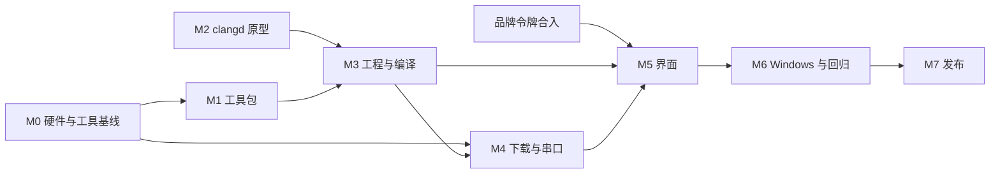

# Nodu 0.2.1 实施计划

日期：2026-10-22。状态：**待评审**。需求见 [PRD.md](PRD.md)，设计见 [FUNCTIONAL-DESIGN.md](FUNCTIONAL-DESIGN.md) 与 [UI-DESIGN.md](UI-DESIGN.md)，验收项见 [acceptance.csv](acceptance.csv)。

本计划只排顺序、关口和分工，不估工期：M0 的硬件结果和 M2 的原型结果会改变后续工作量。

## 1. 阶段

| 阶段 | 内容 | 前置 | 退出标准 |
| --- | --- | --- | --- |
| **M0 硬件与工具基线** | 完成 P0 剩余的 R1–R3：F407 ST-LINK 写入、读回、运行；F103 ST-LINK；两颗芯片串口 ISP。核对探索者 F407 的 LED、调试串口跳线、BOOT 跳线、HSE；确认用户的 F103 板型（D6）。排查 P0 中 F407 写入前 `reset device failed` | 用户提供硬件（§4） | macOS 上四条路径各有备份、写入、读回比对、运行证据；板卡包的事实全部有核对记录 |
| **M1 工具包** | 各平台组件的获取或构建（OpenOCD、stm32flash 自建）、工具链裁剪、工具包清单、`nodu-resources install-toolkit`、断点续传、离线包、镜像 | M0 确认工具组合；D3、D7 | 在干净的 macOS arm64、macOS x64、Windows x64 上安装并完成一次 CLI 编译与下载；体积实测写入 PRD |
| **M2 clangd 原型** | 插件宿主 + vscode-clangd 接入 Theia 1.76；测体积、启动时间、内存；隐藏扩展界面 | 无（可与 M0、M1 并行） | 按 [FUNCTIONAL-DESIGN §6.1](FUNCTIONAL-DESIGN.md#61-接入方式d4) 的四条做出 A / B 决定（D4） |
| **M3 工程与编译** | `nodu-embedded` 侧车骨架与协议；`openProject` / `configure` / `build`；模板（empty、uart-hello、blink）×两颗芯片；诊断解析与中文规则；容量；产物库；Node 服务；编辑器接入 clangd | M1 的工具包可用；M2 决定 | 不接板完成新建、补全、编译；P0 五个负样本移植为测试并通过；断网重复编译 |
| **M4 下载与串口** | OpenOCD 会话与步骤；ROM 应答检测与 stm32flash；备份与恢复；运行记录；串口监视器；锁与交接；模拟 ROM 与假 OpenOCD | M0、M3 | macOS 上四条路径经 Nodu 正常流程通过；拔线、取消、错板、读保护的负样本 |
| **M5 界面** | 工具栏数据源、开始页、向导、工具包对话框、任务条、问题列表、串口监视器、设备弹层、引导卡、诊断卡、第一次点亮；简洁 / 专业；可访问性 | 品牌令牌已合入主线；M3、M4 的服务接口 | 浏览器目标加模拟服务完成全部画面；Electron 实机走通 S1–S6；键盘完成 S1 |
| **M6 Windows 与回归** | Windows 上的 8 条实物路径、中文用户名、ST-LINK 驱动缺失、离线安装；K210 回归；打包 | M1–M5 | [PRD §8](PRD.md#8-发布标准) 的第 2–4 条 |
| **M7 发布** | 验收表补齐证据；交接文档；版本号统一为 0.2.1（`desktop/package.json`、三个子包、11 个 crate、关于对话框、根目录 `VERSION`、`PRODUCT.md`） | M6 | PRD §8 全部满足 |

M2 与 M0、M1 互不依赖，可以同时开始。M5 的静态画面（开始页、向导）可以在服务完成前用模拟数据先做。

## 2. 关口

| 关口 | 不通过时 |
| --- | --- |
| M0：四条路径中任一条无法在实物上稳定通过 | 不进入 M4；先修改下载设计（例如更换 OpenOCD 构建、调整复位方式），并更新 FUNCTIONAL-DESIGN §7 |
| M1：工具包压缩后超过 150 MB 或安装后超过 450 MB | 先压缩（clangd 单架构、去掉 GDB 到调试阶段再装）；仍超出时与用户确认新的体积目标 |
| M2：方案 A 不满足条件 | 改用方案 B，M3 中增加精简 LSP 客户端的工作 |
| M5：品牌令牌未合入 | C 组件先用现有主题变量开发，令牌合入后统一替换；不在组件内写死色值 |
| M6：Windows 上中文路径编译失败 | 默认工具目录改为 ASCII 路径（FUNCTIONAL-DESIGN §4.2 已预留），工程路径含中文时给出明确提示 |

## 3. 与品牌会话的分工

品牌重设计在另一个会话中并行进行。为避免两边改同一批文件：

| 文件或目录 | 品牌会话 | C 开发 |
| --- | --- | --- |
| `scope-theme.ts`、`style/*.css` 中的颜色与字体变量 | 负责 | 只读，组件引用变量 |
| `scope-brand.tsx`、`brand/`、应用图标、关于对话框 | 负责 | 不改 |
| `scope-workbench.tsx` | 工具栏外观与结构 | 只把按钮列表改为来自 `NoduToolbarModel`（一处渲染函数） |
| `scope-frontend-module.ts`、`nodu-backend-module.ts` | 如需新增绑定，只追加 | 只追加新绑定 |
| 新文件 `nodu-embedded-*`、`nodu-toolkit-*`、`nodu-start-page.tsx`、`nodu-new-project.tsx`、`nodu-serial-monitor.tsx`、`nodu-flash-panel.tsx`、`style/embedded.css` | 不改 | 负责 |
| `native/crates/nodu-embedded`、`nodu-serial` 中的锁抽取、`nodu-resources` 的工具包命令 | 不改 | 负责 |

合入顺序：品牌会话先合入令牌与主题，C 开发在其后变基。冲突面应只剩 `scope-workbench.tsx` 中按钮列表的渲染函数。

当前工作区还有其他会话未提交的改动（`scope-workbench.tsx`、`scope-frontend-module.ts`、`scope-languages.ts`、教学 T1 原型文件、`examples/stm32-sht30-tutor/`）。C 开发应从这些改动提交或放弃之后的 `main` 开始，并在独立分支或工作树中进行。

## 4. 需要用户提供

| 项目 | 用于 | 阶段 |
| --- | --- | --- |
| 探索者 F407：板子修订版（丝印或照片）、ST-LINK、USB 线；确认可以写入测试程序（原程序已在 P0 备份，SHA-256 `5d94950b…`） | M0 写入与板卡事实核对 | M0 |
| F103C8 板子型号（照片或购买链接）与它的下载器 | D6、F103 两条路径 | M0 |
| USB 转 TTL 串口（3.3 V）与杜邦线，或确认 F407 板载 USB 转串口可用于 ISP | 两条串口 ISP 路径 | M0 |
| Windows 主机（此前为 `192.168.0.182`，工作目录在 D 盘）与一个中文用户名账户 | M6 | M6 |
| 工具包镜像的存储与域名（D7） | M1 | M1 |
| D1–D7 的决定（[README](README.md#需要用户决定)） | 全部 | 评审时 |
| 同意提交 `spec/2026-10-20_validate-stm32-hal` 工作树中的 P0 文件 | 让设计依据进入主线 | 评审时 |

## 5. 开发约定

- 每个阶段在独立分支上进行，阶段结束时更新 [acceptance.csv](acceptance.csv) 的状态与证据；证据放在 `docs/0.2.1/evidence/`，原始备份与本机路径不入库。
- 状态值沿用 0.1.4：`not_started`、`passed_host`（只在主机或模拟环境通过）、`passed_board`（实物通过）、`partial`、`blocked`。`passed_host` 不能当作实物通过。
- 模拟结果只证明状态机与错误处理；硬件路径以实物记录为准。
- macOS 的工具包可执行文件需要至少 ad-hoc 签名才能在 Apple Silicon 上运行；自建组件在打包时签名，下载的归档在校验后移除隔离属性（FUNCTIONAL-DESIGN §4.3）。Developer ID 签名与公证仍是 0.1.4 遗留问题，0.2.1 不解决，交接中注明。
