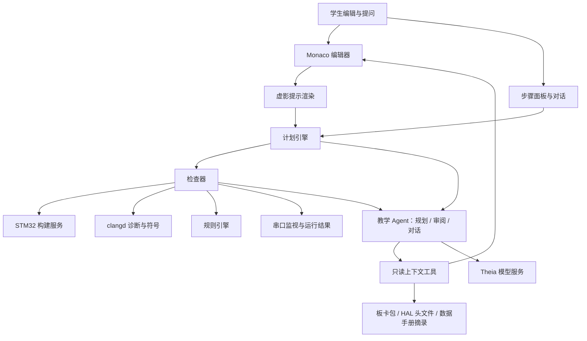

# Nodu 0.2：嵌入式 C 的 AI 教学辅助设计

> 2026-10-23：基于 0.2.1.1 代码现状的[详细实施方案与路线图](../ai-tutor/README.md)已在独立设计分支整理。本文保留历史设计；后续实施以新方案中的芯片适配、证据身份和权限边界为准。

日期：2026-10-21。应用基线：`main` / 0.1.4 / Theia 1.76。

状态：**设计草案；T1 交互原型已在主线实现（见 §13），T2 起未开始。** 后续阶段依赖两项尚未进入主线的工作：STM32 HAL 开发环境（分支 `spec/2026-10-20_validate-stm32-hal`，处于 P0 构建验证阶段，构建服务与 clangd 未集成）和 Theia AI 组件（`@theia/ai-*` 尚未引入）。本文是[教学 Agent 调研](TEACHING-AGENT-RESEARCH.md)在嵌入式 C 场景下的具体化，不构成已冻结需求。

## 1. 目标

产品最终目的是教学。AI 帮助学生学会自己写嵌入式 C，而不是替学生写。

以“STM32 温湿度监测”这类功能为例，助手要做到：

- 按自顶而下的方式，模拟有经验的开发者拆解功能：先定结构和观察手段，再逐层实现，边写边测。
- 在编辑器对应行下方显示虚影提示，说明这里该写什么。
- 学生写法与预期不同时，判断它能否达到目标；能达到就接受，达不到或有隐患时给出有依据的建议。
- 阶段完成后提醒并引导模块测试。
- 支持对话讨论方案，讨论结论回写到计划。
- 把嵌入式工程实践（分层、返回值检查、超时、可测试性、故障注入等）作为计划内容，而不是额外说教。

## 2. 设计原则

| 原则 | 含义 |
| --- | --- |
| 学生写每一行 | 提示不能一键采纳（没有 Tab 接受）；参考实现只在学生主动请求时显示，并记入学习记录 |
| AI 输出结构化计划，不输出自由代码 | 模型产出带完成条件的步骤；编辑器负责渲染，检查器负责判定 |
| 按完成条件判断，不比对答案 | 字面不同但满足条件即通过；比对参考答案会惩罚正确的不同写法 |
| 计划跟随学生 | 学生选了另一条可行方案时，修订后续步骤，而不是拉回参考路线 |
| 测试是步骤 | 模块测试在计划中有固定位置和完成条件，不是弹窗提醒 |
| 确定性检查优先 | 编译诊断和规则检查在本地完成，模型只处理规则覆盖不了的语义判断 |
| AI 不是必要依赖 | 编辑、构建、下载离线可用；助手关闭或模型不可用时 IDE 正常工作 |
| 只读工具 | 助手可读代码、诊断和本次运行结果，不能写文件、执行代码、构建下载或烧写 |

## 3. 核心概念：可验证的开发计划

### 3.1 数据结构

```ts
interface TutorPlan {
    id: string;
    version: number;               // 学生确认后冻结；修订产生新版本并显示差异
    goal: string;                  // 学生能读懂的功能目标
    board: string;                 // 板卡包 id；引脚、时钟、外设只从板卡包取
    sdk: string;                   // 锁定的 Cube / HAL 版本
    source: 'course' | 'generated';
    decisions: Decision[];         // 讨论后确定的方案选择，后续步骤据此生成
    steps: TutorStep[];
}

interface TutorStep {
    id: string;
    kind: 'decide' | 'implement' | 'test' | 'refactor';
    layer?: 'app' | 'driver' | 'bsp' | 'config';
    goal: string;                  // 这一步完成后系统多了什么能力
    why: string;                   // 为什么在这个时候做这一步
    dependsOn: string[];
    anchor: Anchor;
    hints: {
        intent: string;            // L0：意图，一句话
        api: string;               // L1：相关 HAL API 与数据手册章节
        skeleton: string;          // L2：带空位的骨架，关键参数留空
        reference: string;         // L3：参考实现，仅在主动请求时显示
    };
    contract: Check[];             // 完成条件，全部满足才算完成
}

interface Anchor {
    file: string;
    symbol?: string;               // 函数名，经 clangd 文档符号定位
    marker?: string;               // 起始工程中的 `// TODO(step-id)` 标记
}

type Check =
    | { type: 'compiles' }
    | { type: 'calls'; api: string; args?: ArgRule[] }
    | { type: 'checksReturn'; api: string }
    | { type: 'noCallIn'; api: string; context: 'isr' }
    | { type: 'hostTest'; target: string }
    | { type: 'serialMatch'; pattern: string; withinMs: number }
    | { type: 'review'; rubric: string };   // 规则无法表达的部分，交给模型
```

字段名为设计示意，实现时再定。关键是 `contract`：它定义“做到了什么”，而不是“写成什么样”。

### 3.2 步骤类型

| 类型 | 作用 | 完成方式 |
| --- | --- | --- |
| decide | 方案选择（传感器、轮询或中断、采样周期） | 对话中确定，写入 `decisions` |
| implement | 写一个函数或一段配置 | `contract` 全部通过 |
| test | 主机单元测试、板上冒烟、集成或故障注入 | 测试结果关联本次构建产物 |
| refactor | 在已有功能上补健壮性或调整结构 | 原有测试仍通过，且新条件满足 |

### 3.3 提示分级

默认只显示 L0 + L1。以下情况自动升一级：同一步连续编译失败若干次、停留超过设定时间且没有有效修改、学生点“再提示一点”（阈值待原型确定）。L3 参考实现必须由学生主动请求，显示后该步标记为“看过参考”。提示级别与升级记录进入学习记录，供教师和学生回看，不用于自动评分。

## 4. 示例：STM32F407 温湿度监测

板卡：正点原子探索者 F407（STM32 调研中的首个适配板）。传感器：SHT30（I2C）。此处为计划示意，未在实物上执行；引脚、I2C 实例和串口号由板卡包给出，本文不猜具体引脚。

| # | 类型 | 层 | 学生做什么 | 为什么在这时做 | 完成条件 |
| --- | --- | --- | --- | --- | --- |
| S0 | decide | — | 选传感器与接口、采样周期、报警方式 | 先定需求，再写代码 | 决定写入计划 |
| S1 | implement | app | 写 `app_init()` / `app_loop()` 和空的模块接口 | 自顶而下：先定结构和接口 | 编译通过 |
| S2 | implement | bsp | 串口日志输出 | 先建立观察手段，后面每一步都靠它验证 | 上电后串口出现版本行 |
| S3 | implement | config | I2C 初始化 | 外设先单独起来 | 编译通过；`HAL_I2C_Init` 返回值有检查 |
| S4 | test | — | 写 I2C 总线扫描 | 先确认接线和地址，再写驱动 | 串口出现 `0x44` 应答（ADDR 接低；接高为 `0x45`） |
| S5 | implement | driver | `sht30_crc8()` 纯函数 | 与硬件无关的逻辑先写，可以在电脑上测 | 编译通过 |
| S6 | test | — | 主机单元测试 | 用数据手册的测试向量验证 | `0xBE 0xEF` → `0x92` |
| S7 | implement | driver | `sht30_read_raw()`：发测量命令、等待、读 6 字节、校验 CRC、返回状态码 | 驱动层只负责“拿到可信的原始数据” | 检查 `HAL_I2C_Master_Transmit/Receive` 返回值；地址为 `0x44 << 1`；超时不是 `HAL_MAX_DELAY`；等待时间不短于数据手册的最长测量时间 |
| S8 | implement | driver | `sht30_convert()` 纯函数 | 换算与通信分离 | 主机测试：原始值 `0x6666` → 25.0 °C，`0x8000` → 约 50.0 %RH |
| S9 | test | — | 板上打印温湿度，手握传感器观察变化 | 第一次端到端验证 | 串口数值合理并随环境变化 |
| S10 | implement | app | 非阻塞周期采样（基于 `HAL_GetTick`）、阈值与迟滞报警 | 应用逻辑最后写，只依赖驱动接口 | 主循环没有长时间 `HAL_Delay`；阈值逻辑主机测试通过 |
| S11 | test | — | 跨越阈值的集成测试 | 验证报警不抖动 | 串口日志显示一次进入、一次退出 |
| S12 | refactor | driver | 传感器断开时返回错误、计数重试、总线恢复 | 健壮性是功能的一部分 | 拔掉传感器后系统不卡死，恢复连接后继续读数 |

这个顺序本身就是教学内容：先结构，后观察手段，再确认硬件，然后自底向上补驱动、自顶向下接应用，每层都有测试。

S0 如果选了 DHT11（单总线、微秒级时序），S3–S8 整体替换为 GPIO 时序与定时器步骤。S7 如果学生改用中断或 DMA 读取，按 6.2 的“另一可行方案”处理。

## 5. 编辑器内虚影提示

### 5.1 渲染方式

用 Monaco view zone 在锚点行下方插入只读区块，显示当前级别的提示，样式为降低对比度的等宽文字。锚点用带 stickiness 的 decoration 跟踪，学生在上方增删行时提示随之移动。

不使用 `InlineCompletionsProvider`：它的交互是 Tab 接受，会让提示变成代写。也不复用 `@theia/ai-code-completion`，它解决的是补全问题；补全是否在练习中开放，按[调研报告 §7](TEACHING-AGENT-RESEARCH.md#7-ai-代码补全的定位)单独讨论。

虚影内容不属于文档模型：不进入撤销栈、不参与复制、不写入磁盘、不影响 clangd 和构建。

### 5.2 显示规则

- 每个文件同时只显示当前步骤的一处提示，其他步骤在步骤面板列出。
- L2 骨架中的空位用占位符（如 `/* 地址? */`）表示，学生需要在正文中自己写出。
- 学生在锚点处开始输入后，提示折叠为一行意图，避免遮挡正在写的代码。
- 一个开关控制全部虚影提示（命令与快捷键），关闭后步骤面板仍可用。

### 5.3 锚点

优先用 clangd 文档符号定位函数；T1 原型阶段用起始工程中的 `// TODO(step-id)` 标记。锚点丢失（函数改名、标记被删）时，提示不显示在猜测的位置，而是在步骤面板请学生指出新位置。

### 5.4 跟写模式（候选）

L2 之后可选：骨架以虚影形式出现在正文位置，学生输入相符的字符时对应虚影消失，不相符时不报错，完成判定仍按 contract。它介于看提示和抄答案之间，是否有学习价值需要原型和课堂验证，默认关闭。

### 5.5 无障碍

view zone 默认不被屏幕阅读器朗读。步骤面板提供同样的提示文本，可以用键盘切换步骤与提示级别。虚影只是相对正文降低对比度，在深浅主题下仍需可读。完整的无障碍结论需要用辅助技术实测。

## 6. 偏离判断

### 6.1 三层检查

| 层 | 内容 | 实现 | 成本 |
| --- | --- | --- | --- |
| 编译 | 编译器与 clangd 诊断 | 构建服务、clangd | 本地，确定 |
| 规则 | contract 中的结构条件：调用了哪些 API、参数、返回值是否检查、ISR 内是否阻塞、分层是否越界 | 基于语法树的规则引擎（clangd AST 扩展请求或 tree-sitter-c，待原型选型） | 本地，确定 |
| 审阅 | 规则表达不了的语义：是否等价、方案取舍、隐患 | 教学 Agent 的审阅角色 | 模型调用 |

前两层能判定的不调用模型。审阅输入包括：步骤目标与 contract、学生当前缓冲区（含未保存内容及文档版本）、前两层结果、相关头文件与数据手册摘录。

### 6.2 判定结果

| 结果 | 例子 | 处理 |
| --- | --- | --- |
| 等价写法 | CRC 用查表代替逐位计算；函数拆分、命名不同 | 通过，可附一句说明两种写法的差异 |
| 另一可行方案 | 用中断或 DMA 代替轮询 | 通过；选择写入 `decisions`，修订后续步骤（例如加入回调与共享标志），学生确认新计划 |
| 能运行但有隐患 | 回调里调用 `HAL_Delay`；`HAL_MAX_DELAY` 超时；忽略 CRC | 当前目标通过，标出隐患与依据，在当步或后续 refactor 步骤给出修正方向 |
| 达不到目标 | 地址没有左移；读取字节数不足；发测量命令后不等待 | 不通过；指出未满足的条件，用问题引导（“数据手册的 7 位地址和 HAL 要求的地址格式一样吗？”），不直接给改法 |

看似等价的写法需要结合器件判断。例如用 `HAL_I2C_Mem_Read` 把 16 位测量命令当作寄存器地址：它在命令写完后立即重复起始读取，配合 SHT30 的时钟延展命令通常可行（HAL 超时须长于测量时间，重复起始与数据手册时序图的差异需实测确认）；配合 S7 所用的非时钟延展命令，传感器测量未完成时会对读头回 NACK。审阅必须拿到数据手册摘录和学生实际用的命令值才能下结论，这类判断不能只靠代码文本。

“另一可行方案”是关键：判定依据是目标和 contract，计划跟着调整。只有当方案与本课目标冲突（例如本课专门练习轮询）时，才说明原因并请学生回到本课要求；这种约束由课程在 contract 中显式声明，不由模型临时决定。

### 6.3 触发时机

保存、构建、点击“完成这一步”，或最后一次编辑后空闲数秒（阈值待定）。不在每次按键时调用模型。每个结果绑定文档版本；学生已经继续修改时丢弃旧结果，不在新代码上显示旧结论。

## 7. 测试与提醒

| 测试类型 | 对象 | 方式 | 依赖 |
| --- | --- | --- | --- |
| 主机单元测试 | 纯函数：CRC、换算、阈值逻辑、状态机 | 主机编译器构建，配合轻量 C 测试框架（候选 Unity，MIT） | 纯逻辑与 HAL 分离 |
| 板上冒烟 | 外设能否工作：串口输出、I2C 扫描、读数 | 串口输出匹配 `serialMatch` | STM32 构建、下载、串口监视器 |
| 集成 | 模块组合后的行为：周期采样、报警进出 | 串口日志加学生操作（手握传感器） | 同上 |
| 故障注入 | 拔掉传感器、错误地址、总线异常 | 学生按提示操作，观察是否卡死与能否恢复 | 同上 |

提醒时机：

- 到达计划中的 test 步骤。
- 完成一层（例如驱动层）但尚未测试。
- 连续完成若干 implement 步骤没有测试，或距上次测试通过后改动较大。

提醒显示在步骤面板和对应提示中，不用模态弹窗，不阻止学生继续写；依赖未测试模块的后续步骤标注“上游未验证”。

板上结果沿用 STM32 调研中的产物身份与 runId：测试结果关联本次源码、构建产物和日志，旧运行结果不能证明新修改。测试通过只说明功能达到条件，不等于学生掌握了相关知识。

## 8. 嵌入式工程实践

工程实践以“规则卡”组织：每张卡有规则、原理、检查方式和首次出现的步骤。计划引用卡片；学生问“为什么”时，在对话中展开。

| 规则 | 检查方式 | 示例中首次出现 |
| --- | --- | --- |
| 检查每个 HAL 调用的返回值 | 规则 `checksReturn` | S3 |
| 驱动中使用有限超时，不用 `HAL_MAX_DELAY` | 规则：参数检查 | S7 |
| 中断上下文不阻塞、不调用 `HAL_Delay` | 规则 `noCallIn isr` | 选用中断方案时 |
| ISR 与主循环共享的变量用 `volatile`，多字节访问考虑原子性 | 规则加审阅 | 选用中断方案时 |
| 协议与寄存器数据使用 `<stdint.h>` 定宽整数 | 规则 | S5 |
| 分层：应用层不直接调用总线 HAL | 规则：按文件 / 层检查调用 | S10 |
| 与硬件无关的逻辑写成纯函数并在主机测试 | 计划结构 | S5、S8 |
| 先建立观察手段，再逐个带起外设 | 计划顺序 | S2、S4 |
| 外部数据要校验（CRC、范围） | 规则加主机测试 | S7 |
| 时序、地址、命令以数据手册为依据 | 提示 L1 标注章节 | S4、S7 |
| 主循环非阻塞 | 规则：主循环中的长延时 | S10 |
| 魔数改为命名常量 | 审阅 | S7 |
| 出错可恢复，不卡死 | 故障注入测试 | S12 |

规则卡由课程维护者编写并版本化。模型可以引用卡片做解释，但不能自行新增规则。

## 9. 对话与方案讨论

对话基于 `@theia/ai-chat` 的自定义教学 Agent，与计划共享上下文：知道当前步骤、已做的决定、最近一次检查和测试结果。

- **先问后答。** 学生问“为什么读不到数据”时，先确认已知事实（S4 扫描结果如何、返回的是哪个 `HAL_StatusTypeDef`），再指向相关条件；学生自己能得出的结论不直接说出。
- **讨论产生决定。** 方案讨论结束时生成决定卡（选了什么、为什么、影响哪些步骤），学生确认后修订计划，显示新旧步骤差异。未确认的讨论不改计划。
- **回答带依据。** 引用文件位置、HAL 头文件、数据手册章节或规则卡；没有依据的部分明确标为推测。
- **信息不足时直说。** 没有板卡包、数据手册摘录或运行结果时，不编造引脚、时序和寄存器值。
- **允许偏题，但不替做。** 学生可以问与当前步骤无关的问题；要求“直接写出这个函数”时，按提示分级处理，L3 照常记录。

## 10. 架构



| 模块 | 职责 | 位置 |
| --- | --- | --- |
| 计划引擎 | 加载、校验、版本化计划；维护步骤状态机；接收 Agent 的修订提议并等待学生确认 | 前端 |
| 虚影提示渲染 | view zone、锚点跟踪、提示级别 | 前端 |
| 步骤面板 | 步骤列表、状态、提示文本、测试提醒、决定卡 | 前端，复用 Nodu 右侧面板机制 |
| 检查器 | 按 contract 汇总编译、规则、测试和审阅结果，结果绑定文档版本或 runId | 前端调度，规则引擎与测试执行在后端 |
| 教学 Agent | 规划、审阅、对话三种角色，输出经 schema 校验 | 前端，基于 `@theia/ai-core` / `ai-chat` |
| 只读上下文工具 | 见第 11 节 | 前后端，按路径白名单访问 |

计划保存在工程目录内的 `.nodu-tutor/plan.json`（`.nodu/` 已被仓库忽略为本机运行状态，因此另用目录），随工程移动和导出，符合 STM32 调研中“工程与课程可移植、不依赖隐藏数据库或云端服务”的要求。学习记录默认只存本机，由学生决定是否导出给教师。

步骤状态机：`locked → current → checking → passed | needs-work`；`passed` 的步骤在上游代码变化后转为 `stale`，需重新检查。

## 11. 上下文与只读工具

| 工具 | 返回 | 约束 |
| --- | --- | --- |
| 当前缓冲区 | 文件内容、文档版本、选区 | 优先读取编辑器中的未保存内容 |
| 文档符号 | 函数、全局变量及位置 | 来自 clangd |
| 诊断 | 编译错误和警告 | 绑定构建 id |
| 计划与步骤状态 | 当前计划版本、决定、步骤检查结果 | 只读；修改只能以提议形式返回 |
| 板卡包 | 引脚分配、时钟、可用外设 | 唯一的引脚来源 |
| HAL 头文件检索 | 函数签名、宏、类型 | 只检索工程锁定的 SDK 版本 |
| 数据手册摘录 | 器件命令、时序、公式及出处 | 来自课程或板卡包附带的资料 |
| 运行结果 | 指定 runId 的串口日志与状态 | 不返回其他构建的结果 |

不提供写文件、执行代码、构建、下载、烧写或通用 REPL 的工具。

**防止编造。** 提示中出现的 HAL 函数、宏和类型在显示前与锁定版本的头文件比对，不存在的标记为错误并不显示；引脚只从板卡包取；数据手册数值必须附摘录来源，没有来源时标“待核对”。这些是确定性检查，不依赖模型自我纠正。

## 12. 计划来源

| 来源 | 适用 | 可靠性 |
| --- | --- | --- |
| 课程计划 | 正式课程与课堂 | 教师编写并审阅，锁定 SDK 与模板版本；参考实现和测试在声明的板卡上实测 |
| 生成计划 | 学生自选项目 | 模型生成，必须通过 schema 校验和 API 存在性检查；界面标明“生成”；contract 只能使用已有检查类型 |

建议先做课程计划。课程计划的步骤、提示和 contract 都经过人工审阅，最能保证教学质量，也是评估生成计划的基准。生成计划放在课程模式稳定之后。

## 13. 实施阶段

| 阶段 | 内容 | 前置条件 | 退出标准 |
| --- | --- | --- | --- |
| T1 交互原型 | 手写 SHT30 计划 JSON；`TODO(step-id)` 标记锚点；view zone 虚影、提示分级、步骤面板；基础 C 语法着色 | 无，可在主线上独立进行 | 提示随编辑正确移动、锚点丢失时不误显示、可开关；实际使用后判断提示是否干扰书写 |
| T2 确定性检查 | 编译诊断、规则引擎、主机单元测试、串口匹配；结果绑定文档版本与 runId | STM32 P1（构建服务、clangd）与 P2（下载、串口） | 示例中所有非 `review` 条件都能本地判定；改代码后旧结果失效 |
| T3 教学 Agent | 引入 Theia AI；审阅角色、对话、决定卡与计划修订；API 存在性检查 | 模型提供方与数据范围已决定 | 6.2 四类判定在样例集上人工复核；无设备、无模型、取消请求时行为正确 |
| T4 扩展 | 生成计划、课程库、学习记录与教师视图 | T3 稳定 | 另行定义 |

T1 不需要模型、clangd 或 STM32 硬件，可以最早验证最核心的交互：虚影提示是否真的帮助学生自己写，而不是干扰。

### 13.1 T1 实现现状（2026-10-22）

| 内容 | 位置 |
| --- | --- |
| 计划模型、校验、标记定位、步骤状态与测试提醒（纯函数） | `desktop/scope-extension/src/common/nodu-tutor-plan.ts` |
| 计划加载、进度与学习记录 | `src/browser/nodu-tutor-model.ts` |
| 编辑器内虚影提示、命令与快捷键 | `src/browser/nodu-tutor-hints.ts` |
| 教学步骤面板 | `src/browser/nodu-tutor-widget.tsx`、`style/tutor.css` |
| 基础 C 语法着色（只有高亮） | `src/browser/scope-languages.ts` |
| SHT30 课程：17 步计划与起始工程 | `desktop/examples/stm32-sht30-tutor/` |
| 单元测试 | `desktop/scope-extension/test/tutor-plan.cjs` |

与上文设计的差异：

- **提示用 overlay widget 绘制。** Monaco 的文字层盖在 view zone 之上，zone 内的按钮收不到点击。现在 view zone 只占位并报告位置，提示内容放在跟随它的 overlay widget 里，做法同 Monaco 自己的 peek 窗口。提示仍不属于文本模型。
- **完成由学生自查确认。** T1 没有检查器，contract 只作为“完成条件 · 自查”显示，学生点“完成这一步”。
- **进度只存本机。** 完成状态、提示级别、看过参考与操作记录保存在浏览器 localStorage，按工程和计划 id 区分，不写入工程目录。
- **测试步骤不阻塞。** 未完成的 test 依赖只让后续步骤标“上游未验证”；实现类依赖才锁定步骤。
- **L3 需要确认。** 编辑器内最多升到 L2；参考实现只能在面板确认后显示，并标“看过参考”。
- **锚点只用 `TODO(step-id)` 标记。** 标记缺失或重复时不显示提示，面板提供“在光标处放置标记”，以普通编辑写入、可撤销。

已验证：计划解析与 19 项单元测试通过；按计划参考实现拼出的完整工程，主机单元测试通过，故意改错 CRC 初值会失败；全部源文件用 Arm GCC 14.2 与 CubeF4 v1.28.3 头文件 `-Wall -Wextra -Werror` 编译通过；浏览器中验证了首次自动打开面板、确认方案解锁步骤、提示出现在标记下一行、上方插入行后提示跟随、开始书写后折叠、删除标记后提示消失并可重新放置、开关提示、L3 确认与记录、完成步骤后的测试提醒。

未验证：Electron 目标、Windows、屏幕阅读器、浅色主题、长文件中在提示上滚动、真实学生使用效果。起始工程没有板卡包，不能构建和下载；引脚与 `board.c` 待 STM32 P1 板卡包提供。

## 14. 待决定与风险

| 问题 | 影响 |
| --- | --- |
| 模型提供方、云端或本地、发送哪些工程内容 | 决定 T3 的质量、成本、隐私边界和离线能力；沿用调研报告 §6 的结论，未决定前不发送工程内容 |
| 规则引擎选型：clangd AST 扩展请求或 tree-sitter-c | 影响规则表达力与是否需要编译数据库 |
| 提示升级阈值、空闲触发时长 | 需要课堂观察确定，过早升级等于给答案，过晚让学生卡住 |
| 跟写模式是否保留 | 可能更接近抄写，需要对比实验 |
| 学习记录给谁看、保存多久 | 涉及学生数据，先只存本机 |
| 模型判定错误 | 误判“达不到目标”会打击学生，误判“通过”会放过错误；判定附依据，学生可以申诉为“我认为这样可行”，申诉进入人工复核样例集 |
| 计划生成的不确定性 | 同一需求每次生成的计划不同；计划确认后冻结，修订须经学生确认 |
| 课程与板卡耦合 | 每课只在声明的板卡和器件上实测，与 STM32 调研 R7 一致 |

T1 原型应首先回答一个问题：行下虚影提示在实际书写中是帮助还是干扰。这个结论会影响后续所有交互设计。

## 15. 依据

- [教学 Agent 调研](TEACHING-AGENT-RESEARCH.md)：Theia 1.76 AI 组件、只读工具边界、补全定位。
- STM32 HAL 开发调研：分支 `spec/2026-10-20_validate-stm32-hal` 的 `docs/0.2/STM32-HAL-DEVELOPMENT.md`，构建、下载、产物身份、clangd 与课程范围。
- 当前编辑器语言注册：[scope-languages.ts](../../desktop/scope-extension/src/browser/scope-languages.ts)。
- SHT3x 数据手册（Sensirion）：I2C 地址、测量命令、CRC-8（多项式 0x31、初值 0xFF）、温湿度换算公式。示例中的数值按手册公式计算，未在实物上验证。
