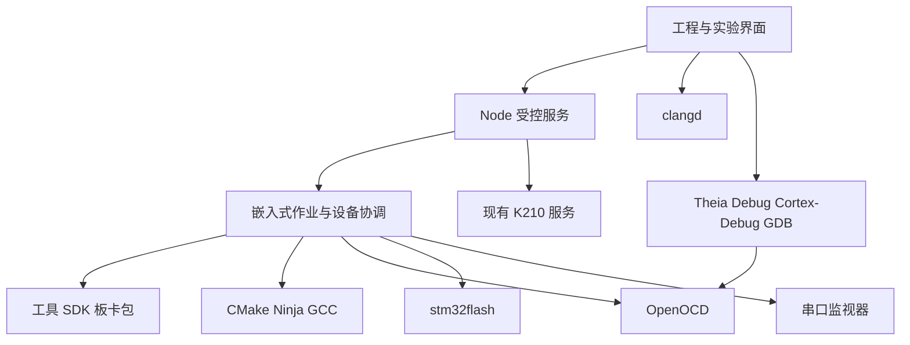

# Nodu 0.2：STM32 HAL 开发环境调研与实施建议

日期：2026-10-20。应用开发基线：0.1.4 / Theia 1.76。验证分支：`spec/2026-10-20_validate-stm32-hal`。

状态：**已有独立 P0 构建验证；尚未集成 Nodu，四条实物下载路径均未完成验收。** 本文为下一版本的开发依据，不代表 0.2 已发布或完整需求已冻结。

## 1. 产品目标与首版边界

将 Nodu 扩展为学生能够开始嵌入式 C 开发的环境：选板卡、创建实验、编辑官方 HAL 代码、编译、通过 ST-LINK 或串口下载、观察结果，并逐步进入调试和 FreeRTOS。

目标芯片为 STM32F103C8T6、STM32F407ZGT6；F407 优先适配用户的正点原子探索者。外设驱动使用官方 HAL，工程包含可查阅的 CMSIS、启动与系统文件。学生不需要安装 CubeMX/CubeIDE，也不需要先学习 CMake，但生成的工程可以离开 Nodu 在终端、VS Code 或 CI 构建。

第一版必须覆盖两颗芯片 × ST-LINK/UART 两种下载方式。完整断点调试、屏幕和课程库分阶段加入。现有 K210 工作流继续由既有服务承担，STM32 采用“工程 → 固件产物 → 下载”模型。

“只学习 HAL”指 MCU 外设驱动的统一入口；时钟、中断、协议和内存原理仍需学习。FreeRTOS、FatFs、LVGL 等后续中间件明确介绍各自 API。教学示例直接调用 `HAL_GPIO_*`、`HAL_UART_*`、`HAL_I2C_*`、`HAL_SPI_*`，避免再造通用教学外设 API。

## 2. 本轮证据及实际限制

完整验证工程位于 [tools/stm32-p0](../../tools/stm32-p0/README.md)。以下结果来自实际命令执行，未用模拟上传器代替实物结果。

| 检查项 | 结果与证据 |
|---|---|
| 独立分支 | 干净 managed worktree 从当时用户 HEAD 创建；主 checkout 未切换、原有改动未混入 |
| Arm GNU Toolchain | 14.2.Rel1，GCC 14.2.1；官方 archive SHA256 已比对 |
| CMake / Ninja | 4.4.3 / 1.13.2；两目标实际编译链接成功 |
| OpenOCD | 上游 0.12.0，Homebrew 包 0.12.0_1；CLI 与 F407 SWD 读取成功 |
| stm32flash | 0.7；可执行程序与固定源码行为已核查；没有真实 UART 下载结果 |
| F103C8 构建 | BIN 2624 B，初始 SP=0x20005000，64 KB Flash / 20 KB RAM；[产物元数据](../../tools/stm32-p0/evidence/f103c8-artifact.json) |
| F407ZG 构建 | BIN 3592 B，初始 SP=0x20020000，1 MB Flash / 128 KB 主 SRAM；CCM 未使用；[产物元数据](../../tools/stm32-p0/evidence/f407zg-artifact.json) |
| F407 实物识别 | ST-LINK V2J37S7；目标约 3.15 V；Cortex-M4；ID 0x101f6413；1024 KiB Flash；[读取日志](../../tools/stm32-p0/evidence/f407-swd-target.txt) |
| F407 原 Flash | 1,048,576 字节已完整备份；SHA256=`5d94950ba7e1708599cee9f111df6b49b0a4bf06b51fae8b39dac85dc49b62e9`；备份原文不入库 |
| F407 写入 | 准备写入时 OpenOCD 返回 `reset device failed`，后续 USB 枚举不再有探针；日志无擦写成功证据，未宣称写入或运行通过 |
| F103 实物 | 用户尝试接入第二下载器；系统 USB 枚举与 OpenOCD 尚未识别，未读取芯片或写入 |
| 两目标 UART | 未识别到 STM32 UART 端口，均未进行 ROM 握手、写入、读回或启动验收 |

固定源代码组合见 [toolchain.lock.json](../../tools/stm32-p0/toolchain.lock.json)：

| SDK | Cube commit | HAL commit | CMSIS Device commit |
|---|---|---|---|
| CubeF1 v1.8.7 | d12e75247d5bcedc734f829b394517ab4c2726e3 | fee494a92b5ad331f92ad21f76c66a5cb83773ee | c8e9a4a4f16b6d2cb2a2083cbe5161025280fb22 |
| CubeF4 v1.28.3 | 94cae6e83f00e276a11957e7833c01ac3d0bd7af | b6f0ed3829f3829eb358a2e7417d80bba1a42db7 | 3c77349ce04c8af401454cc51f85ea9a50e34fc1 |

CMSIS Core 分别来自对应 Cube commit 的 `Drivers/CMSIS/Include`，不混搭两系列 Core。SDK 通过 sparse checkout 和固定子模块取得，Cube ZIP 本身不包含子模块内容。

实际主机工具路径、二进制摘要见 [environment.json](../../tools/stm32-p0/evidence/environment.json)，Homebrew 包及依赖来源见 [homebrew-packages.json](../../tools/stm32-p0/evidence/homebrew-packages.json)。本轮只证明 macOS arm64 下这些工具和构建组合可执行，尚未验证 Windows、其他 Mac 架构或产品离线安装包。

已执行五项软件负样本，见 [selftest.json](../../tools/stm32-p0/evidence/selftest.json)：

1. 源码修改后，拒绝生成旧产物的下载计划。
2. BIN 相同而 ELF 调试信息变化时，保存为不同产物集。
3. ELF 被改动、BIN 未变时，仍拒绝下载计划。
4. 真实 GCC 编译失败后，旧的成功记录失效。
5. 同一目标被另一构建/计划占用时，拒绝并发操作。

测试会恢复原始源码并重建两目标。计划文件均为 `executed:false`，不能作为四条实物路径的完成证据。当前验证固件使用 HSI 和 RAM 心跳；尚未取得心跳实测结果，也未验证探索者 LED、屏幕或外接晶振。

## 3. 开源项目调研结论

| 项目与核对位置 | 学习或复用内容 | 采用建议 |
|---|---|---|
| [Arduino IDE 2](https://github.com/arduino/arduino-ide) | Theia/Electron 与独立编译上传 daemon 的边界 | 借鉴分层与简洁学生流程；架构参考不等于代码复制 |
| [PlatformIO Core](https://github.com/platformio/platformio-core)、[STM32 builder](https://github.com/platformio/platform-ststm32/blob/develop/builder/main.py) | 板卡、包、构建和上传适配器；支持 stm32cube HAL | 借鉴板卡与版本模型，后续评估工程导入；默认构建系统保持一套 |
| [stm32-cmake](https://github.com/ObKo/stm32-cmake) | HAL/CMSIS targets、工具链与链接配置 | 两颗目标先维护明确模板，必要时固定 commit 复用 helper |
| [OpenOCD v0.12.0](https://github.com/openocd-org/openocd/tree/v0.12.0) | F1/F4 Flash、校验、复位、GDB server | 默认 ST-LINK 后端；固定程序与 scripts 组合 |
| [stm32flash 0.7](https://downloads.sourceforge.net/project/stm32flash/stm32flash-0.7.tar.gz) | ROM USART 协议、设备表、分块读回 | 默认 UART 后端；跟踪 SourceForge 上游，GitHub stm32duino 镜像已归档 |
| [clangd](https://clangd.llvm.org/) | 根据真实编译数据库提供 C 语义服务 | 主线语言服务，不能用语法着色代替 |
| [Cortex-Debug](https://github.com/Marus/cortex-debug) | DAP、GDB/MI、外部 GDB server | 先验证 Theia 1.76 与固定依赖扩展；兼容不足时评估 adapter |
| [ST CubeF1](https://github.com/STMicroelectronics/STM32CubeF1)、[CubeF4](https://github.com/STMicroelectronics/STM32CubeF4) | 官方驱动、CMSIS、启动和系统文件 | 按完整包的兼容组合锁定，不独立追最新 HAL 和 CMSIS |

默认路线为 **CMake/Ninja + Arm GCC + 官方 HAL/CMSIS + OpenOCD/stm32flash**。优势是工程透明、易导出且适合现有 Rust 服务。代价是 Nodu 维护工具分发、板型与模板。PlatformIO 是成熟替代后端，不能把它的芯片支持直接等同于某一版本探索者的完整适配。

## 4. 继续调研与验证的顺序

| 顺序 | 具体问题与动作 | 交付证据 | 退出标准 |
|---|---|---|---|
| R1：USB 与目标连接 | 使用已知可识别的下载器和数据线，逐板排查；先读 VID/PID，再读电压、芯片 ID、容量与 UID | 下载器/板卡标识、连接日志、接线记录 | 两颗芯片都能稳定识别，插拔后可恢复 |
| R2：ST-LINK 下载 | 备份原 Flash，核对 immutable 产物，写入、独立读回、正常复位、观察 RAM 心跳 | 两板写入日志、BIN/readback 摘要、两次运行状态 | 两条 SWD 路径通过，重试不写错板 |
| R3：UART ROM | 按 AN2606 核对接口与板级接线；手动 BOOT/RESET，查询 ROM，核对目标，备份、写入、读回和恢复启动 | 两板 ROM 信息、实际擦除范围、读回和运行结果 | 两条 UART 路径通过；自动 BOOT 单独验证 |
| R4：编辑器 | Theia 插件宿主/语言服务原型；clangd 使用真实 compile_commands | HAL 补全、跳转、错误定位记录 | 保存、切换目标和配置后语义与构建一致 |
| R5：调试 | 固定 Cortex-Debug 与其依赖，external OpenOCD，核对 launch/attach/restart | 断点、单步、变量、退出后再下载的日志 | 核心 DAP 功能可用，退出无遗留占用 |
| R6：分发与课堂 | Windows x64 / macOS arm64 工具运行依赖、离线包、中文路径、安装中断恢复 | 各平台包清单、校验和真实构建/下载矩阵 | 两芯片×两方式在声明平台分别通过 |
| R7：课程与板卡 | 探索者修订版、F103 板型、4.3 寸屏/触摸控制器、课程依赖器件 | 官方资料与每课实测 | 课程只展示当前板卡实际具备的能力 |

当前 R1 尚未完成；R2/R3 的结果不能以命令能生成或工具可执行来替代。R4/R5 可与硬件排查独立推进，但完整 Theia 插件能力尚未在本轮实现。

## 5. 0.2 模块与开发阶段建议

| 阶段 | 实施内容 | 验收门槛 |
|---|---|---|
| P0 | 完成本文件 R1–R3，补足固定版本和硬件证据 | 两芯片×两下载方式均通过；当前只有构建及部分读取证据 |
| P1 | Project/Package/Build Service，板卡与实验向导，clangd，诊断和容量报告 | 不接设备也能构建；真实 HAL 补全；断网重复构建 |
| P2 | Device Broker、上传适配器、BOOT 向导、串口交接和失败恢复 | 四条路径进入 Nodu 正常流程；跨窗口互斥；K210 回归 |
| P3 | 调试 UI、DAP、外部 OpenOCD 与会话回收 | 两芯片断点/单步/变量可用；关闭后能再次下载 |
| P4 | 主流外设、屏幕、存储、FreeRTOS、离线课程与录课快照 | 每课在声明的板卡和器件上实测 |

工程管理、工具包、构建、上传和设备协调分别有明确责任。Node 沿用受控 RPC，Rust 协调成熟 CLI；编译和上传进程有唯一生命周期 owner。不要继续扩大现有 K210 Python 运行/固件状态机的条件分支。

工程建议保留 `nodu.json`、依赖锁、普通 CMake 配置、Core、Board、Drivers、Startup、Linker 和按需 Middlewares。manifest 选择目标和 preset，CMake 导出实际编译元数据；冲突时拒绝下载。模板只在新建时展开，迁移和升级显示差异，不覆盖学生修改。

## 6. 由本轮验证提炼的最佳实践

| 规则 | 本轮依据与下一版落地方式 |
|---|---|
| 区分证据阶段 | 编译、USB 枚举、芯片识别、Flash 校验、应用运行分别记录；成功安装工具不等于下载成功 |
| 先排查 USB 再排查 BOOT | 主机没有 ST-LINK VID/PID 时，板上 RESET 和 BOOT 不会让下载器枚举；先检查数据线、USB 口和集线器 |
| 明确两种复位流程 | SWD 正常 Flash 启动通常保持 BOOT0/BOOT1=0，由工具控制复位；UART ROM 则 BOOT0=1、BOOT1=0 后复位，结束恢复 BOOT0=0 后再复位 |
| 固定工具与配置组合 | OpenOCD 0.12.0 的 stlink.cfg 使用 HLA/hla_swd，与 master 不同；程序、scripts 和命令一起锁定 |
| 固定 HAL/CMSIS 组合 | SDK 的 Cube/HAL/Device commit 均核对；HAL 源码保持原样，配置保留其许可 |
| 让最小实验减少板级假设 | HSI＋HAL tick＋RAM 心跳先证明运行；LED/屏幕待核对引脚、极性与控制器，不猜 PC13/PF9/PF10 |
| 保留准确内存模型 | F103C8 默认64 KB/20 KB；F407主 SRAM128 KB与CCM64 KB分区，DMA不使用CCM；容量按官方型号约束 |
| 处理真实 HAL 模块依赖 | 本轮 RCC 源即使未调用 MCO，编译仍需要 GPIO 类型/头文件；裁剪 HAL 时验证编译依赖，不能只根据 main 中的调用删模块 |
| 工具链变量传入 try_compile | CMake 工具链自定义 ARM_TOOLCHAIN_ROOT 需要传播到子配置；本轮已补 CMAKE_TRY_COMPILE_PLATFORM_VARIABLES |
| 校验实际写入文件 | SWD 核对 ELF，UART 核对 BIN；元数据不能只校验 BIN 却写另一份 ELF |
| 使用整个产物集的身份 | 同一 BIN 可对应不同调试信息；ELF/BIN/HEX/MAP 摘要共同标识产物集，避免错误碰撞或符号错配 |
| 构建失败立即失效 | 不让失败构建继续引用旧成功文件；生成计划再次核对当前源码、SDK和产物 |
| 设备成功结果也要判旧 | 新一轮验证开始即失效旧的当前成功记录，成功结果附runId；失败后不能留下上一轮“正在运行”的结论 |
| 固定本次输入 | 构建前后比较输入摘要，检测中途编辑；产品阶段可采用工程快照；同构建目录串行 |
| 上传产物不可变 | 等待手动 BOOT 或设备租约时，不允许下一轮构建覆盖准备写入的文件 |
| 核对目标与保留数据 | MCU/板型/连接分别建模；家族 ID 不等于精确封装识别；擦除范围按页/扇区计算，普通上传不自动解除保护或改 option bytes |
| 正确限制 UART 范围 | stm32flash 0.7 的 -S 过短可截断而仍返回成功，必须预先比对BIN大小；-v是读回比较，-S不能与-e/-s混用 |
| 不承诺通用自动下载 | DTR/RTS 电路按具体板卡核验；即使没有显式序列，OS open/close也可能改变控制线；手动路线独立可用 |
| 让后台协调真实资源 | monitor 关闭 OS 句柄后交给UART下载；ST-LINK写入与调试互斥；已关联同板UART/SWD修改操作也互斥 |
| 明确调试进程 owner | broker 管 OpenOCD，adapter 管 GDB，以debugSessionId关联；实际退出后再释放租约；launch的加载也纳入上传检查 |
| 以 CLI 能力定义取消 | P0核对固定CLI是否支持可靠边界；不支持时延迟取消，不把解析进度后强杀称为安全取消 |
| 同步版本和安装依赖 | 工具包包含GDB、OpenOCD scripts/USB库、clangd、VSIX依赖；不能直接套用现有资源ZIP大小与权限策略 |
| 保护学生工程 | 工具升级不覆盖源码；首次外部工程配置遵循执行信任；clangd不在打开文件时隐式执行CMake |

每次设备验收关联 target、板卡、下载器、源码身份、固件摘要、工具版本和本次日志。原始固件备份、端口和机器路径属于本机状态；项目及课程可移植，不依赖隐藏数据库或云端服务。

## 7. 学习内容与课堂交付

课程至少覆盖 GPIO/按键、RCC、EXTI/NVIC、UART（轮询/中断/DMA）、定时器/PWM/捕获/编码器、I2C、SPI、ADC/DMA、RTC、看门狗、低功耗、内部 Flash、存储/FatFs、显示/触摸、CAN、USB、F407 网络与 FreeRTOS。

I2C 与 SPI 各自独立成组，包含协议、HAL驱动、器件读写、时序观察、超时及错误恢复。F103资源有限，按模块裁剪；大型GUI、网络、多媒体优先F407。F103C8没有的片上DAC、FSMC、以太网MAC不显示为直接可用实验。

FreeRTOS 单独引入任务与同步 API，处理 HAL tick/RTOS tick、ISR优先级、栈堆和DMA缓冲区。四点三寸屏先核实控制器和触摸接口，屏幕尺寸不代表兼容性。

每课包含起始工程、目标现象、接线、重点文件、HAL API、检查项和参考完成版，锁定 SDK/模板版本。录课按课保存快照或Git tag。课程通过记录与固件运行证据分开，避免把自动运行成功当成学生掌握知识。

现有 [教学 Agent 调研](TEACHING-AGENT-RESEARCH.md) 保留为独立研究。以后可将工程/板卡/SDK版本、编译诊断和本次运行证据提供给教学助手；基础构建下载应离线可用，AI不作为其必要依赖。

## 8. 下一轮开始时的检查项

- 先确认主机实际枚举到哪支ST-LINK及哪一个STM32串口，避免沿用旧端口记录。
- 先用 `verify_swd.py --target ...` 只读核对，再使用显式 `--execute` 完成真实备份、写入、读回与运行。
- 补齐四条路径后，更新本文件与 evidence 中的结果；任何未执行格子继续保留未验证。
- R1–R3证据完整后启动P1/P2集成，R4/R5单独记录Theia兼容验证。
- 首批声明Windows x64、macOS arm64时，在各自实物主机验证，不能用本轮Mac构建代替跨平台验收。
