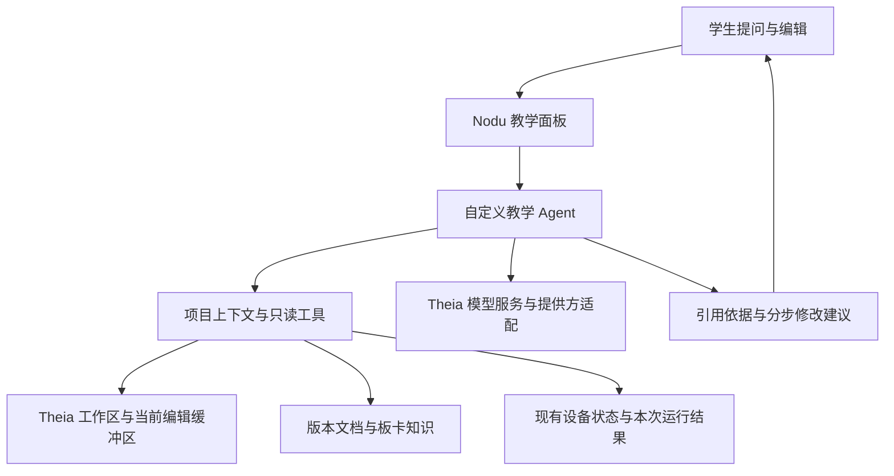

# Nodu 0.2 前期调研：基于 Theia 1.76 的教学辅助 Agent

调研日期：2026-10-19。基线：Nodu 0.1.1 / Eclipse Theia **1.76.0**。状态：**研究建议，未集成、未原型验证、未冻结需求**。

本次只提供调研报告。0.1 开发完成后，再讨论和深化后续需求；本报告不判定 0.1 已完成，也不推进 AI 实现、安装依赖、修改 UI 或调整当前版本号。

## 1. 结论与目标

建议以 **Theia 1.76 的 AI 基础组件 + Nodu 自定义教学 Agent** 为研究方向，复用现有编辑器、工作区、前后端服务和设备会话。

核心目标是：**Agent 先理解学生正在做的项目，再依据真实代码指导学生修改，由学生完成编辑和运行，Agent 根据新的代码与结果继续反馈。**

Theia 提供 Agent、模型、上下文变量、工具和聊天基础设施；项目画像、嵌入式知识组织、教学策略和学习反馈仍需 Nodu 开发。安装 AI 组件本身不能证明 Agent 已理解项目，也不直接带来完整课程系统。[Agent 接口][agent]、[上下文变量][variables]。

本方向符合此前“开源项目 Star 超过 1 万”的筛选条件：Theia 官方主仓在本次查阅时约 **21.7k Star**。这是 **Theia 主仓**的数量，AI 是仓内组件，不是单独拥有这些 Star 的项目；Star 仅作为初筛参考，不代表教学效果或集成验收。[官方仓库][theia-repo]。

## 2. 当前项目具备什么

| 本地基线事实 | 对后续研究的意义 |
| --- | --- |
| Theia 1.76.0、Electron 42.8.1、React 19、TypeScript 5.9、Node.js 24 | 可以沿用当前桌面和浏览器共享的原生扩展路线 |
| 已有 Monaco、工作区、文件搜索、React Widget、Node RPC | 可以取得编辑上下文、项目文件并承载助手界面 |
| 尚未引入 `@theia/ai-*` | AI 仍是待集成方向，本报告没有安装验证 |
| 尚未引入 `@theia/plugin-ext` / `plugin-ext-vscode` | 不能把现成 VS Code AI 插件描述为当前应用可直接安装使用 |
| Python / JSON 目前为基础语法支持 | 尚无完整 Python 语言服务器和可靠符号图；不能假定已有跨文件语义分析 |
| 设备由同一 RPC / Python worker 管理 | 后续读取设备上下文应复用现有服务，不另开串口 |
| 日志只有文本、流和时间 | 未来若依据运行结果反馈，需关联运行时的代码版本，避免使用旧日志判定本次修改 |

依据：[应用清单](../../desktop/browser-app/package.json)、[扩展清单](../../desktop/scope-extension/package.json)、[语言支持](../../desktop/scope-extension/src/browser/scope-languages.ts)、[设备协议](../../desktop/scope-extension/src/common/nodu-device-protocol.ts)、[0.1.1 交接](../0.1.1/HANDOFF.md)。

这些是当前源码事实；AI 功能没有实机、模型质量或双平台运行证据。现有 Windows 未实机验收、固件身份 `DE/E7` 等事项仍归 0.1 阶段处理，不由本次调研放行。

## 3. Theia 1.76 的可复用能力

本节按固定 `v1.76.0` 源码核查，不直接把滚动版文档中的新功能套用到当前项目。

| 组件 / 位置 | 已核实的框架能力 | Nodu 仍需处理的部分 |
| --- | --- | --- |
| [`@theia/ai-core`][ai-core] | Agent、模型需求、提示词、上下文变量和工具注册接口 | 定义教学 Agent、组织项目资料、选择允许调用的工具 |
| [`@theia/ai-chat`][ai-chat] | 聊天 Agent、请求 / 响应及工具调用的基础模型 | 教学对话策略、依据引用、提示层次和反馈逻辑 |
| [`@theia/ai-chat-ui`][ai-chat-ui] | 可复用的聊天界面与前端模块 | 按 Nodu 精简布局定制入口、内容和面板行为 |
| [`@theia/ai-code-completion`][completion-package] | 行内补全的前后端扩展 | 嵌入式上下文、启用方式及其对练习的影响 |
| [`@theia/ai-openai`][provider-example] | 同版本模型提供方适配的一个实例 | 实际提供方、模型和运行方式尚未决定 |
| [`@theia/ai-ide`][ai-ide] 中的工作区工具 | 已有列目录、查找文件、读内容与诊断工具实现 | 选择性参考 / 复用；不等于只装 `ai-chat` 就具备这些工具 |

所有拟采用的 Theia AI 包应与基座 **统一固定到 1.76.0**；这只是兼容研究建议，尚未生成或验证新依赖锁文件。[同版本包清单][ai-core]。

两点会直接影响方案：

- `Agent.variables` / `functions` 的声明不是自动上下文注入。源码明确要求由 Agent 或提示词实际传入相应内容；“注册了变量”不能当作“模型已经看过项目”。[Agent 接口][agent]。
- `ai-ide` 默认模块还会绑定通用 Agent、写文件、任务等能力。当前教学目标适合研究自定义教学 Agent 与受限只读上下文工具，不建议把整个通用模块默认启用。[工作区工具][workspace-tools]、[默认模块][ide-module]。

相关包声明使用 `EPL-2.0 OR GPL-2.0-only WITH Classpath-exception-2.0`。后续若修改或再分发，需保留相应许可与第三方说明；本次不提供整个产品许可已完成验收的结论。[包许可声明][ai-chat]。

## 4. “理解项目”应包含什么

这里的“理解”应表现为有依据的项目画像与按问题检索，而不是一次把整个仓库塞进对话后长期沿用。

| 上下文 | 建议包含的信息 | 用途 |
| --- | --- | --- |
| 项目结构 | 目录、入口脚本、配置、依赖、相关模块 | 知道代码从哪里运行、模块如何关联 |
| 当前编辑状态 | 活动文件、选区、未保存内容、文档版本 | 指导学生此刻看到的代码 |
| 板卡与运行环境 | 用户选择的板型、固件、可用 API、项目配置 | 区分 MaixPy 与普通 CPython 等环境 |
| 当前问题 | 学生描述、报错位置、最近一次相关修改 | 缩小阅读范围，避免泛泛回答 |
| 知识依据 | 对应版本文档、API stub、项目示例 | 降低推荐不存在接口的风险 |
| 运行证据 | 与代码快照关联的本次输出、错误和状态 | 分析本次修改，不能借历史成功日志确认当前结果 |

建议流程是：先读项目摘要与目录，定位入口和相关模块，再按问题读取必要文件；回答附文件位置和依据。看不到文件、缺少板型信息或未找到调用关系时，应说明信息不足。

**未保存文本必须进入研究验证范围。** 上游工作区读取逻辑会优先读取 Monaco 中已打开的文本，这为学生编辑后的继续指导提供参考；Nodu 接入时仍需确保实际使用了这条路径，并为内容附带文档版本。磁盘内容不能静默替代学生刚改的缓冲区。[工作区读取实现][workspace-tools]。

项目摘要、检索结果与对话记忆需要随修改更新。上游有文件读取追踪，但不同读取路径覆盖不完全，不能承诺所有上下文都会自动判旧。向量检索、持久记忆和完整符号图是否必要，留待真实多文件样例评估后再决定。

## 5. 面向学生的交互闭环

以下是研究示例，不是已确认的课程标准或最终界面：

1. 学生提出问题或学习目标，例如“为什么修改阈值后仍检测不到目标”。
2. Agent 查阅相关入口、阈值定义、调用位置及板型信息，先核实项目中的实际数据流。
3. Agent 指出应关注的文件 / 函数与原因，先给观察方向和小步骤；需要时给短代码片段或建议差异。
4. **学生自行修改代码**，保留现有编辑、撤销、保存和运行操作。
5. Agent 重新读取修改后的版本，对照原问题解释变化；学生运行后，再结合对应的本次结果继续指导。

例如阈值定义在一个文件、调用位于另一个文件时，Agent 应解释这两处关系，再请学生检查或修改实际生效的位置；不应只根据当前选区直接输出一个完整替代项目。

首阶段值得研究的是“定位依据 → 小步提示 → 学生修改 → 新版本反馈”。自动改写文件、自动执行程序、整项目代写、成绩判定、教师后台和课程发布均不列为本轮已确定范围。

Theia 的变更集可表达建议修改，但其应用路径可能直接修改并保存模型。因此，未来即使复用差异预览，也不能默认把“看建议”接成“应用并保存”；学生主导编辑是本次目标，具体采纳机制以后讨论。[变更集实现][change-set]。

## 6. 建议研究的接入结构

图中是职责划分，类名、服务协议和部署方式尚未确定。可研究把项目上下文、板卡知识和教学策略独立为 TypeScript 模块，未来便于与搭芯复用；MCP、多端服务和跨产品会话不在本次确定范围。

上下文工具建议先覆盖列目录、查找 / 读取相关源码、读取当前选区、检索版本资料、取得设备状态和指定运行结果。工具返回内容应有来源与版本；每次读取都要核对允许的工作区和实际路径，不能把对话确认等同于文件系统边界。

设备继续通过已有 `NoduDeviceService` 与唯一 worker 取得上下文。`execute()` 是可运行任意 Python 的执行入口，不能因为叫 REPL 就当作只读查询；本轮不提出向教学 Agent 开放通用执行、写文件或固件烧写工具。[现有 RPC 边界](../../desktop/scope-extension/src/node/nodu-backend-module.ts)、[设备协议](../../desktop/scope-extension/src/common/nodu-device-protocol.ts)。

模型请求的上下文范围、凭证保存、是否允许云端发送项目内容和本地模型方式，需要在 0.1 完工后的讨论中决定。仓库指令、注释和检索文档应作为资料处理，不自动获得系统工具权限。

## 7. AI 代码补全的定位

保留行内补全作为 **相关但独立的后续研究项**，不让它替代项目级教学，也不在本轮决定默认开启。

Theia 1.76 的补全 Agent 使用 Monaco 行内接口，主要依赖当前文件前后文；这并不自动形成多文件项目理解。固定版本偏好中自动补全默认关闭，手动快捷键为 `Ctrl+Alt+Space`，自动请求的防抖默认 300 ms，上下文行数默认 `-1`。这些是上游初始值，不是 Nodu 选定的教学配置；也不能沿用滚动文档的不同默认值。[补全实现][completion-agent]、[1.76 偏好][completion-preferences]、[快捷键注册][completion-trigger]。

后续可以分别研究教学对话模型与低延迟补全模型，共用接入配置但保持请求路径独立。补全是否只在学生主动请求时出现、是否受练习阶段限制、提示长度、MaixPy API 约束及对学习效果的影响，都留待后续讨论。此处不绑定模型品牌、参数规模或价格。

## 8. 与现有简洁界面的关系

沿用已确认的界面原则：默认以代码为中心、只有一个助手入口、相机开关保留最右侧、不要在左侧 / 顶部 / 底部重复放 AI 入口，也不增加常驻过程解释。

助手说明出现在学生主动打开的对话中；代码区继续承担编辑。助手与视觉面板如何切换、提示如何呈现、是否使用上游聊天 Widget，均为后续原型比较项。本报告不生成新效果图或修改当前布局。

## 9. 0.1 完成后再讨论的问题

| 待讨论问题 | 为什么现在保留开放 |
| --- | --- |
| 课程驱动、自由提问，还是两者结合 | 决定项目画像和对话需要哪些教学上下文 |
| 逐级提示、代码片段、差异预览的边界 | 需要兼顾学习过程与实际解题效率 |
| 项目规模及文件类型 | 决定索引、符号分析、检索与缓存的必要程度 |
| 模型提供方、云端 / 本地、数据范围 | 需要结合质量、设备条件和成本实测 |
| 自动补全如何启用 | 需要评估它是否替学生完成本应练习的部分 |
| 对话记忆、课程进度与评价 | 需要先定义学习目标，不能只用程序是否运行作为成绩 |
| Windows / macOS 与 UI 细节 | 必须在实际应用中验证集成与布局，源码可行性不等于可用 |
| 未来搭芯复用方式 | 需结合搭芯当时的产品边界和接口再确定 |

未来原型应重点验证：能否正确指出入口和相关文件、能否读取未保存修改、修改后能否停止依赖旧内容、能否引用真实 API、能否把建议拆成学生可执行的步骤，以及是否能区分本次与历史运行结果。

取消请求、模型不可用、无设备、知识缺失、工具越界、现有模式切换和未保存内容保留也需要覆盖。这些是研究验证方向，当前没有执行，不设虚构通过率、延迟指标、工期或费用。

## 10. 资料来源与调研边界

Theia 官方 `v1.76.0` 标签对象为 `12f62a6bdafe275e87507d6b4984dd5e99fc61a0`，通过 `git ls-remote` 解引用到提交 **`d8106d7ffa62b3413ff1ca5b63a0e6c2fe0b0649`**。本报告的固定源码链接使用该提交；读取标签与提交两个 URL 的内容逐字节比较，并将所读文件大小、SHA-256 和来源写入 [sources.json](sources.json)。这不是 npm 发布包与 Git 源码逐字节等价的证明，后续集成仍需核对实际依赖与行为。

本次完成的是官方资料与现有项目源码的只读核查，没有安装 AI 包、调用模型、验证教学效果或修改设备。滚动版[Theia AI 说明][theia-ai-doc]仅作为概念参考，固定 1.76 源码与本地清单优先。

选择 Theia AI 的依据是现有技术栈和可定制的项目上下文。此前讨论中的 Vercel AI SDK、Mastra、Tabby 等保留为备选研究，不作为本方案新增依赖；本轮也不围绕其他框架展开实施。具体功能清单与产品承诺，在 0.1 完工后另行讨论。

[theia-repo]: https://github.com/eclipse-theia/theia
[theia-ai-doc]: https://theia-ide.org/docs/theia_ai/
[ai-core]: https://github.com/eclipse-theia/theia/blob/d8106d7ffa62b3413ff1ca5b63a0e6c2fe0b0649/packages/ai-core/package.json
[ai-chat]: https://github.com/eclipse-theia/theia/blob/d8106d7ffa62b3413ff1ca5b63a0e6c2fe0b0649/packages/ai-chat/package.json
[ai-chat-ui]: https://github.com/eclipse-theia/theia/blob/d8106d7ffa62b3413ff1ca5b63a0e6c2fe0b0649/packages/ai-chat-ui/package.json
[completion-package]: https://github.com/eclipse-theia/theia/blob/d8106d7ffa62b3413ff1ca5b63a0e6c2fe0b0649/packages/ai-code-completion/package.json
[provider-example]: https://github.com/eclipse-theia/theia/blob/d8106d7ffa62b3413ff1ca5b63a0e6c2fe0b0649/packages/ai-openai/package.json
[ai-ide]: https://github.com/eclipse-theia/theia/blob/d8106d7ffa62b3413ff1ca5b63a0e6c2fe0b0649/packages/ai-ide/package.json
[agent]: https://github.com/eclipse-theia/theia/blob/d8106d7ffa62b3413ff1ca5b63a0e6c2fe0b0649/packages/ai-core/src/common/agent.ts
[variables]: https://github.com/eclipse-theia/theia/blob/d8106d7ffa62b3413ff1ca5b63a0e6c2fe0b0649/packages/ai-core/src/common/variable-service.ts
[workspace-tools]: https://github.com/eclipse-theia/theia/blob/d8106d7ffa62b3413ff1ca5b63a0e6c2fe0b0649/packages/ai-ide/src/browser/workspace-functions.ts
[ide-module]: https://github.com/eclipse-theia/theia/blob/d8106d7ffa62b3413ff1ca5b63a0e6c2fe0b0649/packages/ai-ide/src/browser/frontend-module.ts
[change-set]: https://github.com/eclipse-theia/theia/blob/d8106d7ffa62b3413ff1ca5b63a0e6c2fe0b0649/packages/ai-chat/src/browser/change-set-file-element.ts
[completion-agent]: https://github.com/eclipse-theia/theia/blob/d8106d7ffa62b3413ff1ca5b63a0e6c2fe0b0649/packages/ai-code-completion/src/browser/code-completion-agent.ts
[completion-preferences]: https://github.com/eclipse-theia/theia/blob/d8106d7ffa62b3413ff1ca5b63a0e6c2fe0b0649/packages/ai-code-completion/src/common/ai-code-completion-preference.ts
[completion-trigger]: https://github.com/eclipse-theia/theia/blob/d8106d7ffa62b3413ff1ca5b63a0e6c2fe0b0649/packages/ai-code-completion/src/browser/ai-code-frontend-application-contribution.ts#L90
