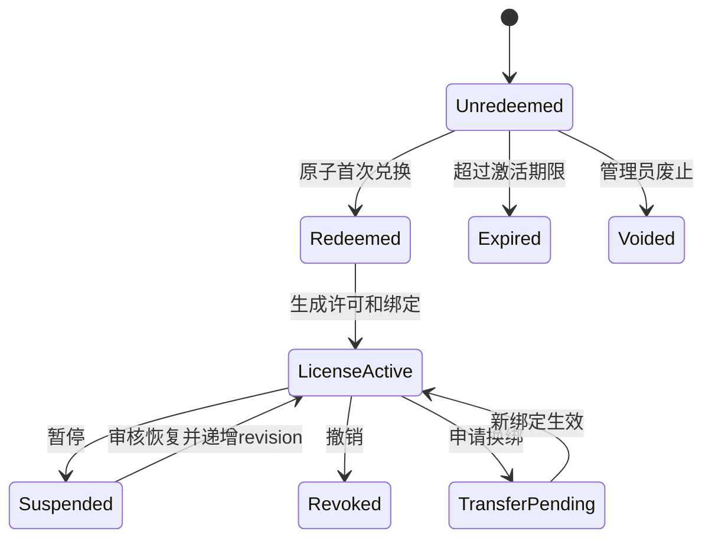

# 0.3 集成接口与开发边界

状态：拟议契约，不是当前已实现 API。与 [完整设计](DESIGN.md) 配套；Claude 负责教学、代码虚影、行检查，本版团队负责身份、许可、供应商和云网关。

## 1. 本地模块

```text
common/account/account-protocol.ts
common/ai/ai-access-protocol.ts
common/ai/provider-profile.ts
common/licensing/license-protocol.ts
browser/account/account-model.ts
browser/account/account-dialog.tsx
browser/ai/provider-settings.tsx
browser/licensing/activation-dialog.tsx
node/account/auth-session-service.ts
node/account/credential-vault.ts
node/licensing/device-license-service.ts
node/ai/ai-gateway.ts
node/ai/provider-registry.ts
node/ai/request-scheduler.ts
node/ai/providers/official.ts
node/ai/providers/openai-chat.ts
node/ai/providers/openai-responses.ts
node/ai/providers/anthropic.ts
native/crates/nodu-identity/
```

以上是建议落点，不要求把现有类原样改名。生产账号服务和设备服务不得依赖测试 mock；测试使用构造器注入，而不是环境变量“跳过授权”。

## 2. UI 读模型与权限

```ts
type ProviderProtocol =
  | 'openai-chat'
  | 'openai-responses'
  | 'anthropic-messages';

type AccessBlockReason =
  | 'login-required' | 'account-disabled' | 'quota-exhausted'
  | 'license-required' | 'license-expired' | 'license-revoked'
  | 'device-mismatch' | 'cloud-check-required'
  | 'provider-unconfigured' | 'protocol-unsupported';

interface AccessDecision {
  revision: number;
  route: 'official' | 'custom';
  allowed: boolean;
  reason?: AccessBlockReason;
  validUntil?: string;          // UTC，仅供展示/调度；后端再验证
  feature: 'ai.chat' | 'ai.teach' | 'ai.review';
}

interface ProviderProfileSummary {
  id: string;
  revision: number;
  name: string;
  route: 'official' | 'custom';
  protocol?: ProviderProtocol;
  origin?: string;
  modelIds: string[];
  hasCredential: boolean;       // 不返回密钥、不返回可逆密钥片段
  capabilities: {
    streaming: boolean;
    structuredOutput: boolean;
    toolEvents: boolean;
    usage: boolean;
  };
}

interface AIAccountState {
  revision: number;
  account?: { id: string; displayName: string; plan?: string };
  customLicense: {
    status: 'none' | 'active' | 'expired' | 'revoked' | 'device-mismatch';
    licenseId?: string;
    expiresAt?: string;
    leaseExpiresAt?: string;
    protection?: 'device-bound' | 'hardware-backed' | 'attested';
  };
  profiles: ProviderProfileSummary[];
  selectedProfileId?: string;
  access: AccessDecision[];
}
```

没有公开 `getApiKey/getRefreshToken/getDevicePrivateKey`。设置时用户输入的 key 可由受控写入 IPC 短暂传递，提交后清空输入框；不要声称用户输入密钥从未经过 renderer，也不能持久保存在 renderer/localStorage。

`hasCredential` 不代表权限、协议或连通性有效；`allowed` 也不是永久许可。Node 每次真实请求重新做 gate。

## 3. 本地 RPC 白名单

```ts
interface AIAccountService {
  getState(): Promise<AIAccountState>;
  beginLogin(): Promise<{ attemptId: string }>;
  cancelLogin(attemptId: string): Promise<void>;
  logout(): Promise<void>;
  activateCustomProvider(code: string): Promise<AIAccountState>;
  refreshEntitlement(): Promise<AIAccountState>;
  listProviderProfiles(): Promise<ProviderProfileSummary[]>;
  saveProviderProfile(input: ProviderProfileInput, secret?: string): Promise<ProviderProfileSummary>;
  deleteProviderProfile(profileId: string): Promise<void>;
  testProvider(profileId: string): Promise<ProviderTestResult>;
  selectProvider(profileId: string, expectedRevision: number): Promise<AIAccountState>;
  requestDeviceTransfer(): Promise<{ transferRequestId: string }>;
}
```

`ProviderProfileInput` 必须运行时严格校验名称长度、协议 enum、地址、模型 ID 数量、超时上限和非秘密字段；不要允许任意 header、文件路径或脚本字段。`beginLogin` 由后端生成并打开官方白名单 URL，renderer 不传任意 OAuth endpoint。`testProvider` 与 `chat` 一样先经过 entitlement gate。

Provider 选择默认按窗口保存；同一 profile 变更按 revision CAS，其他窗口收到事件。账户身份默认本机 profile 共享；多账号并行使用不在 0.3 首期范围。

## 4. 与教学模块的最小桥接

保留现有接口：

```ts
interface TutorModelProvider {
  complete(
    messages: TutorModelMessage[],
    signal: AbortSignal,
    delta: (text: string) => void
  ): Promise<string>;
}
```

新增 Gateway 在每次调用构造不可变执行快照，并以适配器实现这个接口：

```ts
interface ExecutionContext {
  requestId: string;
  workspaceHandle: string;
  intent: 'chat' | 'line-review' | 'step-review';
  teachingEpoch: number;
  profileId: string;
  configRevision: number;
  accessRevision: number;
}

interface AiGateway {
  providerFor(context: ExecutionContext): TutorModelProvider;
  cancelScope(scope: { workspaceHandle?: string; accessRevision?: number }): void;
}
```

`ExecutionContext` 由 Node 接受已授权的教学请求后构造；renderer 提交的 ID/epoch 只是关联线索，不能自报账号权限或替换 device binding。Gateway 内部采集 usage/finish reason/request ID，不要求教学 UI 解析不同上游的 usage。

统一流事件内部可为 `text_delta / usage / completed / failed`；工具调用事件只是解析结果，不能因协议支持就执行代码/硬件工具。教学结构化输出仍走 Claude 的 schema/范围/来源校验。

调用路径：

```text
TutorChatSession
  → 校验工作区与教学 epoch
  → Gateway 冻结 profile/config/access 快照
  → Entitlement 判定
  → Scheduler 获取本地任务槽
  → 官方：云鉴权/并发/预占/转发
    自定义：有效本机 lease + 直连指定 origin
  → 统一流与错误
  → 教学层再次核对 epoch/快照后应用
```

账号退出、许可撤销、配置切换属于 `accessRevision`；工程切换、教学/提问切换属于 `teachingEpoch`。二者独立。取消只影响 AI 任务，不复用烧录任务的 stop。

自动行审阅可合并重复快照、淘汰同一行旧修订，但不能因为排队把不同已完成行静默丢失；课程层负责行记录，网关负责受控发请求。云端 intent 主要用于调度/审计，不把客户端可伪造的 intent 当作低价特权。

默认每工程最多 20 个待发模型任务、一次一个行审阅；同文件合并为最新快照和待检查 line ID 集合，超过容量保留行状态并暂停自动提交。排队超过 30 秒的旧快照失效，行标为待复查；联网恢复后先校验最新快照，按正常配额批量检查，不回放所有历史请求。429 遵守 Retry-After，网络恢复采用有上限的退避，不对已可能执行的生成自动重试。

## 5. 云 API（统一新增前缀 /nodu/v1）

所有云调用 HTTPS；实际域名待配置。下表全部是拟议新增接口，除登录页依托上游会话外，不表示 New API 已原生实现。

| 接口 | 身份 | 职责 |
| --- | --- | --- |
| `GET /oauth/authorize` | Web 登录会话 | PKCE public client 授权；只接受注册 client、loopback redirect 策略和 scope |
| `POST /oauth/token` | code+verifier 或 refresh | 一次 code 消费/refresh 轮换，禁止隐式流/密码授权 |
| `POST /oauth/revoke` | 当前会话 | 注销/revoke family |
| `GET /me` | user access token | 账号、权益、余额摘要，不返回后台管理 token |
| `GET /models` | user access token | 允许模型、能力、价格版本、配额规则 |
| `GET /usage` | user access token | 本人请求/账单，分页和脱敏 |
| `POST /license/challenge` | 激活尝试或设备会话 | nonce/算法/用途/有效期，独立限速 |
| `POST /license/activate` | code+设备证明 | 原子兑换，返回 license/binding/lease/设备会话 |
| `POST /license/activation-result` | 新 nonce+设备签名+原 request ID | 恢复已经提交但丢失响应的结果，不重复消费码 |
| `POST /license/renew` | 设备会话+设备签名 | 校验 binding/revision/策略并签发新 lease |
| `GET /license/status` | 设备或关联用户会话 | 当前状态，不签发可绕过绑定的 bearer license |
| `POST /license/transfer` | 关联用户会话或恢复证明 | 创建换绑申请；不因持有码就自动换机 |
| `POST /license/release` | 设备证明 | 主动释放；保留旧 lease 最迟失效时间 |
| `POST /ai/requests` | scoped user access | 官方统一请求入口，内部走已选协议/relay adapter |
| `POST /ai/requests/{id}/cancel` | 同一用户会话 | 取消关联请求，不用 request ID 越权取消别人 |
| `GET /ai/requests/{id}` | 同一用户会话 | 读取状态、usage、账单关联，用于断网对账 |

控制 API 不接用户源码；只有官方模型请求 body 接选定上下文。服务端绝不接受用户传“官方上游 URL”或渠道密钥作为官方请求的一部分。

管理 API 用 `/nodu/admin/v1`：

- `POST /activation-batches`：生成批次与一次性导出；创建权限+MFA。
- `GET /activation-batches`、`GET /licenses`：脱敏检索与分页。
- `POST /licenses/{id}/revoke`、`/restore`、`/approve-transfer`：明确状态机、理由、审计、revision。
- `POST /price-versions`：发布未来生效价格，不修改历史。
- `PUT /users/{id}/policy`：调整功能/并发/预算，CAS。
- `GET /audits`、`GET /billing/reconciliation`：受控审计与待核算队列。

所有写请求有 request ID、幂等键、长度限制、权限验证；Web cookie 管理操作有 CSRF 防护。管理凭证不能用作桌面推理 token。

## 6. 激活请求与签名

示意，不含真实授权码：

```json
{
  "requestId": "uuid",
  "activationCode": "NODU-<随机授权码>",
  "challengeId": "uuid",
  "devicePublicKey": { "kty": "EC", "crv": "P-256", "x": "...", "y": "..." },
  "deviceSignals": { "version": 1, "platform": "darwin-arm64", "platformIdDigest": "..." },
  "proof": "<设备签名证明>"
}
```

设备 proof 必须绑定 challenge nonce、purpose、HTTP method、规范化 URL、request ID、设备公钥和规范化 body 摘要（明确排除 `proof` 自身），避免把续租签名用作换绑。使用成熟 JWS/签名库、固定算法白名单和已定义 canonicalization，禁止拼字符串后各端自行解释。与 OAuth token sender-constraining 相关的能力可依据 [RFC 9449 DPoP](https://www.rfc-editor.org/rfc/rfc9449) 实施；自定义 body binding 不能未经验证就标称完整 DPoP 合规。

nonce 只能消费一次，超时重试用新 nonce，但业务 request ID 不变。签名用的尝试摘要包含本次 nonce/challenge；业务幂等摘要则明确排除 `challengeId/nonce/proof` 等重试字段，只覆盖激活码摘要、设备公钥、设备信号版本/摘要和授权意图。两种摘要分别命名，不混用。同 request ID 不同参数返回 conflict；已完成请求仍需要验证属于同一公钥，不能只知道 UUID 就拿到 lease/设备会话。

`online_required` 策略每次模型任务出队后调用新的云校验，携带该模型 request ID，不以 15 分钟缓存替代。默认离线策略只有网络故障可使用剩余 lease；明确撤销、无效签名、设备不匹配不得回退到缓存。客户端保存最高已知撤销 revision，恢复必须有云端更高 revision 的有效签名结果。

服务端 lease 签名算法与设备密钥算法可以不同：例如服务器 Ed25519、设备 P-256。Secure Enclave 支持范围需按平台验证，不要求它生成不支持的算法。私钥没有导出 RPC；原生 sign API 仅接受经校验的官方授权域和规定用途。

## 7. 错误契约

```ts
interface AIServiceError {
  code:
    | 'AUTH_REQUIRED' | 'ACCOUNT_DISABLED' | 'AUTH_EXPIRED'
    | 'ACTIVATION_USED' | 'ACTIVATION_EXPIRED' | 'ACTIVATION_INVALID'
    | 'LICENSE_REQUIRED' | 'LICENSE_REVOKED' | 'LICENSE_EXPIRED'
    | 'DEVICE_MISMATCH' | 'ONLINE_CHECK_REQUIRED'
    | 'ACCOUNT_CONCURRENCY' | 'RATE_LIMITED' | 'QUOTA_EXHAUSTED'
    | 'PROVIDER_AUTH_FAILED' | 'MODEL_UNAVAILABLE' | 'PROTOCOL_UNSUPPORTED'
    | 'REQUEST_CONFLICT' | 'UPSTREAM_INTERRUPTED' | 'CANCELLED';
  requestId?: string;
  retryAfterMs?: number;
  scope?: 'account' | 'license' | 'provider' | 'network';
  action?: 'login' | 'activate' | 'manage-account' | 'edit-provider' | 'retry';
}
```

前端使用短中文映射；原始服务商错误详情仅经脱敏后进入可展开诊断。禁止把 activationCode、secret、refresh、用户完整上下文放进错误或 query 日志。

## 8. 状态机



该图是码与许可的联合业务视图；数据库分别建表。`Redeemed` 不返回 `Unredeemed`，恢复/换绑不复活旧码。`Revoked` 恢复若业务允许也需管理员明确审核并重新签发，不靠客户端重输旧码。

## 9. 兼容和迁移

接口增量上线：服务端先具备版本化 discovery，旧桌面官方 token 不存在则不能伪造兼容登录；已发布旧版自带 key 的直连行为无法通过云端撤销彻底阻断，应明确许可证规则从 0.3 官方发行版生效。

0.3 迁移读取现有安全存储条目，用户确认后创建自定义 profile，完成设备激活后启用；读取/写入不改变现有代码和课程进度。移交时对本契约进行一次短评审，再由两条开发线按模块范围实施，不同时修改同一 provider/model 文件。
