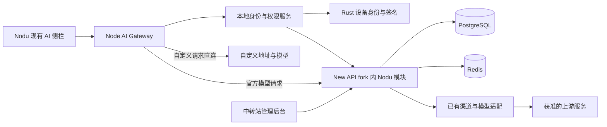

# Nodu 0.3 完整设计方案

日期：2026-10-23。本文为拟议设计；默认参数是可调整的产品建议，不是已实现能力或对硬件证明的承诺。AI 教学由 Claude 开发，本次仅定义账号/服务商/授权层及集成契约。

## 1. 版本目标与启用规则

0.3 将模型能力从“本机填一个固定 GLM Key”升级为可运营的服务：统一登录、官方模型目录、余额/额度、并发控制、用量账单，以及受一次性设备授权保护的自定义服务商。

### 1.1 两条独立路径

| 条件 | 官方 AI | 自定义服务商 | 普通 IDE 与本地检查 |
| --- | --- | --- | --- |
| 未登录、未激活 | 不可请求，提供登录 | 可查看配置入口，不能测试模型/发送请求 | 可用 |
| 登录但无额度/权限 | 显示具体原因，不能请求 | 不自动获得自定义授权 | 可用 |
| 登录且权限、额度可用 | 可用 | 仍需对应设备许可证 | 可用 |
| 未登录但本机许可证有效 | 不可用 | 可用，使用用户自己的服务商 | 可用 |
| 许可证到期/被撤销/设备不匹配 | 官方账号状态独立判断 | 停止新模型请求，保留配置 | 可用 |

原需求是“登录账号，或者使用自定义服务商”。因此建议 **自定义服务商不强制注册账号**：凭有效授权码激活，生成设备授权会话；绑定账号作为可选恢复手段。若后续业务决定所有许可证必须归账号，只修改兑换策略 `require_account`，不混淆两种身份。

所有产生模型调用的路径均经过门禁：对话、逐行审阅、整步 AI 审阅、模型生成的虚影/高光/批注、模型连接测试。静态课程阅读和 tree-sitter 等本地确定性检查不依赖账号。课程中已授权的静态提示如何售卖另行建模，0.3 不把它们伪装成云 AI 使用。

### 1.2 不纳入本版

不重写 Claude 的课程/虚影逻辑，不新增老师课堂管理，不把 DACIR 嵌入 Nodu，不做多租户代理商分销、渠道商结算或用户代码云同步。只读账单与购买入口在网页，不在 IDE 内堆运营页。

“自定义端口和协议”解释为用户配置模型服务的网络地址和 API 协议，不改变 STM32 串口协议，也不把端口号作为授权凭据。

## 2. 开源项目选型

项目资料会变化，实施 P0 必须锁定具体 commit、LICENSE、镜像 digest 并复核。以下不以 stars 排名，也不把项目自述当性能实测。

| 候选 | 本需求匹配度 | 可复用部分 | 主要缺口 | 建议 |
| --- | --- | --- | --- | --- |
| New API | 高 | 账号、管理后台、渠道、模型分发、额度、用量/定价相关能力 | 桌面授权流程、设备许可证、严格跨节点并发和计费幂等需要专项验证/二开 | 首选，有条件采用 |
| One API | 中高 | Go 单体、用户/令牌/渠道/额度基础，MIT | 较新的协议语义、运营细节、设备授权、桌面流程均需核对和补齐 | 必须闭源二开时的主要备选 |
| LiteLLM | 中 | 多模型协议适配、路由、预算/限速、虚拟 key | 用户消费账户/购买/设备授权不是现成整套产品；部分管理功能有企业版边界 | 更适合内部平台，不作为本项目首选账户底座 |
| VoAPI/VoAPI | 不适合作为本次底座 | 本次核到的公开仓库未提供完整业务源码 | LICENSE 限个人非商业使用，公开 `main.go` 仅为占位程序 | 排除；不将其他同名仓库混为一谈 |

依据：[New API 官方仓库](https://github.com/QuantumNous/new-api)、[One API 官方仓库](https://github.com/songquanpeng/one-api)、[LiteLLM 官方仓库](https://github.com/BerriAI/litellm)。具体已有/待做列表与许可核对见 [中转站调研](research-gateway.md)。

### 2.1 推荐实施形态

新建独立云端仓库（建议名 `nodu-cloud`，此处只是建议，不创建），fork New API，在同一项目中增加 `nodu` 扩展模块和后台页面。继续复用上游用户 ID、渠道、模型和现有管理账号；不另做第二套密码数据库。

采用模块化单体先交付，不先拆成多套微服务：New API + Nodu 扩展 + PostgreSQL + Redis。管理后台增加设备授权页面，授权码生成和云校验均位于该 fork 内，满足用户要求。以后可按接口拆分，不依赖桌面读取数据库。

将账户、授权、计费、模型网关视为不同模块，而不是不同产品：

- `identity`：现有用户登录与桌面授权会话。
- `license`：授权码、电脑绑定、续租、换绑、撤销。
- `entitlement`：汇总用户/许可证能使用的功能。
- `inference`：身份鉴别、许可、并发、预占额度、模型转发、结算。
- `billing`：不可变价格版本、账单事件、充值和退款对账。
- `admin`：沿用后台，新增角色权限与审计。

### 2.2 许可证是选型条件

当前核对 New API LICENSE 为 AGPL-3.0，One API 为 MIT。New API 修改版通过网络提供服务时需评估并履行对应源码提供等义务；One API 也需保留版权与许可通知。不能把隐藏产品首页署名等同于可以删除许可证。Nodu 通过网络 API 与服务通信不应在本文中被武断认定为一定需要或一定不需要整体开源，实施前按实际组合和分发方式确认范围。[New API LICENSE](https://raw.githubusercontent.com/QuantumNous/new-api/main/LICENSE)、[One API LICENSE](https://raw.githubusercontent.com/songquanpeng/one-api/main/LICENSE)

New API 的 NOTICE 另要求在显著的关于、法律、页脚或署名位置保留贡献者署名和原项目链接；可结合云端“关于/开源许可”页设计，不能直接删掉。One API README 也提出页脚署名与链接要求，须连同锁定版本 LICENSE 核查，不能仅看到 MIT 就承诺可任意去署名。[New API NOTICE](https://raw.githubusercontent.com/QuantumNous/new-api/main/NOTICE)、[One API README](https://github.com/songquanpeng/one-api/blob/main/README.md)

若接受合规提供云端二开对应源码，优先 New API；若要求云端扩展闭源，则选择经核对的商业授权路径或改用 One API，不能通过简单拆目录规避义务。业务签名密钥、生产配置和用户数据库不是要公开的源码内容。

## 3. 架构与数据边界



| 数据 | 本机 | Nodu 云端 | 自定义服务商 |
| --- | --- | --- | --- |
| 用户密码 | 不保存，不在 Electron 内输入 | 现有账号系统验证 | 不涉及 |
| 官方上游渠道 key | 不下发 | 加密存储，仅代理进程使用 | 不涉及 |
| 官方 access/refresh token | 安全存储；access 尽量内存 | 哈希/会话记录与撤销状态 | 不发送 |
| 自定义 API Key | OS 安全存储，设置表单只写入/删除 | 不上传 | 请求时按协议发送 |
| 用户选定代码 | 只按原 AI 上下文规则提交 | 官方路线处理；默认不记录正文 | 仅自定义路线接收 |
| 设备硬件摘要、公钥 | 采集和签名 | 授权所需最少字段 | 不发送 |
| 自定义 endpoint / 模型名 | 本机配置 | 默认不上传 | 实际调用所需 |
| 使用量 | 本地展示 | 官方路线服务端计量 | 自定义按供应商结算，Nodu 不代扣 token 费 |

不把用户的自定义请求再经过 Nodu 中转站来“验证许可”。否则既增加延迟和成本，又改变 BYOK 隐私边界。云校验使用独立授权 API。

## 4. UI 设计

借鉴 ZCode 的“官方账号连接 / 自定义协议接入 / 模型选择器”结构，沿用 Nodu 组件，**不复制 ZCode 的多套运营入口**。[ZCode 官方配置说明](https://zcode.z.ai/cn/docs/configuration)

### 4.1 保留入口

右上角仍是现有 `AI ▾`；AI 侧栏底部现有模型选择器增加“管理服务商”。账号可从此设置窗访问，主工作区不增加常驻头像栏、余额条、充值按钮或登录遮罩。

未启用时，只在 AI 侧栏正文替换为空态：

```text
         启用 AI

     [ 登录 Nodu ]
     [ 使用自定义服务商 ]
```

两个按钮并列选择，不自动打开浏览器，不自动开始扫描硬件。基础 IDE 完全可用。用户选择自定义后展示激活表单；已激活则直接进入配置。

### 4.2 “AI 设置”弹窗

默认宽 560 px，最大高度视口减 48 px；左侧窄分类约 116 px，右侧表单。小窗口改顶部 tabs，按钮区固定、内容滚动。Tab/Shift+Tab、Esc、焦点陷阱与关闭后恢复触发按钮焦点都需实测。

```text
AI 设置                                           ×
──────────────────────────────────────────────────
官方服务    │  账号       name@example.com
自定义      │  套餐       基础
设备授权    │  额度       读取服务端状态
            │  模型       [模型选择              ▾]
            │  [用量记录] [账户管理] [退出登录]
```

用量和账户管理打开外部官网已登录页面。金额只在设置/账单显示，主编辑区不显示逐行 token 计费小字。

自定义配置：

```text
名称          [我的模型服务                         ]
协议          [OpenAI Chat Completions            ▾]
API 地址      [https://example.com:8443/v1           ]
API Key       [••••••••                            ]
模型 ID       [自定义填写，或读取模型列表          ▾]
              [测试连接]                 [取消] [保存]
```

地址中的端口、路径就是用户的配置；默认不加独立“端口”字段造成双重来源。协议一行、地址一行，不用 `·` 拼接示例说明。地址规则、证书和代理设置放“高级”折叠项；不允许任意 JS 插件/模板注入。

测试连接明确属于一次模型请求，必须先有许可；优先低开销能力检查，确需生成时点击后发送固定短测试，不携带项目源码。列表接口不支持时允许手填模型 ID，不要求所有兼容服务都实现 `/models`。

### 4.3 设备激活与管理

```text
设备授权                                          ×
授权码        [                                    ]
设备          当前电脑
有效期        兑换成功后显示
                                   [取消] [激活]
```

首次激活前提供必要的“一机授权与设备摘要”确认/隐私链接，不在主界面重复展示。成功后简短显示“已激活”、到期日和“解除绑定/申请换绑”。设备码仅在支持详情内可复制，不显示原始硬件序列号。

错误使用具体行动：`授权码已使用`、`授权已撤销`、`需要联网验证`、`设备发生变化`、`服务商认证失败`。不把 provider 401 显示成 Nodu 账号失效；不把额度不足显示成网络问题。

管理员界面允许更多信息密度，但避免公开页出现后台技术字段。授权码和余额充值码采用不同菜单、不同权限、不同前缀。

## 5. 官方账号登录

### 5.1 复用与补做

New API 的网页登录/第三方登录能力不等于“已经提供 Nodu 的 OAuth 授权服务器”。0.3 必须新增桌面授权接口；浏览器登录复用现有用户系统，成功后由专门模块向桌面发放短期会话，不能复制 Web cookie 或下发管理员 token。

推荐系统浏览器 + Authorization Code + PKCE S256。原生桌面是 public client，不在安装包内放固定 client_secret。授权码一次性、有效期建议 60 秒；本机回调绑定 `127.0.0.1` 随机端口和固定路径，严格 state 校验，页面只显示成功，不把 token 放回调 URL。[RFC 8252](https://www.rfc-editor.org/rfc/rfc8252)

如端点真正采用 OAuth，使用成熟实现/经审查库并做协议测试，不把一个自定义短码交换接口叫成完整 OIDC。现有账号系统作为登录会话来源，PKCE 授权模块是新增工作。设备码登录可作为后续兼容，不是首期默认；它与商业授权码在数据和 UI 上完全分开。[RFC 8628](https://www.rfc-editor.org/rfc/rfc8628)

### 5.2 登录步骤

1. 本地生成 verifier/challenge/state，注册回调并记录 5 分钟登录尝试。
2. 系统浏览器打开官网授权页，复用账号密码/验证码/第三方登录。
3. 页面显示应用 Nodu 和请求权限，不请求管理权限。
4. 授权后回传 code；本地验证 state，以 verifier 交换 access/refresh。
5. 返回用户摘要、可用功能、套餐/额度、官方模型目录。所有凭证经安全存储，不进工程文件。
6. 退出登录撤销本会话和 refresh family，清理官方请求队列；不删除本机自定义许可或用户代码。

建议 access 10 分钟、refresh 30 天且轮换；重放旧 refresh 撤销会话族。多窗口用同一本地账号服务 single-flight 刷新，不能各自刷新导致相互踢出。账号封禁/注销在服务端立即阻断新官方请求。跨设备请求并发由云端判断。

官网初版采用邮箱验证、登录、找回和管理员 MFA，沿用已选版本上游支持的机制；未支持的二开或接现成 IdP，避免再写密码学。Keycloak/Authentik 首期不必加入多一套用户库；有企业 SSO 需求时通过明确 subject 映射接入，详见调研。

## 6. 自定义服务商的设备许可证

### 6.1 对象必须分清

| 对象 | 用途 | 使用次数 |
| --- | --- | --- |
| 授权码 activation code | 首次领取软件功能许可 | 全局成功兑换一次 |
| 许可证 license | 功能、期限、席位与状态 | 持续存在，可撤销/换绑 |
| 设备绑定 binding | 许可证当前允许的电脑/密钥 | 默认一台，不能靠再输码无限增加 |
| 许可租约 lease | 服务端签名、短期本机使用凭据 | 到期续签，不能自行延期 |
| 登录授权 code | 官方网页登录回传短码 | 一次、约 60 秒，与激活码无关 |
| 余额充值码 | 增加官方额度 | 沿用业务计费流程，不能解锁 BYOK |

默认一个授权码换一份单机 `ai.custom_provider` 许可证。可支持永久许可证，但永久只指 license 的 expire_at 为空，**不是发一张永不需要云校验的签名文件**。到期策略可在生成批次选择 30 天/365 天/永久，具体售价不在技术方案中拍定。

### 6.2 管理员生成

在 fork 内新增“设备授权”管理页：批次名、数量、功能、激活截止日期、兑换后有效期、席位数（0.3 固定 1）、是否要求账号、允许设备保护等级、备注/订单关联。

授权码使用 CSPRNG，至少 160 bit 随机性，Crockford Base32 分组显示，可带校验字符。存储 `HMAC(server_pepper, normalized_code)` 与末四位，不存明文。批量导出只在生成成功时提供；日志不写码。导出丢失则废止未领批次再生成，不提供“查看全部明文”。服务端 pepper 由密钥管理保护并支持版本化轮换。

管理员操作需权限、MFA/二次确认和审计；生成/撤销/换绑与改价格、资金调整分权。管理员不能看到用户 BYOK 密钥。

### 6.3 首次激活的事务

1. 用户明确点击激活后，本机读取最少硬件信号、生成设备签名密钥及随机 installation ID。
2. 调用 challenge API，获得一次性 nonce（建议 60 秒）和可接受的算法/策略。
3. 本地提交激活码、设备公钥、信号摘要、nonce 签名、幂等 request ID；校验率受 IP、设备、公钥和码前缀限制。
4. 云端验证 nonce、签名和格式；数据库事务锁住 code，检查有效/未兑换/用途/账户约束；插入 license、binding，并标 code 已兑换，写审计与 outbox。
5. 事务提交后签发 lease。签名服务失败不回滚到“码未使用”，客户端以原 request ID + 设备签名恢复结果。
6. 并发在两台电脑兑换同一码，只能一台成功；同设备同 request 重试得到同一 license，不多占席位。

不能简单“先查未使用，再写已使用”；必须依靠唯一约束、条件更新或行锁。请求超时后要查询/恢复结果，而不是让用户再购买一码。

### 6.4 绑定什么硬件

绑定 **运行 Nodu 的电脑**，不绑定开发板、ST-LINK、串口号、Wi-Fi MAC、IP 地址、用户名或工程目录。

- Windows：候选稳定信号为 SMBIOS System UUID；全零/占位/重复值要判无效，不能直接拿它当可信证明。优先使用 TPM/CNG 中不可导出的设备签名密钥。
- macOS：候选平台 UUID/设备信号须通过系统 API PoC，原始值只在本地处理；Apple Silicon 优先 Secure Enclave 支持的签名密钥，Intel 型号逐机验证。
- 内存、显卡、USB 外设、网卡变化不触发换绑。主板、平台 UUID、设备密钥丢失需要恢复/换绑处理。
- 系统身份经版本化规范化、产品域隔离散列后上传；云端再 HMAC 防数据库泄露关联。摘要仍是设备识别数据，不声称完全匿名，也不记录原始序列号。

参考：[微软 SMBIOS UUID 来源及无值情况](https://learn.microsoft.com/en-us/windows/win32/cimwin32prov/win32-computersystemproduct)、[TPM 概览](https://learn.microsoft.com/en-us/windows/security/hardware-security/tpm/trusted-platform-module-overview)、[Apple Secure Enclave](https://developer.apple.com/documentation/security/protecting-keys-with-the-secure-enclave)。

**能力分级而非虚假承诺：**

- `device-bound`：硬件信号摘要 + OS 安全存储设备密钥 + challenge 签名；防普通配置文件复制。
- `hardware-backed`：设备密钥不可导出且本地硬件支持；没有可验证 attestation 时云端仍不能仅凭客户端报告证明密钥在硬件里。
- `attested`：云端验证硬件证明链、随机挑战与应用策略后才能声称，0.3 PoC 未通过前不作为已具备能力。

推荐 0.3 默认 device-bound，合格设备优先 hardware-backed；管理员若选择强硬件策略，不合格机器必须拒绝并说明，**不静默降级**。纯随机机器码不满足绑定物理硬件的意图。绝对防破解需要改变产品信任模型，不能由一个 Rust 模块或隐藏算法保证。

### 6.5 租约、云校验与离线

建议默认：lease 最长 24 小时；启动联网刷新，使用中每 6 小时刷新，进行模型请求前若上次云校验超过 15 分钟则优先短超时校验。离线时可在现有 lease 的剩余有效期内使用本机/自定义模型，最多 24 小时，**无额外滚动宽限**。首次激活和租约到期后必须联网。

管理员可设置 `online_required`：每次模型任务实际出队、开始请求前，都必须通过一次新的云端续租/状态校验；不复用 15 分钟缓存，也无离线放行。校验与本次 request ID 关联，仅用于紧接着启动的这一次请求，不预取多张通行凭据。默认离线策略意味着撤销最长 24 小时后才生效，要在管理页明确。

只有网络不可达等可恢复故障，才可按默认策略使用既有 lease 余期。云端明确返回 revoked/invalid、签名错误、设备不匹配、时钟异常时立即阻断；已知撤销 revision 持久保存，断网或恢复旧缓存不能重新放行，必须得到更高 revision 的有效恢复结果。

lease 包含 issuer、audience、license_id、binding_id、设备公钥 thumbprint、fingerprintVersion、device_signal_digest、features、issued_at、not_before、expires_at、license_revision、policy_version、jti、kid。`device_signal_digest` 是本机可重算的产品域隔离摘要，不是服务端存储用的 HMAC。服务端以固定算法签名；客户端内置可信根/公钥，验证 kid/算法/受众、期限、本机 key 与硬件摘要一致，不接受任意 URL 提供的验证公钥。

每次续租需 nonce 签名证明持有设备私钥；刷新会话凭证轮换和撤销。离线验租约同时验证本机设备身份，时钟回拨/恢复快照可疑时要求联网校验。可信时间使用最近服务端时间与单调时钟辅助，不声称普通软件在完全受控 OS 中能防所有时间篡改。

客户端收到撤销/功能变化后递增 access epoch，取消排队和在途 AI 请求、清除可应用的迟到结果。未收到的变化按校验周期或 lease 到期生效，不宣称默认策略能即时远程吊销。上游可能已经计费，不能承诺取消必然免费。许可证变化不触碰编译/烧录/串口任务。

### 6.6 重装、换绑和恢复

- 同电脑应用升级，设备密钥和签名身份稳定，直接续租。
- 重装后密钥仍在且硬件一致，走 challenge 恢复；密钥丢失不能仅凭相同 UUID 自动认领。
- 有账号关联：网页登录后申请恢复/换绑，结合设备记录、冷却期和审核；旧绑定 revision 失效。
- 免账号许可：生成单独恢复凭据/恢复包，首次只展示一次并要求用户保存，云端只存摘要；也可用订单凭证经管理员人工恢复。不能再次使用已消费激活码。
- 用户主动解除绑定可释放席位，但不恢复原码为未使用；向下一台发放短期一次性转移票据，或通过账号/管理员完成转移。
- 默认管理员审核换绑，防一份码被无限轮换分享；可配置冷却期，但不能不给主板损坏的正常用户恢复路径。
- 离线旧 lease 无法瞬间收回。默认可接受最长 24 小时新旧设备重叠；严格单机策略需旧设备在线交还或等旧 lease 到期后再启用新绑定。

## 7. 自定义服务商协议与配置

首期支持三个明确适配器：OpenAI Chat Completions、OpenAI Responses、Anthropic Messages。三者共享上层流事件，但保留各自认证、消息结构、usage、停止、工具/结构化输出能力；不能仅换 URL 就声称兼容。

| 协议 | 配置约定 | 必测差异 |
| --- | --- | --- |
| OpenAI Chat Completions | API base + `/chat/completions`，常见 base 含 `/v1` | content/tool call 增量、finish_reason、流尾 usage |
| OpenAI Responses | API base + `/responses` | 事件类型、文本 delta、完成/失败事件、usage 维度 |
| Anthropic Messages | 服务 base，适配器拼 `/v1/messages` | x-api-key、版本头、content blocks、stop_reason、cache tokens |

地址字段保存规范化 base；如果用户粘贴完整 operation URL，识别已知后缀并展示规范化结果，不能重复拼 `/v1/v1`。GLM 的 Coding 专用地址与通用按量地址分别保存成不同 profile，不做自动互换。未来再加 Gemini 原生/本地专用协议。

配置包含 `id/name/protocol/baseUrl/modelIds/credentialRef/capabilities/timeout/networkPolicy`。模型 ID 原样保留大小写，名称可另设显示别名。只有非秘密字段可导出；导入后重新选择密钥，不读取工程中的任意环境变量作为 credential。

自定义地址安全：

- 默认 HTTPS，TLS 正常校验；不提供“忽略证书错误”开关。
- 用户主动配置 localhost 可用 HTTP，适配 Ollama/LM Studio 的兼容端点；局域网 HTTP 必须显式确认风险并保存为本机策略，远程公网 HTTP 不允许。
- 只支持 http/https，拒绝 URL userinfo、fragment、带凭证 query、云 metadata 等保留目标；认证 header 在 Node 构造。
- 禁止跨源重定向转发 key；代理/私有 CA 放高级配置，不能让模型内容修改 endpoint。
- 凭证按 profile+origin 绑定，切换 origin 后需重新确认/输入；不把官方云 refresh token 发给自定义地址。
- 能力探测由用户测试动作触发；不支持结构化输出时，只降为普通问答，不假装可安全执行教学展示。

用户自定义地址是明确选择的可联网目的地；本地业务校验避免不必要的 SSRF 面，但不把 Node 能访问内网当作完整隔离沙箱。

## 8. 官方 AI 请求与并发

官方请求统一从 Nodu 云端接入层进入，再交已有 New API 路由。客户端不拿永久 New API 用户 key，更不拿渠道 key。短期会话须在服务端每次检查用户、token scope、access epoch、模型权限和预算。

执行顺序：鉴权 → 模型/功能权限 → 请求幂等 → 并发占位 → 额度预占 → 上游请求 → usage/结果归档 → 一次结算 → 释放并发。失败必须释放未消费的预占；顺序采用一致性设计，不把两个分布式系统假装成单个数据库事务。

建议基础默认账号跨全部设备最多 2 个受控请求槽，本地调度 1 个交互对话 + 1 个逐行/检查请求；数字由套餐政策下发，不写死 UI。云端 slot 统计整个流的存活时间，而不是请求 headers 返回就释放。

Redis Lua 原子 semaphore，使用 request ID、owner 和租约，定时续期；断开/崩溃/重启后有过期与对账回收。Redis 异常时官方新请求 fail closed，不退化为“无限并发”。数据库保存请求状态，避免 TTL 到期后仍存活的旧上游流与新请求无限重叠；worker 失去租约须中断并退出。失联请求还需数据库 tombstone/隔离占位，在确认上游已停止或达到可依赖的上游硬截止前不重新出售该槽。若供应商不保证取消或硬截止，只能承诺网关接纳槽上限，不能证明上游实际生成绝不短暂超用；严格并发套餐应仅使用具备相应控制的渠道。

同时限制 RPM、TPM、最大上下文、单请求输出、日预算、全站/渠道并发。逐行审阅按不同 priority 排队，交互对话优先，但不能静默丢弃待审阅行。每工程最多 20 个待发模型任务，按同文件最新快照合并行 ID；30 秒以上旧快照标待复查，积压过多暂停自动提交并保留行记录。恢复联网后不重放历史生成请求，先取得最新快照再受控批量检查。达到限额返回稳定错误码、Retry-After 和可恢复状态，UI 显示“排队中/额度不足”等短文案，不持续弹 toast。

客户端取消用端到端 AbortSignal；已发出的请求不自动切另一路由或重试第二次生成。只有确认上游未接收的失败才允许受控重试，且所有 attempt 关联同一逻辑请求。流已输出内容后不无提示切供应商。

BYOK 仅受本地资源队列和许可策略约束，其 provider 额度与并发以供应商为准。云端不知道直连请求事实，**不能承诺对被篡改 BYOK 客户端实施精确 token 限额或强并发限制**。

## 9. 定价、充值和账单

### 9.1 三种商业对象

- 官方 AI：套餐/余额/模型用量计费。
- 自定义许可证：一次性或期限授权价格，不消耗 Nodu 模型额度。
- 自定义上游消费：用户与供应商直接结算，不在 Nodu 云账单伪造精确金额。

首期默认预付费官方额度，技术模型预留订阅周期，不立即做信用额度/复杂后付费。许可证初版由管理员生成/订单关联，自动购买交付可在支付链路稳定后上线。

### 9.2 价格版本

每个 model alias 的价格按版本保存：币种、每百万输入/输出/cache read/cache write token 单价，必要的固定请求费、上下文档位和生效时间。模型实际消耗/套餐积分规则不统一，渠道适配器返回规范 usage 与原始 usage 引用，不能把 thinking token 与 output 重复计费。

账单使用整数最小计费单位或精确 decimal，禁止二进制 float 记账；明确每请求最后一步舍入，价格单位与展示币种分开。公式是非重叠 token 桶加权，不把“含缓存总输入”再与缓存输入双收：

`费用 = (非缓存输入 × 输入单价 + 缓存读取 × 读取单价 + 缓存写入 × 写入单价 + 输出 × 输出单价) / 1_000_000 + 固定费`（单价均按每百万 token）。

price_version 在请求接受时冻结；用户发起前能查目录价，管理员改价只影响后续请求。上游成本和用户售价分离，管理员可比较毛利，不能直接拿模型名推断当前真实上游成本。

### 9.3 一个资金事实源

复用 New API 的 quota/钱包作为唯一余额事实源，经适配服务提交预占、扣款和退款，不另外建立第二套会互相覆盖的余额。新增 `billing_event` 保存 request/attempt/price version/usage/ledger reference，以唯一 request settlement ID 防双扣。

P0 必须核查所选 commit 的既有预扣、失败退款、流尾 usage、分布式缓存与浮点倍率实现；不满足要求时在同一结算服务中改造。**不能外层扣一次，内层 New API relay 再扣一次**；每请求只能选一个结算 owner，所有渠道经相同入口。

最大输出/上下文确定可预估上界时预占；无法可靠界定成本的模型先不上线。缺少 usage 时状态为“待核算”，有界保留预占并用上游记录对账；不能直接记 0，也不能把估算标成精确账单。约定核算期限与封顶/人工调整规则，并将调整写成冲正事件。

### 9.4 支付与管理

优先复用已选上游实际支持且合规开通的支付适配；不得只因后台出现按钮就宣称支付可用。网页收银台，服务端校验签名、订单号、金额、币种和商户；webhook 幂等、延迟到达可重放，浏览器跳回不直接加钱。退款、争议、重复回调、许可证订单撤销各有状态机，不删历史账单。

管理员可设账户预算、模型名单、并发、有效期、临时冻结；人工余额调整需理由与审计，禁止直接编辑数据库余额。

## 10. 云端数据模型

表名前缀 `nodu_`；已有上游表通过服务适配复用，不从桌面暴露字段。

| 表/对象 | 关键字段与约束 |
| --- | --- |
| 上游 user | 唯一账号来源；记录 user_id 映射，不复制密码 |
| desktop_session | user_id, token_hash, refresh_family, scopes, expires_at, revoked_at |
| authorization_attempt | client_id, PKCE challenge, redirect_uri, state binding, code_hash, expires_at, consumed_at |
| activation_batch | 功能、期限、策略、创建管理员、导出审计 |
| activation_code | code_hmac, pepper_version, batch_id, deadline, redeemed_at；code_hmac 唯一 |
| license | owner_user_id 可空、features、starts_at/expires_at、seat_limit、status、revision |
| device_binding | license_id、public_key、key_thumbprint、fingerprint_hmac/version、assurance、status、last_seen |
| activation_request | idempotency_key、code_hash、device key hash、license_id、结果；同 key 不接受不同参数 |
| device_session | binding_id、refresh hash family、撤销状态；不可冒用为 user session |
| lease_record | license/binding revision、jti、issued/expire、kid、policy_version |
| nonce_record | challenge hash、purpose、expiry、used；短期 Redis，消费原子 |
| transfer_request | old/new binding、ticket_hash、审批状态、冷却/生效时间 |
| entitlement_policy | 功能/模型/并发/预算/离线策略，版本化 |
| model_price_version | alias、价格维度、单位、币种、生效时间、版本不可修改 |
| inference_request | user/session/request IDs、intent、model alias、attempts、status、并发占位、价格版本 |
| billing_event | usage、整数金额、上游 ledger reference、settlement ID 唯一、冲正关系 |
| admin_audit/outbox | actor/action/target/reason、非秘密变更摘要、异步通知与重放状态 |

PostgreSQL 事务保证兑换、席位与账务幂等；Redis 用于速率、并发、nonce 和撤销缓存，不作为唯一许可证/余额存储。签名私钥、pepper、渠道密钥不作为普通明文字段存表。

## 11. 前端、Node 与 Rust 分工

### 前端

新增账户与服务商配置组件、激活窗、只读权限投影。使用现有 AI 入口，功能状态从后端获取。配置写入不返回 secret，前端不拼认证 header、不检查 license 签名来代替后端。

前端只能提升 UI 可解释性，不能作为授权边界。`configured: true` 需替换为 `AccessDecision`，具备 key 不等于许可有效。

### Node

`IdentityService`、`LicenseService`、`EntitlementService`、`ProviderRegistry`、`AiGateway`、`CredentialVault` 独立模块。`TutorModelProvider.complete` 继续作为 Claude 教学模块的依赖注入接口，新增 wrapper 在任何网络请求前检查选中的连接和许可；不改课程 store 的 schema 来存账号。

每次请求绑定 `connectionId/configRevision/accessEpoch/teachingEpoch`。账号切换、许可撤销、provider 切换取消旧请求并丢弃迟到结果；不允许同一后台共享可变全局 model 导致窗口间串线。默认每个窗口选择连接，后端共享不可变 profile 与凭据。

### Rust

新增独立 `nodu-identity` crate/本地受限服务，用于硬件标识、设备密钥签名、lease 验证及可靠本机状态，不复用会触发 MCU 操作的 embedded service。API 只允许 `getDeviceSummary/createDeviceKey/signChallenge/verifyLease` 等受限动作，不开放任意命令或任意消息签名 oracle。

系统 API 通过平台 adapter 封装：Windows CNG/TPM、DPAPI/凭据库，macOS Security/IOKit/Keychain/Secure Enclave。若需要 unsafe FFI，应集中在小平台 crate 并专项审查，不能默默放松现有 workspace 的 `unsafe_code=forbid`。优先成熟安全 wrapper，未覆盖接口通过受审计的独立边界接入。

候选依赖需 P0 固定兼容版本及许可证：Go 沿用上游路由/ORM/Redis，OAuth 模块采用成熟库而非手写认证；Node 用 schema validator 与 JWT/JWS 验证库，网络可用已有 fetch；Rust `serde`、`sha2`、`zeroize`、平台 `windows`/Security wrapper 与现有 `ts-rs`。这是依赖方向清单，不是假装已验证的 Cargo 锁定版本。

安全存储统一抽象，避免把现有 keytar 随处复制。Electron safeStorage 是主进程功能，平台保护语义不同；Linux `basic_text` 不可作为安全密钥库，Electron 版本升级亦需核对 API，不能直接套用最新文档成员。[Electron safeStorage](https://www.electronjs.org/docs/latest/api/safe-storage)

Browser 开发模式只能通过本机 Node/Rust host 使用同一设备授权；远程 Web/Theia 的“物理电脑”指哪端不能静默推断。0.3 正式支持桌面，远程浏览器 BYOK 激活默认禁用，未来另设授权类型。

## 12. 部署、运行与上游同步

首期：反向代理/TLS + 两个可选无状态应用副本 + PostgreSQL + Redis + 密钥管理/备份。低流量可单副本起步，但所有并发和账务测试按两副本设计。具体云规格由压测决定，不给未经验证的 QPS 承诺。

- 公共域分离 `account`/`api`/`admin`，域名待实际注册；控制 API 与模型转发分别限流。
- 管理端 MFA、最小 RBAC、危险操作审计；生成码/调整额度/改价格不同权限。
- 默认不记录 prompt、代码、completion 和密钥；只记 request ID、状态、模型、usage、延迟、成本和许可证事件。排障正文需用户主动提供、有时限与脱敏。
- 设备摘要/审计保留期、注销删除和财务记录保留规则在上线前确定，不声称摘要不是个人关联数据。
- 数据库每日备份、恢复演练；Redis 丢失不丢许可证/账本，续期/计费任务通过 outbox 可重放。
- 签名密钥 kid 轮换保留旧公钥直到旧 lease 过期；支持紧急吊销，不把签名私钥放代码仓库。
- SLO 初始目标：鉴权/许可判定 P95 < 200 ms（不含上游），关键结算和兑换零重复；目标需压测，不作为本次测得数据。

fork 使用 `upstream` remote，固定稳定 commit/digest。扩展集中在 `internal/nodu`、`web/.../nodu` 和有编号迁移，必要 relay hook 保持小 patch。每次上游升级跑协议、账务、登录、license、并发契约测试再灰度；不自动部署 `latest`。依赖/SBOM/安全公告按周期复核。

## 13. 与 Claude 的开发边界

本轮只读核对时，现有代码仍有 `TutorModelProvider.complete`、`TutorChatSession`、`TutorProviderState`、硬编码 GLM adapter 与共享 provider binding；这些文件在被 Claude 修改，因此文件和行号仅作识别，不作为冻结实现。

先交付 [API 契约](API-CONTRACT.md) 给开发者确认。教学模块只依赖 `AiGateway` 提供的统一请求/流/取消以及 `AccessDecision`；账号与设备授权开发不改虚影算法。采用临时 fake entitlement 做单测必须仅在测试构造器注入，生产构建不能留下“总是允许”开关。

当前已有 GLM key 不上传云端，也不自动变成官方渠道。升级 0.3 时提示用户将其转为本机自定义 profile，并要求设备激活后使用；若另行授权可发迁移许可证，不能静默赠永久许可或直接删除旧 key。

## 14. 设计待确认项

已采用的建议值：New API fork、官方浏览器 PKCE 登录、自定义免账号激活/可选关联、默认一机、24 小时 lease、6 小时定期刷新、15 分钟请求前在线检查新鲜度、官方默认 2 并发。

以下是上线前产品决策，不阻塞接口与 PoC：云端是否接受 AGPL 对应源码提供方式；自定义许可证永久/年费/试用价格；是否强制硬件不可导出并验证 attestation；是否允许默认离线窗口或全部 online_required；支付渠道；账号关联/换绑审核策略。没有确认的项不能被写成用户已经批准的商业条款。

详细实施顺序与验收门槛见 [路线与测试](ROADMAP-AND-TESTS.md)。
