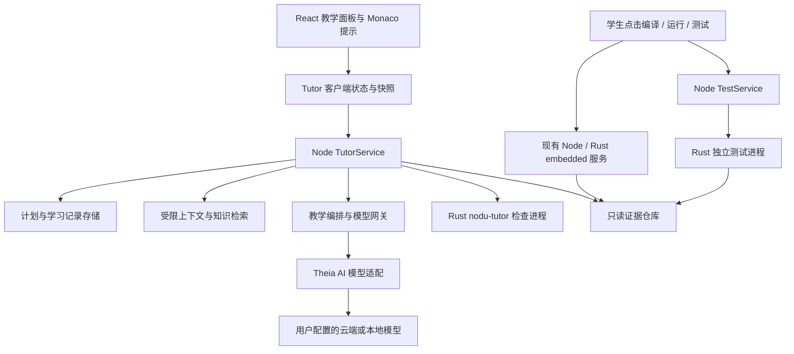

# Nodu AI 辅助教学详细实施方案

日期：2026-10-23；基线：`1209ffd`；分支：`codex/ai-tutor-design`。这是待共同定稿、可拆解实施的设计，所有新增模块和 API 均为拟议接口，不代表已经实现。

## 1. 产品选择

以现有“教学步骤”原型为基础，完成“确认目标 → 分解步骤 → 代码虚影跟写 → 完成一行 → AI 检查一行 → 整步测试 → 下一步”。

2026-10-23 用户修订：默认提示必须是实际代码虚影，不是步骤意图；完成每行自动触发 AI 检查。详细触发、队列、语义边界和接口见[逐行跟写规范](LINE-GUIDANCE.md)。最新双模式、代码高光、浮动批注、步骤浮窗和快速开关以[教学交互设计](INTERACTION-DESIGN.md)为准。AI 帮学生理解和完成工程，不自动替换源码，不代替学生操作设备。

推荐采用 **Nodu 自定义教学 UI + Theia AI 核心 + Node 模型网关 + Rust 本地检查器**。首期不增加独立聊天应用，不接入通用自动编程 Agent，采用必须亲手输入的教学代码虚影，不提供 Tab 一键接受。编辑、编译、下载、串口功能继续离线工作。

### 1.1 继承与修订旧规划

| 原规划 | 本轮细化决定 |
| --- | --- |
| 自顶而下拆解、学生自己写、分级提示 | 学生亲手写保留；默认改为实际代码虚影，完成一行自动 AI 检查。意图/API/原理按需展开，当前行虚影不设参考确认门槛。 |
| 只读 Agent，确定性检查优先 | 保留。用户点击测试与模型调用工具是两条授权路径；AI 没有测试执行或设备操作工具。 |
| 板卡包决定引脚 | 改为芯片能力 + 版本锁定 SDK + 显式接线配置；不再绑定正点原子等开发板名。引脚和电源、时钟、传感器实例必须有来源，未知时先询问。 |
| T1 学生自查即完成 | 保留为“自查完成”，不能迁移成“已验证”。正式检查结果区分通过、失败、未知、过期。 |
| 模型判断等价就通过 | 模型只给审阅建议；不能覆盖编译失败、测试失败或缺失证据。硬性条件未满足时不判通过。 |
| 看过参考进入记录 | 保留本机记录；不作为扣分项，不禁止学生复制自己源码，不把 UI 防复制当防作弊。 |
| 本地 progress 仅 localStorage | 迁移到后端持久化；浏览器/Electron 共享工程身份和计划版本。前端只保存面板宽度、显示偏好。 |
| 全部依赖用同一 locked 状态 | 拆分“是否可开始”和“证据是否有效”。上游测试未通过时允许练习，但不能宣布相关整课目标已验证。 |
| T2 → T3 → T4 | 保留顺序；拆成可交付的 M0–M7，见路线图。 |

### 1.2 范围与芯片

| 对象 | 首期范围 | 不能直接承诺 |
| --- | --- | --- |
| STM32F103C8T6 | HAL C、代码提示、编译规则、纯函数测试、已绑定串口证据，第一条完整课程 | 本轮尚无 AI 教学实测；不能把现有烧录实测作为教学效果证明 |
| STM32F407 | 相同教学框架，独立芯片/时钟/引脚配置，课程移植验收 | F407 ST-LINK 已验证不等于传感器课程或 ISP 已验证 |
| ESP32 系列 | 模型和课程协议保留 target/SDK 适配能力 | 首期不宣称 ESP-IDF 规则和硬件证据可用 |
| K210 / MaixPy | 仍可使用原开发功能；预留 Python checker 和 API 资料适配 | 不用 C 的 tree-sitter 规则检查 Python；首期不承诺跨语言教学验收 |
| DACIR 搭芯 | 模板仍只在新建项目模板选项中；日后可提供外部仿真证据导入 | 不嵌入搭芯界面，不增加顶级入口，不要求开发 AI 时先完成跨应用烧写 |

## 2. 当前基础与真实缺口

| 能力 | 本地事实 | 需要做的工作 |
| --- | --- | --- |
| 教学计划 | `common/nodu-tutor-plan.ts`，schema 1；contract 只有 type/text，仍有 board 字段 | schema 2、可执行条件、课程锁和迁移 |
| 教学 UI | `nodu-tutor-widget.tsx`、`nodu-tutor-hints.ts` 已有步骤、overlay + view zone、TODO 锚点 | 去重复标题和解释，增加检查/对话/修订状态；保留原组件风格 |
| 完成记录 | `nodu-tutor-model.ts` 存在 localStorage，以路径 + plan id 区分 | 加 plan hash/version、后端记录、过期传播、跨窗口冲突处理 |
| 编译 | Rust `build.rs` 已有 buildId、inputDigest、bundleSha256、过期检测 | 把记录转为只读证据；明确未保存缓冲区和磁盘构建的区别 |
| 下载 | 有 runId、目标身份、选中的探针、回读摘要和运行结果 | 增加启动代次与课程采集窗口；设备状态不能自行当作课程测试通过 |
| 串口 | `monitor.data` 当前只有 port/data；前端运行分隔行是显示文字 | 需要 captureId、顺序号、连接代次、运行关联和原始数据落盘，不能解析分隔行作为证据 |
| clangd | 两个应用已有 plugin-ext，当前使用 vscode-clangd | 获取文档符号/诊断，处理未保存内容；不承诺现成的完整数据流分析 |
| AI | 应用清单尚无 `@theia/ai-*` | 同版本基础组件、受限 Provider、请求调度、引用校验和质量集 |
| 主机单测 | 旧 SHT30 样例有独立实验记录；无产品级通用执行服务 | 提供独立受控测试工具包与执行入口 |
| 凭证 | Theia core 有 KeyStore/Credentials 接口 | 核实两端的真实实现；凭证只在本机后端使用，不进工程或 renderer 持久化 |

旧文档里“尚无 plugin-ext、STM32 仅 P0、板卡包待接入”等是历史事实，不作为本次架构前提。[历史方案](../0.2/AI-TUTOR-DESIGN.md)、[本次代码核查索引](SOURCES.md)。

## 3. UI 方案与交互

### 3.1 布局选型

| 方案 | 判断 |
| --- | --- |
| 新增左侧 AI 活动栏 + 独立聊天页 | 入口重复，会挤压项目和代码，不选 |
| 底部全宽聊天 | 与编译/串口争用位置，学生看不全运行证据，不选 |
| 现有右栏，内部“教学 / 提问”两种模式 | **采用**。两种模式都有对话；教学顶部固定当前步骤，完整步骤折叠；保持一个 AI 入口 |

工作台右上角复用现有教学入口位置，采用一个 AI 分体按钮：主体打开/收起右栏，下拉管理虚影、高光、批注、步骤浮窗和“暂停教学”；相机入口保持原位置。关闭右栏只是显示操作，教学未暂停时逐行检查继续。无课程时同一右栏可提问或选择课程，不增加 AI 首页或悬浮球。导入课程只在助手内和命令面板提供。课程项目第一次进入可以打开一次，以后尊重用户收起状态。

```text
┌ 项目名                          编译   运行   AI ▾   相机 ┐
│ 文件树 │ main.c / sht30.c                   │ 教学  提问 × │
│        │                                   │ 7/13 读取数据 │
│        │ 高光代码 〔批注〕                  │ 检查本步  ⌄  │
│        │ if (crc != expected) { 灰色后缀   │ 本行检查状态  │
│        │   return SENSOR_CRC_ERROR;         │ 对话与引用    │
│        │                                   │              │
│        │                                   │ 输入问题 发送 │
├────────┴ 编译输出 / 串口 ───────────────────┴──────────────┤
│ ST-LINK  编译成功 100%                                     │
└───────────────────────────────────────────────────────────┘
```

### 3.2 视觉规格

沿用 `nodu-brand.ts` 和 Theia token：深色编辑区 `#14171C`、侧栏 `#181B21`、表面 `#1D2027`、边框 `#343A45`、主色 `#2F5BFF`、可读强调 `#8FA8FF`，不重新创建品牌。正文沿用应用中文 UI 字体，代码使用现有 Plex Mono/SFMono/Consolas；不加入展示字体。

- 右栏默认 360 px，可调 320–480 px；内边距 12 px，行间 6–8 px，单行控件高 28–32 px，圆角 4 px。
- 正文 13 px，行高约 20 px；辅助来源 12 px，仍须可读。状态不只靠颜色，配图标和短标签。
- 面板标题只出现一次。步骤名、必要字段、tab 是导航标签；不要再加“为什么现在做”“工程实践”等常驻二级标题。
- 禁止中点拼接解释，禁止每个按钮旁边放教程。原 T1 的中点文案、重复标题和完整目标段落全部进入清理范围。
- 提示正文、错误原因属于用户需要的内容；只在当前步骤、用户展开详情或请求解释时出现，不把“不要解释性文案”误解为删掉教学反馈。
- 特征是“代码位置 ↔ 当前步骤 ↔ 证据”三者可互相定位，使用同一个步骤编号和文件引用，不靠大色块或装饰卡片。

### 3.3 各状态行为

| 状态 | 显示内容 | 操作及结果 |
| --- | --- | --- |
| 无计划 | 项目芯片一行、课程选择、提问框 | 选课程打开适配条件与计划预览；确认后写教学元数据，不生成实现代码 |
| 教学 | 当前步骤、对话、下一行实际代码虚影、本行 AI 状态 | Enter 自动审阅；高光和批注辅助讲解；“检查本步”单独核验整步证据 |
| 正在检查 | 当前条件旁转动图标，单一停止按钮 | 只取消检查任务，不能调用当前下载的 stop |
| 条件失败 | 指出未满足的一条条件和源码位置 | “查看依据”“讨论”；不自动输出完整替代函数 |
| 证据不足 | “待编译”“待运行”“来源未确认”等明确短状态 | 定位现有操作入口；检查按钮不顺带编译、下载或连接串口 |
| 已通过 | 短“已验证”，后续步骤入口 | 保存证据 ID；代码变化立即转“需复查” |
| 提问 | 近期消息、引用链接、用户选定上下文、底部输入 | 不自动检查代码、不推进课程、不显示教学覆盖层；回车发送、Shift+回车换行，输入法组合态不发送 |
| 教学对话 | 当前步骤下方的消息与输入框 | 讨论本步无需切到提问；发送文字不等于执行编译/设备操作 |
| 教学暂停 | 保留课程、对话和当前输入，短“已暂停”状态 | 停止新教学请求，旧 epoch 结果不应用；恢复时重新检查暂停期间的相关修改 |
| 计划修订 | 同面板只读变更对比，标明新增/删除/受影响步骤 | “保留原计划”“采用修订”；确认只改计划，绝不批量改 C 文件 |
| 模型不可用 | 对话区域短错误 + 重试 | 本地课程提示和检查继续可用，不全屏阻断 IDE |
| 查看参考 | 面板内展开、一次明确点击，记录“看过参考” | 不加“一键应用”、不拦截正常编辑器 Tab |

教学模式未暂停时，完成代码行自动发起 AI 审阅；普通按键不发请求。当前行虚影默认可见，完整函数参考仍需主动展开。失败反馈短而具体，原理按需查看。

### 3.4 编辑器内提示与无障碍

复用 Monaco 的只读 decoration/view zone/overlay 能力渲染实际代码虚影，与源码同字体、同基线；已输入部分成为正常源码，未输入后缀保持灰色。不进入文档、不参与保存/复制，不提供 Tab 接受。默认一次一行；Enter 完成后自动 AI 检查，通过后提供下一行，用户可自由继续编辑。跨行语句、不同有效写法、过期与队列见[逐行跟写规范](LINE-GUIDANCE.md)。

按“符号 + 作用域 + 文件 → 唯一 TODO 标记 → 用户重新指定”定位。新课程优先不要求往源文件插教学标记；手动标记仍是用户主动可撤销编辑。焦点从引用跳到编辑器后可返回；Esc 关闭弹层并还原焦点。步骤/tab 支持键盘与可见焦点，提示正文在面板有同等可访问版本；流式回答按段落公告，不能每 token 朗读。

高光使用 decoration 的背景/边线而非编辑器选区，不改变语法颜色、不抢光标；默认只强调当前讲解所需的小范围。AI 批注是教学展示对象，不写成 C 注释；悬停或键盘聚焦行旁标记展开，一次一个，可钉住，Esc 关闭并还原焦点。与当前输入行冲突时移至空白侧边或右栏，无法安全放置则不覆盖代码。右栏提供同等内容和定位入口。

步骤默认固定在教学面板顶部；“步骤浮窗”默认关闭，由用户手动钉住，适合收起右栏后继续写代码。只显示进度、当前任务、“检查本步”和收起；不追随光标、不自动展开长说明。窄窗口降为编辑器顶部窄条，与右栏共享同一状态，不能产生第二个检查任务。

桌面最小宽度当前为 980 px：助手打开时优先收起文件树并允许恢复，不能把代码压至不可编辑。浏览器小于 900 px 时右栏改为覆盖抽屉（宽 `min(360px, 100vw)`），保留明确关闭按钮和焦点约束；不依赖 hover。200% 缩放、深浅主题和 640 px 窗口列为验收项。

### 3.5 模式、显示和执行状态

```ts
interface TutorInteractionState {
  mode: 'teach' | 'ask';
  teachingPaused: boolean;
  teachingEpoch: number;
  panelVisible: boolean;
  display: { ghost: boolean; highlights: boolean; comments: boolean; stepFloat: boolean };
}
```

显示偏好不授予或撤销模型权限。隐藏虚影/批注或收起右栏不停止逐行审阅；“暂停教学”、切到提问、切工程则增加 teachingEpoch，取消教学请求并拒绝旧 epoch 的显示和行检查结果。提问模式不发送教学自动请求，也不应用高光/批注工具结果；返回教学保留进度，按当前快照重新排队未检查的实质修改，不回放旧视图。两种模式分别维护会话任务/上下文，切换不丢文字草稿；未完成的旧模式流可取消并标为中断，不能串入新模式。

首期在关键控制流提供可选短预测题，点击分支后显示课程标定的路径；必须标明这是预测/示意，不冒充实机执行轨迹。首期课程可在跟写后提供一段自主小改写，由学生主动隐藏或恢复虚影；M6 增加测试期望/实际值到断言与源码的定位，串口消息的精确代码映射在 M7 单独扩展。不自动隐藏用户已开启的虚影，不把抄写完成当作理解证明。[教学依据与限制](SOURCES.md)

## 4. 总体架构与边界



**唯一事实源**：Node `TutorStore` 管理计划版本、进度和事件；前端是可乐观更新的投影；Rust 返回检查结果，不独立维护另一套完成状态。硬件所有权仍在现有 embedded/device 服务中，不新增第二个串口连接者。

**三种权限分开**：

| 能力 | 用户界面 | 模型工具 | Rust 检查进程 |
| --- | --- | --- | --- |
| 读当前步骤与允许的源码 | 可以 | 只读、按本次范围 | 只接收快照 |
| 修订计划 | 用户确认后可以 | 仅提出结构化提案 | 不可以 |
| 教学高光/批注 | 可显示、隐藏、钉住 | 仅教学模式提出结构化展示对象 | 只返回合法源码区间，不操作 UI |
| 修改源码 | 学生在编辑器操作 | 不可以 | 不可以 |
| 编译、下载、复位、串口发送 | 沿用现有按钮和设备策略 | 不可以 | 不可以 |
| 纯函数测试执行 | 用户点击，受信任课程/工程范围 | 不可以，仅读取结果 | 专用测试进程，不是规则检查器 |
| 发外部模型请求 | 已配置端点和数据范围后可用 | 只能通过网关 | 不提供网络客户端 |

不把宽泛的 `NoduEmbeddedService.call()` 传给 Agent。静态工具目录里不存在 `build`、`flash`、`reset`、`execute`、`writeFile`、`openMonitor`、`writeMonitor`、`runHostTest`。

## 5. 数据模型与版本

### 5.1 schema 2 的核心结构

以下为接口设计节选，正式 JSON Schema 在 M1 冻结；`CourseTarget`、`Requirement`、`EvidenceRef` 和 AI 输出均使用判别联合，不能继续用任意 `Record<string, unknown>` 表示关键约束。

```ts
interface TutorPlanV2 {
  schema: 2;
  id: string;
  revision: number;
  contentHash: string;
  source: 'course' | 'generated';
  goal: string;
  target: {
    mcu: string;                       // 具体芯片型号，不是开发板名
    sdkId: string;
    sdkDigest: string;
    template?: { id: string; revision: string; digest: string };
    wiringProfileId?: string;
    wiringDigest?: string;
  };
  course?: { id: string; version: string; digest: string };
  decisions: DecisionRecord[];
  steps: TutorStepV2[];
}
interface TutorStepV2 {
  id: string;
  kind: 'decide' | 'implement' | 'test' | 'refactor';
  title: string;
  dependsOn: { stepId: string; mode: 'required' | 'advisory' }[];
  anchors: { path: string; symbol?: string; scope?: string; marker?: string }[];
  requirements: Requirement[];
  hintsRef: string;
}
interface CheckResult {
  checkId: string;
  outcome: 'pass' | 'fail' | 'unknown' | 'not-run' | 'stale';
  severity: 'required' | 'advisory';
  reasonCode: string;
  evidence: EvidenceRef[];
  stamp: EvidenceStamp;
}
interface EvidenceStamp {
  workspaceSessionId: string;
  planHash: string;
  stepId: string;
  inputDigest: string;                // 本次检查输入，含头文件/配置依赖
  bufferVersions: { path: string; version: number; sha256: string }[];
  buildId?: string;
  artifactDigest?: string;
  runId?: string;
  launchEpoch?: string;
  captureId?: string;
  rulesetDigest: string;
  checkerVersion: string;
}
```

所有 `contentHash` 按明确定义的规范 JSON（排除自身 hash 字段）计算，不依赖对象原始键顺序。示例类型名是本项目拟新增类型，不是 Theia 内置 API。

### 5.2 完成规则

- 所有 `required` 条件均有效且为 `pass` 才可 `verified`；缺资料为 `unknown`，不能自动归为错误或通过。
- `advisory` 条件只产生“建议”，不阻塞目标；安全/必学约束由课程预先标为 required，模型不能临时降级。
- 学生自查记录 `self-checked`，与 `verified` 分开；模型审阅 `supported/concern/alternative/insufficient` 是建议枚举，不等同于事实。
- 显式 `review` 条件可记录“AI 审阅支持”，必须保留模型/依据身份；只有课程预先允许的非硬件语义条件可用，不允许借此替代 `compiles`、`hostTest`、`serialMatch`。
- 学习进度不是成绩。展示“已验证 5/12”，不根据提示次数、耗时或 AI 语气推断掌握程度。

### 5.3 状态机与失效

可开始状态：`locked | available | active`；验证状态独立为 `unchecked | checking | verified | needs-work | unknown | stale | self-checked`。

编辑发生时，依据结果的依赖文件集合使当前结果失效，再沿计划依赖图传播；头文件、SDK、编译选项、接线或课程规则改变也参与失效。依赖集合不完整时保守标记整个工程相关结果过期。不能只比较活动文件版本，也不能只比较同名 stepId。生成中切换工程/计划/编辑器代次后，旧响应可以作为历史消息保留，但不得更新当前检查或修订按钮。

计划确认使用 `expectedRevision + expectedHash` 比较并交换。两窗口同时修订时第二个收到 `revisionConflict` 并重新加载对比；保存后追加事件并通知各客户端。断线重连根据服务端序列号拉取差量，缺口则拉完整快照，不重复执行动作。

## 6. 存储与迁移

```text
工程/.nodu-tutor/
  plan.json                 # 当前课程计划，可进 Git
  plan.lock.json            # 课程、SDK、模板、资料的版本摘要
  wiring.json               # 明确采用的外设实例与接线，不含个人设备 UID

本机应用数据/tutor/<projectKey>/
  state.json                # 当前投影，原子写入
  events.jsonl              # 追加事件，有序号和版本
  plans/<hash>.json          # 历次确认计划
  evidence/<id>.json         # 检查结果与输入身份
  captures/<id>/             # 只保存用户启用的测试采集
  conversations/<id>.jsonl   # 可删除、可关闭保存
```

`projectKey` 以规范化工作区路径和本机登记 ID 区分，不写真实绝对路径到导出包。复制工程默认新建本机学习会话；用户可主动导入旧学习记录，导入后旧源码证据必须重新核对。

迁移 schema 1：首次加载提供预览，备份原计划；`board` 只保留历史元信息，不据此推断引脚；从实际 `nodu.json` 获取目标。缺少可执行参数的旧 contract 转 `manual`，不得把文字条件自动提升为可执行规则。localStorage 的完成记录映射为 self-checked，看过参考记录保留；旧数据迁移成功前不删除，支持回退读取。

进度文件临时写入 + flush + 原子替换（分别验证 Windows/macOS），同工程单写者锁，多窗口通过 Node 服务串行化。事件日志尾部写坏只丢弃未完整尾行，记录恢复事件。课程源码不被后台迁移程序改写。后端落盘失败要返回 `storageUnavailable`，不得在界面虚报“已保存”。

本机默认限制：每工程证据/日志 100 MiB，单采集 10 MiB 或 10 分钟，先到先停并显示“采集已截断”；默认保留最近 30 天原始采集和对话，计划与简要进度直到用户清除。数值是实施默认值，设置中可调整；导出由学生主动触发，默认不包含对话、密钥、UID、端口或绝对路径。

## 7. 前端实现拆分

| 文件/模块 | 具体职责 |
| --- | --- |
| 改 `browser/nodu-tutor-model.ts` | 从 localStorage 主状态迁移为服务端状态投影；维护连接、revision、当前选步和取消令牌 |
| 改 `browser/nodu-tutor-widget.tsx` | 单一面板容器，教学/提问模式、两种模式的聊天、固定步骤条、无计划态 |
| 改 `browser/nodu-tutor-hints.ts` | 保留 overlay/view zone；符号锚点、版本检查、低干扰折叠、键盘定位 |
| 新 `browser/tutor/tutor-step-view.tsx` | 条件行、证据来源、过期与未知状态；不复制编译日志 UI |
| 新 `browser/tutor/tutor-chat-view.tsx` | 流式消息、引用、停止、重试；不用通用 AI 工作区编辑 UI |
| 新 `browser/tutor/tutor-plan-diff.tsx` | 只读计划结构对比及受影响步骤；采用/拒绝修订 |
| 新 `browser/tutor/tutor-context-collector.ts` | 获取选区、相关未保存缓冲区、模型版本、符号与诊断；返回受限快照 |
| 新 `browser/tutor/tutor-guidance-controller.ts` / `tutor-line-review.ts` | 代码虚影、完成行事件、组合输入处理、稳定行 ID、逐行检查投影 |
| 新 `browser/tutor/tutor-presentation-controller.ts` / `tutor-annotation-widget.tsx` | 受校验高光、浮动批注、过期移除、键盘/右栏等价路径；不写源码 |
| 新 `browser/tutor/tutor-controls.tsx` / `tutor-step-float.tsx` | 右上角分体入口、模式/暂停与显示开关、可选步骤浮窗、窄版顶部条 |
| 新 `browser/tutor/tutor-symbol-anchor.ts` | Monaco 符号提供者/clangd 可用时定位；无符号服务时显式退回标记 |
| 改 `scope-workbench.tsx`、`scope-frontend-module.ts` | 合并唯一入口、注入服务、feature flag；不增加第二套工作台 |
| 改 `style/tutor.css` | 使用品牌 token，统一按钮 pressed/focus/disabled，移除小字与中点解释 |

快照捕获：在同一 JS 任务内读取所选模型版本和内容；异步查符号后再检查版本，变化则重取。UTF-16 编辑器位置与 Rust UTF-8 字节区间使用显式映射，测试中文注释、emoji、CRLF。上下文哈希由后端复算；不能把前端自报 hash 当唯一真实性依据。

性能：当前步骤的本地语法检查在保存后或编辑空闲 600 ms 触发，合并待执行快照；每工程最多一个检查在跑，后来的版本取消旧检查。教学模式未暂停时，每行完成事件自动进入 AI 审阅队列；同一行同一版本去重，不因学生继续下一行就丢弃前一行检查。完整模型语义与本地规则状态分开。组件订阅最小状态，流式消息按 50–100 ms 批次更新；收起面板保留会话且不暂停教学；暂停教学或切到提问才停止自动请求并推进 teachingEpoch。显示状态与执行状态按 §3.5 处理。

## 8. Node 后端与协议

新增 `/services/nodu-tutor`，沿用现有 `Object.create(null)` RPC facade 白名单模式，按客户端会话注册和移除。不要把整个 service 实例的原型方法暴露出去。Node 持有工作区 capability，客户端只能传后端分配的 workspace/session ID，不能通过随意传绝对路径切到任意目录。

### 8.1 服务划分

- `TutorServer`：RPC、事件顺序、窗口隔离、请求取消。
- `TutorStore`：计划、记录、迁移、事务和修订冲突。
- `TutorContextService`：路径边界、缓冲区覆盖、资料检索、截断与来源登记。
- `TutorCheckCoordinator`：计算输入依赖、调用 Rust、组合编译/测试证据、过期判定。
- `TutorLineReviewCoordinator`：逐行队列、批处理、快照/epoch 校验和取消；不把 AI 审阅升级成硬件证据。
- `TutorPresentationService`：教学专用展示工具白名单、范围/引用/schema 校验，发出高光与批注投影；不存为源码。
- `TutorModelGateway`：提供方配置、密钥读取、数据范围检查、预算、流、重试和脱敏日志。
- `TutorCourseRegistry`：课程校验、版本锁、适配矩阵，不执行包内脚本。
- `TutorEvidenceBridge`：订阅当前 embedded 服务的只读事件，不新建 sidecar 或串口。
- `TutorTestService`：仅面向用户命令，受信任课程测试执行，与 Agent 工具注册完全分开。

### 8.2 拟议 RPC

| 方法 | 请求关键字段 | 输出/约束 |
| --- | --- | --- |
| `openSession` | workspace handle | sessionId、capabilities、计划/状态 snapshot；绑定连接所有权 |
| `getSnapshot` | sessionId、afterSeq? | 增量事件或全量状态 |
| `checkStep` | sessionId、stepId、expectedRevision、bufferSnapshot | checkJobId；只读取已有构建/运行结果，不构建 |
| `setInteractionMode` / `setTeachingPaused` | sessionId、mode/paused、expectedEpoch | 原子更新 epoch、取消旧模式教学任务；保留进度 |
| `sendMessage` | sessionId、mode、teachingEpoch、message、contextSelection、expectedRevision | requestId，后续 stream 事件 |
| `requestHint` | stepId、level | 解释/资料按需展开；完整函数参考由用户明确请求 |
| `reviewLine` | lineId、revision、snapshotId、fragmentId、reason、teachingEpoch | 自动审阅完成的代码行，返回逐行结果；不改源码 |
| `cancelRequest` | requestId | 幂等取消，只对该用户自己的 tutor 请求有效 |
| `proposeRevision` | 讨论 ID/目标变更 | 返回 proposalId；不落为当前计划 |
| `acceptRevision` | proposalId、expectedRevision/hash | schema/适配/依赖检查后原子写教学元数据 |
| `recordManualCheck` | stepId、note? | self-checked，不伪造 verified |
| `startCapture` / `stopCapture` | 已有 monitor session、runId | 仅启动/结束数据订阅，不打开、重配或发送串口 |
| `runPureTests` | 已批准课程 suiteId、snapshotId | 用户命令路径；不允许命令字符串、路径外的可执行文件 |
| `exportLearningRecord` | 选定范围 | 本地导出；不自动上传给教师 |

事件统一 `{sessionId, seq, requestId?, type, payload}`，类型包括 `interaction.changed`、`presentation.changed/expired`、`line.review.started/completed/cancelled`、`guidance.candidate`、`state.changed`、`check.completed`、`message.delta`、`message.completed`、`request.failed`、`request.cancelled`、`proposal.ready`、`capture.state`。教学事件额外携带 teachingEpoch 和 snapshotId；模式/快照不匹配则不应用。取消后来的 delta 不再渲染；缺少 completed 的半截 JSON 不执行、不当结论保存。

错误码固定：`invalidSchema`、`outOfScope`、`staleSnapshot`、`revisionConflict`、`modelUnavailable`、`rateLimited`、`credentialMissing`、`contextTooLarge`、`unknownApi`、`sourceMissing`、`deviceUnbound`、`toolkitMissing`、`timeout`、`cancelled`、`storageUnavailable`。用户看到短中文原因与一个有效动作，详细诊断进入开发日志。

## 9. Rust 工作范围

新增小型 `nodu-tutor` crate/binary，按现有打包矩阵延迟启动。首期只负责纯检查，不依赖 `nodu-serial`、OpenOCD、HTTP 客户端或设备服务。测试执行另置 `nodu-tutor-test`，按需安装/加载，避免把 Wasmtime 体积加到所有用户启动路径。

```text
native/crates/nodu-tutor/
  src/main.rs               # 有界 stdio JSONL 请求与取消
  src/protocol.rs           # serde 类型，ts-rs 导出
  src/snapshot.rs           # 内容摘要、UTF-8/UTF-16位置与依赖
  src/parse.rs              # tree-sitter C 增量解析
  src/rules/{calls,returns,isr,arguments}.rs
  src/serial_match.rs       # 完整窗口、正则、数值/序列判定
  src/result.rs             # pass/fail/unknown 与来源区间

native/crates/nodu-tutor-test/
  src/main.rs               # 每次测试独立进程
  src/runner.rs             # WASI 权限、内存/时间/输出限制
  src/report.rs             # 测试清单与结果校验
```

拟议命令：`hello` 返回 protocol/rules/capabilities；`classifyLineContext` 返回语句/块边界和待补上下文；`resolveSourceAnchor` 在指定快照内返回符号/范围与摘要，歧义则 unknown；`checkSnapshot` 返回条件结果；`matchCapture` 检查已采集数据；`cancel` 按 requestId；`shutdown`。收到大于 1 MiB 单行在解析前拒绝；一快照默认最多 20 个文件、512 KiB 文字，可分有界批次，不能无界累计。解析/规则支持主动取消和工作量上限；异常进程退出只影响当前检查，Node 重启时生成新 epoch，旧任务标失败，不重放测试动作。

`ts-rs` 复用项目已有工具，生成到 `common/generated/tutor/`；协议字段缺失/未知枚举都需有兼容策略。JSON Schema 是持久化计划的权威定义，Rust 对规则输入进行第二次结构与长度校验；跨语言 golden fixture 证明类型/运行时校验一致，不能只依赖 TypeScript 类型断言。

Rust 只提供可核对源码范围、语句边界和规则事实；高光配色、悬浮位置、模式开关由前端决定，AI 文字由 Node 受控网关生成。上述展示功能不新增 Rust UI、网络或设备依赖。

### 9.1 规则实现与可证明边界

采用 **tree-sitter-c 做局部语法规则，clangd 做符号/诊断，编译器与测试作事实**。tree-sitter 可处理编辑中不完整源码，官方提供 Rust 接口和 C grammar；这不等于完整 C 语义、宏展开或路径证明。[Tree-sitter](https://tree-sitter.github.io/tree-sitter/using-parsers/)、[C grammar](https://github.com/tree-sitter/tree-sitter-c)。

| 条件 | 判定方法 | 不确定时 |
| --- | --- | --- |
| `compiles` | 成功构建且 inputDigest 与当前已保存输入相符，无相关未保存变更 | 待编译/过期，不偷偷保存再编译 |
| `calls` | 限定函数/文件内的实际 call_expression，排除注释、字符串、无关函数 | 宏/函数指针/间接调用未知，不以 grep 认定 |
| `checksReturn` | 识别直接比较、赋值后受控判断、错误传播 return，有限局部控制流 | wrapper 跨函数或复杂别名未知；单纯赋值不算检查 |
| `argumentRule` | 经核对的 SDK 常量、显式整数常量及有限常量表达式 | 条件编译歧义/运行时值未知，不推定为安全 |
| `noCallIn` | 以课程声明与启动文件登记的 ISR/回调入口构建有限直接调用图；发现可达阻塞调用则失败 | 未解析函数指针/宏路径不能判全路径通过 |
| `hostTest` | 检查匹配源码/测试套件摘要的结构化执行结果 | 工具包未装/未运行为 not-run |
| `serialMatch` | 已绑定 run 与启动代次的完整采集窗口内，安全正则/数值断言/事件顺序 | 来源不明、截断、重连无确认返回 unknown |
| `manual` | 学生主动观察记录 | 始终标自查，不升级成机器验证 |
| `review` | 模型基于同快照与资料给出建议并引用依据 | 不确定保留 unknown，可由教师复核 |

规则中“HAL_MAX_DELAY、ISR 等”必须依据当前 SDK 定义和实际上下文。`volatile` 只说明编译器访问可见性，不保证原子性或线程安全；规则卡明确这一点，避免把旧规划简写教成错误知识。不同命名、查表 CRC、错误传播函数等合法写法必须包含在反误判测试集。

## 10. 主机纯函数测试方案

旧方案希望 Unity 主机测试，但 Arm GCC 不能生成本机可执行文件，clangd 也不等于带链接器和 libc 的主机工具链。首期选定 **按需测试包：WASI SDK + Unity + Rust Wasmtime 执行器**，将纯 C 编译成 `wasm32-wasip1`，在统一受限运行环境验证 CRC、换算和状态机。它是电脑上的逻辑测试，不是 STM32 CPU/外设仿真。[WASI SDK](https://github.com/WebAssembly/wasi-sdk)、[Unity](https://github.com/ThrowTheSwitch/Unity)。

具体流程：用户点击“测试” → 选择已签名/受信任课程 suiteId → 确定相关源码是否已保存（首期测试已保存快照） → 拷贝允许文件至临时目录 → 固定参数调用受管 clang → 校验产物为 Wasm → 启动测试进程 → 捕获结果与摘要 → 删除临时文件 → 使旧版本结果失效。

不执行课程提供的 shell/CMake/Ruby 生成脚本。测试 runner 由课程发布流程生成；运行时只使用固定 clang 参数与白名单源文件，不接收 `-Xclang`、插件、response file 或任意 linker 参数。临时目录只含选中代码、测试、许可头文件和锁定 sysroot；拒绝绝对 include 与跨目录 include，清理环境变量。编译器本身仍是宿主进程，工程信任检查和资源限制不可省略；Wasm 沙箱只保护执行阶段，不能把它说成整个编译链已沙箱化。

运行阶段：不继承宿主环境、stdin、文件系统目录或网络能力；只开放有界内存 stdout/stderr 和测试结果接口。设置 64 MiB 线性内存、每套 5 秒墙钟时限、fuel 上限、输出 256 KiB、测试编译 60 秒；限制为首版默认值，依据基准再调整。超时/陷阱/输出超限均为失败，不保留为上次成功。Wasmtime 官方有 fuel/epoch 中断能力，但具体 feature、WASI API 和平台签名需 M4 验证。[执行配置](https://docs.rs/wasmtime/latest/wasmtime/struct.Config.html)、[安全模型](https://docs.wasmtime.dev/security.html)。

测试结果必须包含 suiteDigest、源码输入摘要、编译器摘要、runner 版本、用例 ID、断言统计、退出码。stdout 中出现“PASS”不足以证明通过；被测代码与测试同一 Wasm 地址空间，结果不是防作弊成绩证明。固定测试清单、预期用例数量和摘要可以防意外串结果，不能防恶意学生伪造进程内状态。

不支持 MMIO、ARM 汇编、DMA 时序和目标 ABI 特有行为；这些在 MCU 编译/真机/未来搭芯证据中验证。Windows 无可用已验证测试包时显示“不支持此测试环境”，不得自动执行本机 EXE 或偷偷用 Docker/云编译替代。M4 必须锁定实际可分发的三平台资产，否则只发布已验证平台。

## 11. 构建、下载与串口证据链

这是首期准确性的最高优先级，不能用模型补齐缺失身份。

### 11.1 身份链

`计划与规则摘要 → 输入快照 → buildId/inputDigest → artifactDigest → runId/目标身份 → launchEpoch → monitorSession/captureId/seq → CheckResult`。

构建返回的实际摘要是已保存文件事实；未保存代码只可做语法/语义建议。编译失败不改变“上次成功产物”，但该旧产物不能证明当前步骤。恢复备份也须独立运行身份，不能关联为本次源码。所有引用存依赖摘要，不仅存文件行号。

### 11.2 改造现有 embedded 事件

`monitor.data` 新增 schemaVersion、monitorSessionId、connectionEpoch、seq、monotonicTimestamp、portIdentity、data；用户开始采集后服务端绑定 captureId 与 runId。一般串口观察仍可不保存、不绑定。`flash.started/finished` 与 run record 增加 artifactDigest、inputDigest、selectedTarget、launchEpoch；已有 API 要保持旧前端忽略附加字段可运行。

ST-LINK 通道和 USB 串口是两种不同连接，**时间接近不等于同一块板**。第一版有两种证据强度：

1. **已确认绑定**：用户在该课程的采集设置中明确选目标与串口，记录绑定和连接代次；结果标为人工关联，课程可接受这类证据。
2. **课程握手绑定**：课程预留只读串口协议，程序响应 nonce 与本次 artifact/build 标识。握手仍由用户点击现有发送/课程采集动作明确触发，不由 AI 自行发串口。为避免“固件哈希嵌入自身”的循环，使用编译前生成的 build token，经产物清单映射至最终摘要。

两块相同芯片或多个串口、USB 拔插、外部烧写、独立上电无法自动证明身份时，解除旧绑定或标为待确认。ST-LINK tick 变化只证明芯片有运行活动，不能证明 SHT30 读取正确。首期人工确认结果可用于教学自测，但明确不能作为自动硬件认证。

### 11.3 采集状态机

`idle → armed → collecting → complete | timeout | interrupted | truncated`。监视器可以在下载前打开以保留启动数据，但 armed 缓冲区不是成功证据；仅在目标下载成功且启动边界建立后接纳对应窗口。ISP ROM 数据、等待恢复 BOOT0 期间数据、旧固件残余字节不进入应用测试窗口。不能依靠“收到任意文本”证明启动身份。

捕获使用原始 RX 流，序列与编码边界连续；时间戳显示、HEX 切换、暂停跟随、清空 UI 不改变证据。UTF-8/GBK 用流式解码，正则跨 chunk 只在重建行/指定窗口上匹配；去除 UI 分隔线，不能把用户 TX 回显当 RX。默认最多 10 MiB，丢包/超限记录 gap，不允许悄悄删掉失败数据再判通过。断线重连新 epoch，旧窗口结束，用户重开观察。

`serialMatch` 先支持 literal、受限 regex、numericRange、sequence 四种规则；Rust regex 限制模式长度与窗口大小，禁止接受任意 JS 表达式。存在性检查不能证明“未发生故障”；absence/持续心跳必须等完整指定窗口结束，无 gap 才可通过。学生手握传感器或拔线后的环境变化标为 manual，除非有受控、带身份的仿真输入证据。

## 12. AI 接入与教学策略

### 12.1 集成方式

Theia 同版本 `ai-core` 提供模型/Agent 基础，`ai-chat` 提供会话模型；采用自定义 Nodu 教学布局，M0 比较同版本 `ai-chat-ui` 的受控组件复用和 Cline 独立聊天组件；不原样启用上游默认工作台。详见[开源复用选型](OPEN-SOURCE.md)。官方源码有模型 request、取消、结构化输出和 usage 相关类型，仍需在 M5 用实际锁定包验证。[ai-core 清单](https://raw.githubusercontent.com/eclipse-theia/theia/v1.76.0/packages/ai-core/package.json)、[ai-chat 清单](https://raw.githubusercontent.com/eclipse-theia/theia/v1.76.0/packages/ai-chat/package.json)、[模型接口](https://raw.githubusercontent.com/eclipse-theia/theia/v1.76.0/packages/ai-core/src/common/language-model.ts)。

实现 `NoduTutorAgent`，内部任务类型为解释/提问、逐行审阅、整步语义审阅、教学展示和计划修订；聊天与逐行队列受统一调度，不建立自治多 Agent 网络。结构化规则与权限由代码约束，不依赖 prompt 自觉。

网络链路确定为：面板 → Nodu TutorServer（构造/审查本次 ContextEnvelope）→ TutorModelGateway → Theia 后端模型适配 → 端点。前端 Agent 是会话桥接，不持密钥、不直接发 HTTP。首个云端协议适配复用固定 `@theia/ai-openai@1.76.0` 的能力，在 Node 适配层接入受限请求和凭证，禁止将上游全部默认模型/工具配置自动暴露为产品入口。若其默认注册无法插入后端请求策略，M0 原型须用该包的模型实现包裹成受控 Provider，不能绕过策略直接调用。后续具体厂商只增适配器，不改课程协议。[提供方实现](https://raw.githubusercontent.com/eclipse-theia/theia/v1.76.0/packages/ai-openai/src/node/openai-language-model.ts)。

不引入 `ai-ide`、通用命令/编辑工具、MCP server 自动发现、远端 web search/code interpreter。上游 `functions/variables` 声明不是安全边界；网关重新校验实际工具白名单、每次上下文范围和请求总预算，不接受客户端或模型临时追加工具名。

### 12.2 模型选型与配置

首期以 **开发者自带密钥或显式配置的本地模型** 验证质量，正式学生版本再接学校/官方网关。不把某家模型写死进课程，也不预装大模型或强制学生登录才能编译。模型配置在现有设置中的“学习助手”，对话正文不常驻厂商、token、温度等技术参数。

每个端点登记 baseURL、协议适配类型、modelId、streaming/jsonSchema/toolUse/cancel 能力、上下文上限及凭证引用。只有经过探测/契约测试的能力可用；“兼容 API”不代表 tool calling、usage、取消完全等价。缺 JSON schema 能力时先生成 JSON 再本地校验，最多一次修复请求；仍不合法就失败，不渲染未校验计划。固定回归集比较至少一个云端模型与一个本地候选后确定默认项，本方案不编造未来模型价格或质量排名。

### 12.3 输入与输出

请求输入：用户问题、当前步骤/版本、已确认决定、局部代码快照、确定性结果、相关接口、少量资料摘录、证据摘要和允许工具。默认预算建议：当前代码约 8k tokens、规则/资料 4k、近期对话 4k、系统与结构 4k；总量由实际模型上限减输出预留后缩减。预算是配置上限，不代表每次全部发送。tokenizer 不可用时保守限制字节，超限明确收窄，不能截掉一半协议或函数而不标注。

输出分为用户可读流式解释和经过 schema/权限校验的结构化结果：`LineReviewResult`、`TutorReview`、`PlanProposal`、`TeachingPresentation`。审阅对象包含 `verdict`、claims、citationIds、missingEvidence、suggestedNextQuestion、snapshotId；引用必须是本次提供的 sourceId 与合法区间，模型不能新造本地路径、URL 或执行命令。计划提案用领域操作（增加/替换/移除步骤、记录决定），不接受通用文件补丁或任意 JSON Patch 路径。

### 12.4 只读与教学展示工具

`readBufferSlice`、`listProjectSymbols`、`readDiagnostics`、`readPlan`、`readCheckResults`、`searchSdkSymbols`、`readKnowledgeExcerpt`、`readRunEvidence`。只返回本次 ContextEnvelope 允许的资源；每次工具请求再次做大小、路径和快照校验。未保存缓冲区覆盖磁盘同名内容；阅读次数有上限（建议每轮 6 次），递归工具轮最多 2 轮，超出则让学生收窄问题。

教学模式专有 `showCodeFocus` / `showCodeNote` 工具接收 `TeachingPresentation`，包括 presentationId、teachingEpoch、planHash、stepId、snapshotId、target.sourceSliceId/symbolId、UTF-16 范围与内容摘要、kind/text、citationIds。Node 核对本轮上下文、引用和范围，前端复核当前版本后渲染；禁止模型直接传 HTML、CSS、DOM 或命令。源码变化导致区间失效则立即隐藏并标记待复核，不能只按旧行号迁移。提问模式的白名单不包含这些展示工具。它只有展示权限，不属于文件写入。

编译错误由本地解释规则先处理；教学模式未暂停时完成每行均自动提交 AI 语义审阅，本地规则为输入而非替代 AI。当前代码行虚影优先使用课程预审候选，解释层次按需展示，完整参考显式请求并记录。模型产出的引脚/时序/寄存器数值必须有来源；已在学生代码里定义的自有函数不能因为“不在 HAL 索引”就被拒绝。对官方 API 做版本符号校验，对宏条件无法确定则标“待核对”。

### 12.5 取消、限流和费用

每会话一个聊天生成任务，逐行审阅单独维护有界队列，同工程并发最多两个只读任务；取消层层传到 Provider，服务端记 requestId 墓碑并拒绝迟到事件。聊天等非逐行任务以连接 10 秒、首次响应 30 秒、总请求 90 秒作为初始上限；可配置。逐行审阅采用 LINE-GUIDANCE 的独立 8 秒总时限，不能继承聊天的等待上限。本地校验失败最多重试一次；429 读取 Retry-After，不在已经显示部分回答后偷偷重放付费请求。usage 缺失标未知，不假设零消耗。预算按输入/输出 token 和请求数限额，费用只有在配置可核对价格时计算估算。

默认不开启逐键模型调用，不定时上报工程。聊天长历史压缩只保存已确认决定与带来源的摘要；摘要是派生信息，不能作为证据替代源码和测试记录。

## 13. 上下文、资料与课程包

首期不建向量数据库。对课程资料按 sourceId/章节/API 名建立简单索引，按当前检查缺口检索；工程源码按符号/路径/有限文本搜索。避免一开始引入 embedding、RAG 服务、后台全盘扫描。

每条资料记录来源 URL、出版/版本、章节/页码、许可、内容摘要；课程锁定 SDK 和模板，不跟随远程 Git main 漂移。数据手册只附许可允许的必要摘录，不打包整份来源不明文档。引用打开到受管摘录或经确认外部链接，默认不渲染远端图片或活动 HTML。

```text
resources/tutor/courses/<id>/<version>/
  course.json             # 标题、芯片适配、能力需求、entry plan
  plan.json
  hints/*.json
  knowledge/index.json
  knowledge/*.md
  tests/suites.json
  tests/*.c
  integrity.json          # 全部文件摘要、包摘要、兼容版本
  LICENSES/
```

包只含数据和 C 测试源，不包含可自动执行的插件。导入时限制条目数、总大小、路径穿越、symlink、重复大小写路径；未知包需要用户明确信任才执行测试。官方离线课随包附带；远程课程发布采用签名清单与固定 digest，可借鉴 DACIR 模板同步设计，但独立仓库/版本/信任域，不直接把模板 Git 仓库当课程更新源。

### 13.1 第一条完整课程

主线选 **F103C8T6：建立串口观测 → CRC/数据换算 → 传感器接口 → 周期采样与错误恢复**。把旧 SHT30 F407 示例拆成与硬件无关核心和可替换硬件配置：

| 步骤组 | 学生任务 | 验收证据 |
| --- | --- | --- |
| S0 | 明确芯片、传感器、采样周期、接线 | 用户确认 wiring profile，未知项不默认填引脚 |
| S1–S2 | 建立 app 接口，初始化串口并输出启动标识 | 新构建 + 人工绑定/握手串口采集 |
| S3–S4 | 总线初始化、确认设备地址 | 有限返回值检查 + 板上读数，不用静态代码推断实际接线 |
| S5–S6 | CRC 纯函数、合法/损坏数据用例 | WASI 测试，覆盖正确与负例 |
| S7–S8 | 原始读取、CRC 验证、换算分层 | 本地规则、有限超时、换算边界测试 |
| S9–S10 | 板上读数、非阻塞周期采样 | 匹配本次运行采集，长延时规则、时间序列 |
| S11–S12 | 报警迟滞、错误恢复 | 纯函数测试 + 明确人工/仿真故障注入证据 |

SHT30 的具体命令、地址、测量时序和接线在课程资料审阅时锁定，不从 F407 开发板示例推断 F103 接线。当前 DACIR DHT11 仿真可作为后续另一课程，不把 DHT11 时序要求混入 SHT30 课程。没有传感器时可完成 S1/S2 和纯函数部分，硬件步骤显示待验证，不宣布整课通过。

### 13.2 计划修订

学生改用 DMA/中断时，Agent 返回受影响步骤提案；显示原步骤、新步骤、需要重新测试的范围。校验无环依赖、ID 唯一、支持的规则、课程允许的选择及芯片能力。确认后 revision+1；未改条件且证据依赖完全相同的结果可继承，其余 stale。课程明确要求练习轮询时，提案不能暗改该学习目标。

## 14. 凭证、数据边界与账号

密钥通过后端 KeyStore 适配封装保存，renderer 只拿 configured 状态；浏览器部署不能假定操作系统密钥环可用，开发模式可使用服务端环境注入或会话内存，持久化不可用时明确告知，不降级到明文 localStorage。用户设置的端点变更不自动携带旧域名的密钥；只允许用户配置的 HTTPS 或显式本机 loopback 地址，禁用跨域凭证转发。

第一次启用云端模型时，在设置内明确选择“选中代码/当前步骤相关文件”的发送范围，可查看本轮清单并撤回。项目内容、文档和课程提示都是资料，不能扩展工具权限；文件读取校验 realpath、symlink/junction 和根目录范围。排除 `.env`、私钥、备份二进制、设备 UID 和非选定工程；自动脱敏只作辅助，不能宣称保证发现所有秘密。

聊天用受限 Markdown，禁用原始 HTML、javascript/command 链接和自动远程资源；代码引用只定位，不执行。工程信任、模型发送范围和课程测试信任是不同状态，不能因为现有工作区通用信任选项关闭就全部跳过。模型请求日志默认只记耗时、用量、错误码与 digest，不记代码和凭证。调试导出由用户选择。

正式教学服务后续增加账号：桌面通过系统浏览器登录（PKCE 等协议在服务选型时确定），官方模型密钥仅存服务器，按用户/班级限额。云后端建议先 Node LTS/TypeScript 与 PostgreSQL，负责认证集成、配额、模型代理、课程目录；队列/Redis 只在确有并发需求时加。云端不接收本地硬件控制命令，不默认上传全部源码/聊天。教师视图只接收学生主动共享的数据；评分功能必须另立教学评价设计。

## 15. 依赖与打包决策

**本轮未安装任何包。** 下表的版本是当前基线或待验证候选；新增依赖在 M0/M4/M5 分别以锁文件、编译和许可证扫描冻结，不直接使用 `latest`。现有 Rust 工具链为 1.98.1，Node 24，Theia 1.76.0，React 19，TS 5.9。[核查来源](SOURCES.md)。

| 包/组件 | 层/阶段 | 用途与选择 |
| --- | --- | --- |
| `@theia/core/editor/monaco/workspace/filesystem/markers` | 已有 | Widget、DI、RPC、编辑器、诊断；统一 1.76.0 |
| React、TypeScript | 已有 | 复用 shared React；不增加 UI 框架或另一份 React |
| `ajv` 8.x | Node/前端 M1 | JSON Schema draft-07 校验；已有传递依赖不能代替显式依赖，锁定通过验证的 8.x patch；strict、禁止远程 `$ref` |
| `@theia/ai-core`、`@theia/ai-chat` | M5 必需 | 固定 1.76.0；只接基础服务与自定义 Agent/UI |
| `@theia/ai-openai` | M5 首个协议适配 | 固定 1.76.0，传递 SDK 按 lockfile；凭证和请求仍经过 Nodu 网关 |
| `@theia/ai-chat-ui` 1.76.0 / `@cline/ui` 0.1.0 | M0 UI 候选，尚未选定 | 比较受控聊天组件复用；固定版本，不启用多余入口、写入动作或全局主题 |
| `ai-ide`、`ai-code-completion`、Cline SDK / 完整 VSIX | 不加入首期 | 不为聊天 UI 增加通用自动编程工作流 |
| `serde/serde_json` | Rust 已有 | 有类型请求/结果；复用 workspace |
| `sha2`、`regex`、`tempfile`、`ts-rs` | Rust 复用 | 摘要、安全匹配、临时目录、类型生成；现有分别 0.10、1、3、11 系列 |
| `tree-sitter` + `tree-sitter-c` | Rust M2 新增 | 官方页面当前候选 0.27.1 + 0.24.2；共同验证 grammar ABI/MSRV 与目标平台后冻结，不能只看版本号兼容 |
| `proptest` | Rust 测试已有 workspace | 版本、取消、分块解码、边界和状态机性质测试 |
| `wasmtime` + `wasmtime-wasi` | Rust M4 按需测试组件 | 官方当前页候选同版 50.0.0；仅需要 WASIp1，使用可验证的最小 feature 集。若与 1.98.1/MSRV/签名冲突，锁定仍受维护的兼容组合并记录，不无提示升级全仓 |
| WASI SDK | M4 按平台独立工具包 | 包含 clang/linker/sysroot，记录 OS/arch、版本、SHA、下载大小、展开大小和许可；发布资产必须实际验证 |
| Unity | M4 测试课程 | MIT，固定 commit/vendor 少量源；生成 runner 在课程发布时完成，不要求用户装 Ruby/Ceedling |
| Rust HTTP、SQLite、向量库、LangChain/Mastra | 首期不需要 | Node 已负责网络与存储；避免双模型调用栈与过早索引服务 |
| 第二厂商/本地模型适配 | M6 可选 | 通过同一模型接口，先做能力契约测试，不默认下载模型权重 |

Theia AI 包许可按其官方清单保留；Unity、tree-sitter、Wasmtime、LLVM/wasi-libc 逐项收入第三方清单及 SPDX/SBOM。使用 Wasmtime 的 `unsafe` 在上游依赖内部不等于允许本项目关闭 `unsafe_code=forbid`；若集成确需本项目 unsafe，应另审，不作为默认方案。

修改 `build-native.cjs`/`package-electron.cjs` 纳入 `nodu-tutor`，开发与安装路径都验证。测试运行器和 WASI SDK 后置按需分发，离线可提前安装；分别校验 macOS arm64、x64 和 Windows x64，包含 Electron 签名/JIT 权限、路径空格/中文、只读安装目录、校验失败与回滚。记录安装包增量和启动内存，M0 建基线后冻结预算；不凭空承诺最终体积。无需模型时不启动 AI 网络与检查进程。

## 16. 端到端实施样例

学生打开 F103 工程并选取课程。系统从 `nodu.json` 识别芯片与 SDK，缺接线配置时只收集接口/引脚/供电事实；确认计划后显示 S1，不动 C 源码。学生照着当前代码虚影输入，Enter 后自动检查这一行；通过后出现下一行虚影。保存后的本地规则核对与整步构建证据继续独立运行，缺构建证据显示“待编译”。学生点击现有编译按钮，构建服务发布实际 buildId/inputDigest，检查器重新核对并更新条件。

学生在教学对话中提问“这样检查错误可以吗”，无需切到提问模式。AI 可给当前代码加一处高光和浮动批注，解释通信返回值与 CRC 校验的区别。客户端采集当前未保存缓冲区，后端补充返回值规则和锁定 SDK API，模型仅能读这个范围。规则发现跨函数传播无法证明时返回 unknown，AI 可解释其可行性并给出引用，不把缺少证明转换为硬件通过。

学生点击纯函数测试或现有运行按钮。测试服务记录源码/用例摘要；硬件运行由 embedded 服务完成。学生开启采集并绑定正确串口，本次窗口包含符合条件的数据后 `serialMatch` 才通过。修改驱动后上一步相关证据转 stale；对话保留历史但下一次模型必须读取新版。

学生决定改用 DMA，面板显示计划修订对比；确认只修订计划并使受影响检查失效。学生仍亲自修改、编译和运行。收起右栏后原 IDE 功能正常，已启用的教学仍可在编辑器继续；需要停止自动审阅时使用“暂停教学”或切到提问。

## 17. 验收与质量门槛

| 类别 | 必测场景 | 放行条件 |
| --- | --- | --- |
| 界面 | 980/1280/1600 px、浏览器 640 px、200% 缩放、深浅主题、键盘、输入法 | 不遮操作、不横向裁切；关闭恢复焦点；中点拼接与常驻冗余文案为零 |
| 计划 | schema1 迁移、循环依赖、未知检查、修订冲突、断电尾日志、无资料 | 不丢数据、不伪造 verified、不自动改源码 |
| 源码 | 未保存、中文/emoji/CRLF、重命名、头文件改动、快速切工程 | 结果仅落到对应快照；过期响应不能点亮完成状态 |
| 规则 | 注释伪调用、宏、函数指针、错误传播、间接 ISR、错误地址、合法替代实现 | 不可证明则 unknown；人工已标注的高风险负例零误通过 |
| 证据 | 两块板、旧成功日志、TX 回显、断线重连、错误串口、ROM 数据、截断 | 无绑定或窗口不完整不得自动验证；清空 UI 不伪造新证据 |
| 模式与展示 | 教学/提问往返、切换时流未结束、暂停期间修改、隐藏虚影、收起右栏、旧 epoch | 进度/草稿保留，提问无自动教学请求，迟到结果不恢复覆盖层 |
| 高光与批注 | 源码增删/重命名、歧义锚点、非法范围/HTML、键盘、浮窗与当前输入重叠 | 不改源码、不抢光标、过期即隐藏、一次一个批注且有右栏等价路径 |
| 步骤浮窗 | 手动钉住/关闭、窄版、重复检查、焦点返回 | 默认关闭，不遮输入，检查本步不触发硬件动作 |
| 逐行检查 | 等价写法、多行语句、快速连续输入、改上游定义、旧响应、组合输入 | 每行有状态，不按字符比对评分，不阻塞编辑，不套用旧版本 |
| 模型 | 无密钥、401/429/超时、半截 JSON、伪造引用、请求取消、工具越界 | 原 IDE 可用；无越界读取/写入/硬件调用；失败可重试但不重复执行 |
| 纯函数测试 | 死循环、越界、文件/网络访问、伪 PASS 文本、缺包、中文路径 | 受限失败可解释；退出码/清单/摘要均核对；无原生代码静默回退 |
| 打包 | 三平台目标、签名、无网络启动、工具包损坏 | 实际安装环境通过才标支持，不把开发机通过覆盖其他平台 |
| 教学质量 | 等价写法、不同实现、误区、要求直接答案、传感器未知 | 专家盲审，不把“能运行”当“已掌握” |

首个质量集至少 60 个标注案例：20 正确替代实现、20 确定错误、10 缺信息、10 越界/伪引用/过期攻击样例，每个候选模型至少三次。建议放行目标：硬件/旧证据误通过 0、工具越权成功 0、虚构引用被当真 0，正确替代实现被硬拒绝不超过 1/20；这些是待达到的门槛，不是已测成绩。真实课堂另做 5–8 位试用者的小步任务观察，关注完成所需提示、卡点与脱离参考后的解释能力，不自动收集学生数据。

所有 AI 输出样例记录 modelId、端点适配版本、promptDigest、courseDigest、snapshotId 和结果；经过脱敏的回归集才能入库。算法和 UI 用离线假模型/确定性 fixture 测，真实模型质量试验单独预算；不能让 CI 每次依赖付费外部模型。

## 18. 路线、发布与下一步

详细任务和人日估算见 [ROADMAP.md](ROADMAP.md) 与 [roadmap.csv](roadmap.csv)。第一步是 M0 的依赖/规则/测试包小原型与 M1 的计划和 UI 整理，不立即把真实聊天接到全部工程。

M1–M4 形成完整离线课程基础；M5 接入只读 AI；M6 做教学与多平台验收。生成整套课程、云账号/教师平台、DACIR 仿真桥属于 M7，不是首期能否发布的隐含前置。断点调试、自动写代码、自动烧录、跨应用控制继续保持独立边界。

本分支先只提交设计包。实施按阶段建短分支/PR，每阶段维护证据、回归与可关闭开关；`tutor.enabled` 关闭时不能影响原 C/K210 工作台。首次试用只给明确启用课程的项目，不强制所有用户迁移。
