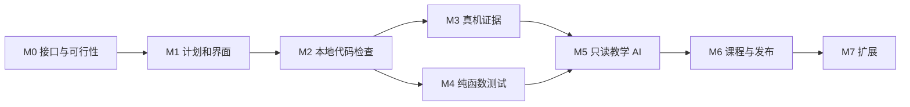

# AI 教学开发路线图

2026-10-23。已开始实施，逐项状态见 [CSV](roadmap.csv) 和[开发记录](DEVELOPMENT.md)。M0 探针通过不等于产品集成完成；M1 当前完成课程协议及迁移基础，存储恢复与前端接入继续推进。人日是熟悉现有仓库的一名开发者的工作量估算，不含等待硬件、模型评审或证书时间；实际排期按探针结果校准。用户最新要求及接口见[教学交互设计](INTERACTION-DESIGN.md)和[代码虚影跟写与逐行 AI 检查](LINE-GUIDANCE.md)。

| 阶段 | 对应旧规划 | 交付 | 工作量 | 退出门槛 |
| --- | --- | --- | --- | --- |
| M0 可行性与接口冻结 | T1/T2/T3 前置 | 固定版本包探针、Rust 规则样例、WASI/平台调查、UI 评审 | 3–5 人日 | 确认 Theia 依赖/只读 Provider 路径，列明平台资产和测试包体积；不引入产品默认功能 |
| M1 离线课程与 UI | T1 收尾 | schema2、迁移、Node Store、双模式、代码高光批注、虚影、快速开关与步骤浮窗 | 10–14 人日 | schema1 不丢进度；自查不等于已验证；深浅主题/键盘/小窗口通过 |
| M2 确定性代码检查 | T2a | Rust 语法规则、缓冲区快照、构建证据与过期 | 7–10 人日 | 正误与未知分开；宏/间接调用不乱判；新编辑不能套旧结果 |
| M3 板上证据 | T2b | 运行/串口采集身份、连接代次、窗口匹配 | 5–8 人日 | 双板、旧日志、错误串口、ROM、重连负例通过；F103 正向真机课程通过 |
| M4 纯函数测试 | T2c | 按需 WASI 工具包、Unity、Rust 测试执行器 | 6–9 人日 | 合法/错误向量、死循环、资源限制、三平台可用性证据；无原生执行回退 |
| M5 只读教学 AI | T3 | Theia AI、逐行审阅队列、教学展示工具、模式/epoch、Node 网关与计划修订 | 11–16 人日 | 取消/离线/越界/伪造引用/改版冲突通过，未保存源码被正确读取 |
| M6 课程与发布验证 | T3 完成 | F103 完整课、F407 适配、模式/展示验收、模型质量集、安装包与试用 | 6–10 人日 | 60 案例回归、三平台目标验收、硬件支持矩阵真实；可关闭与回退 |
| M7 扩展 | T4 | 生成课程、受控课程更新、账号配额/教师视图、DACIR 证据桥 | 单独估算 | 各项独立立项；不挡首期发布，不自动接入设备控制 |

M0–M6 合计 **48–72 人日，约 10–15 个全职工作周**。相较仅逐行跟写的 42–63 人日，新增前端 3–4、Node 2–3、模式/可访问验收 1–2 人日。后置的精确串口代码映射与独立练习引擎不含在内；课程内的小改写任务及测试期望/实际定位属于首期。这是工作量建议，不是交付日期承诺。M2 完成接口后 M3/M4 可独立推进；M5 的 UI/假模型适配可提前研究，但上线必须等证据基础可用。不以“接上聊天接口”作为首期完成。

## M0：先消除工程风险

1. 在临时隔离样例中安装与基座一致的 Theia AI 1.76.0，确认不会拉入第二套 Monaco/React 或默认 AI 菜单。记录 npm tree、依赖许可、真实 Provider 接口。不给主应用新增顶级入口。
2. 用固定 12 组 C 样例验证 tree-sitter 的调用/返回值/不完整源码，并证明复杂宏和函数指针返回 unknown；验证 ts-rs 类型路径。
3. 查验 WASI SDK 三平台发布资产、Rust Wasmtime 的 MSRV 与签名/JIT要求；至少跑一个 CRC 正反例，测安装增量。无法满足 Windows 时先登记缺口，不承诺支持。
4. 在 UI 定稿后，用同一份布局和假模型比较 Theia 1.76 聊天组件与 Cline UI 0.1.0；核对默认贡献、构建增量、主题隔离和升级负担，再冻结具体 UI 依赖。
5. 评审教学/提问、代码高光批注、逐行跟写、步骤浮窗、暂停/显示/失效状态。冻结数据结构、权限边界、目录和 feature flag；M0 不需要传真实工程给外部模型。

## M1：先交付可独立使用的课程界面

- 提交 1：schema2 + 迁移 fixture + 旧数据备份；普通工程无课程不报错。
- 提交 2：Node Store + 多窗口 revision/CAS + 恢复机制；学习记录本机保存。
- 提交 3：紧凑面板替换原 T1 冗余文案，教学/提问均可聊天；右上角唯一分体入口和清晰的显示/暂停状态。
- 提交 4：代码虚影跟写、完成行事件、符号锚点、高光批注与键盘等价路径。
- 提交 5：默认关闭的步骤浮窗、窄版顶部条、双模式草稿/进度恢复。
- 演示：离线打开课程，定位代码，逐行输入，悬停/键盘查看批注，关闭右栏继续教学，暂停后无新请求，切模式恢复草稿/进度；修改计划不串用旧完成状态。

## M2：让“检查”真正有证据

- 批量快照与未保存文档版本、UTF-8/UTF-16映射；已有构建记录只读适配。
- Rust `nodu-tutor`，先支持 calls/checksReturn/argumentRule，再扩到限定调用图的 noCallIn。
- 规则失败与无能力证明分开；检查不能顺便编译。所有结果声明依赖集合和版本。
- 演示：注释伪调用不通过；合法错误传播不误报；源码/头文件修改使旧检查过期；没有模型仍可完成本地检查。

## M3：建立板上证据身份

- monitor 会话/连接代次/顺序号，采集窗口与 run/build/目标关联，原始 RX 流持久化。
- 用户确认目标串口；课程握手作为增强，不自动假设 ST-LINK 与任何 USB 串口配对。
- serialMatch 字面量/正则/数值/序列及完整窗口；下载借用、ROM、等待 BOOT0、重连有明确状态。
- 先模拟后真机：单 F103 正向、双板交叉日志负例、断线和暂停 UI。F407 迁移在 M6。

## M4：把纯逻辑测试接入产品

- 课程 manifest 只引用固定 suite，无任意 shell/链接参数；测试按用户动作启动。
- 独立按需安装包：WASI SDK、Unity、Rust runner、版本/摘要/许可证。
- 增加编译、执行、内存、输出和取消限制；缺包可用明确入口安装，但不得在 AI 请求中自动下载。
- 演示 CRC、换算边界、迟滞状态机；故意改错与死循环失败；Wasm 不能据此证明 MCU 中断/时序。

## M5：接入教学模型

- 先完成 Provider 合同测试与假模型流，再接真实云端/本地端点。
- UI 会话只调用 Nodu 网关；网关处理上下文、凭证、限流、取消，返回引用和结构化终态。
- 解释/提问、逐行/整步审阅、教学展示、计划修订作为同一个 Agent 的明确任务类型；仅受校验的教学展示工具可改变高光/批注，不写源码。
- 新增 mode/teachingEpoch 与展示 schema：切提问/暂停即停止新教学请求并拒绝旧结果；恢复时重检相关修改。
- 修订提案可审阅、有冲突检查、采用后只改教学元数据。当前行代码虚影默认可见，整段参考仍明确请求。
- 新增自动逐行 AI 检查：Enter/离行触发，支持等价实现、待上下文、版本去重、过期与有界队列；不得仅靠本地字符比较宣称 AI 已检查。
- 演示：回答引用当前未保存源码；切工程丢弃旧结果；网络中断仍能编译；工具越权和伪引用被拒绝。

## M6：完成课程而不是只完成框架

- 课程作者核对资料、接线配置和检查条件，所有步骤配正向/负向样例；关键处加入可选分支预测，跟写后提供小改写任务，用户可主动隐藏/恢复虚影。
- 测试报告提供期望/实际短对比与对应断言/源码定位；必须关联套件版本与源码摘要，不从普通串口文字猜调用位置。
- F103 实物课程与 F407 移植分开验收；不带传感器也可完成纯逻辑部分，但不标整课通过。
- 专项验收：收起右栏与暂停不同、提问无自动教学请求、过期批注移除、浮窗不遮当前输入、键盘/Esc 焦点恢复；检查本步只读取证据。
- 模型质量集 60 案例、至少两类候选端点、重复运行；记录漏报/误拒绝/无依据答案。
- 安装包、三平台目标、深浅主题/无障碍、小窗口与 200% 缩放；官方试用包按已验证能力发布。
- 课堂试用观察学习阻碍，确认行下提示有帮助，再决定是否扩大可见范围。

## M7：明确后续边界

| 方向 | 后续实现路线 | 进入条件 |
| --- | --- | --- |
| 自动生成课程 | 基于已验证课程结构生成，schema/规则/来源/适配验证，先预览再冻结 | M6 质量门槛达标，生成课显著标来源 |
| 课程更新 | 独立签名清单、固定 digest、原子缓存、可回退；现有课保留版本 | 课程维护与发布责任明确 |
| 官方模型账号 | 云端模型代理、身份认证、配额、用量，桌面持短期 token | 确认模型合同、数据范围和预算 |
| 教师视图 | 学生主动导出/分享学习证据；非自动评分 | 明确分享范围、保留周期、教师角色 |
| DACIR 证据 | 外部仿真结果带 targetId/固件摘要/电路版本/运行 ID/输入事件 | 搭芯提供版本化 CLI/MCP/导出协议，并做独立信任验证 |
| ESP32/K210 课程 | target adapter + SDK资料 + 对应语言检查器 + 真实运行证据 | 原开发链与各课程实测完成 |
| 精确串口映射与练习引擎 | 有身份的串口消息到源码映射、跨课程改写与理解记录 | M6 课堂试用后按需立项，基础课小改写已在首期；不将抄写算作掌握 |
| 调试教学 | 接入未来 GDB/DAP 的只读变量/调用栈证据 | 调试器本身完成稳定独立验收 |

## 分支与合并

`codex/ai-tutor-design` 保存设计提交；开发已切到 `codex/ai-tutor-foundation`，起点为前序修改检查点 `765affa`。后续每个 M 阶段可用 `codex/ai-tutor-<stage>` 短分支；以既有嵌入式分支为目标整合，不在本次把 `dev/0.2.1-embedded-c` 合入 main。需要独立 checkout 时再创建 worktree。

每阶段提交包含代码、类型/数据迁移、相应回归、用户可读测试记录。PR 只在用户要求时创建。未发布的 AI 功能受开关控制；不能为关闭 AI 删除用户课程/聊天。破坏性迁移必须有备份和可逆路径。包版本号随真正发布流程确定，本次不预设 0.2.2 已发布。
