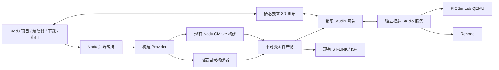

# 搭芯接入 Nodu IDE 设计方案

日期：2026-10-23。状态：历史完整集成草案，已被后续范围决定收窄。

**当前决定：Nodu 与搭芯保持独立，仅接入现有新建窗口的模板选项。以下内嵌画布、仿真目标、统一虚拟串口和新构建服务均暂缓，不作为当前实施计划。** 已实现范围、模板同步与测试见 [搭芯模板接入记录](../0.2.1/DAXIN-TEMPLATES-2026-10-23.md)。

## 1. 设计结论

采用 **Nodu 工作台 + 搭芯独立画布 + 搭芯本地仿真服务**。Nodu 继续管理项目、编辑器、编译诊断、下载和串口；搭芯提供电路、器件、环境输入以及真实固件仿真。用户在同一个项目中完成“选模板 → 改代码 → 编译 → 下载到仿真 → 观察与交互”，随后可以显式切换到实物下载。

首期完整支持 **STM32F103C8T6、搭芯 fixed72 工程、PICSimLab QEMU 与 Renode**。K210、STM32F407、ESP32 保持现有项目入口，不标为支持搭芯仿真。F103 的其他型号和时钟配置也不能只凭系列相同就放行。

“下载到仿真”指将编译好的 MCU 固件加载进模拟 Flash，并启动模拟 CPU。不会调用 ST-LINK、STM32 ROM ISP、物理串口连接或 BOOT 控制。

### 方案比较

| 方案 | 收益 | 主要问题 | 选择 |
| --- | --- | --- | --- |
| 在 IDE 打开整个搭芯桌面/网页 | 初期接入少 | 两套文件树、编辑器和下载入口；草稿、项目身份与进程归属难统一 | 不采用 |
| 直接把搭芯整个前端和引擎搬进 IDE | 看起来统一 | React 版本、构建依赖和服务生命周期耦合；后续难同步搭芯 | 不采用 |
| 接入独立画布与版本化服务 | 复用现有边界；统一工作流；保留搭芯独立迭代能力 | 需要宿主适配、构建产物契约、模板包 | **采用** |

## 2. 调研依据与真实边界

本次只读取本机源码和项目文档，没有启动仿真、构建固件、操作板子或更改两个项目的应用代码。以下是代码核对结果，不是本轮运行验收。

搭芯源码位于 `/Users/wangwei/Project/FC/STM32_Study_Studio`，品牌记录明确名称为“搭芯 / DACIR”。调研时搭芯 HEAD 为 `ea5de485e`，Nodu HEAD 为 `1bf1ac7`；工作目录包含未提交内容，因此这两个提交号不能完整代表本次读取的文件。

| 现状 | 源码依据 | 设计影响 |
| --- | --- | --- |
| Nodu 按芯片创建项目，默认模板、Hello World；默认 F103 使用内部 HSI | `nodu-project-catalog.ts`、`nodu-new-project.tsx`、已有新建项目设计 | 保留双栏和芯片树；搭芯模板仅按兼容芯片增加 |
| Nodu 构建保存 ELF/BIN/HEX/MAP、源码摘要与产物摘要，下载前再次校验 | Rust `build.rs` | 复用产物防过期机制；仿真不能另找“最近一个 BIN” |
| 搭芯项目校验限定 F103C8T6 / 72 MHz | `studio/project.py:validate_manifest` | 不能自动接收现有 HSI 空项目或其他 MCU |
| 搭芯目录工程为 `src/`、`include/`、`drivers/`，附电路、布局、环境文件 | `studio/project.py` | 原样保留结构，避免重写成 Nodu HAL 模板后丢失配置 |
| 三个已登记目录模板为温湿度 OLED、仓库温湿度监测、ESP8266 联网 | `Project.create` 和 `templates/studio/*/studio.project.json` | ESP8266 模板的主控仍是 F103，不能归到 ESP32 |
| 搭芯构建脚本调用容器工具链，固定平台支持、启动文件、链接脚本和驱动选择 | `firmware/directory_build.py` | 首期保留该构建配方；不能仅复制 `.c/.h` 就宣称等价 |
| 两引擎适配器接受 ELF；现有 `simulation/run` 只接受搭芯内部构建记录 | `studio/simulation.py`、`studio/service.py` | 外部固件接入必须新增受控导入接口，不能伪造 job.json |
| 搭芯已有单独 React 19 画布与 `studio.renderer.v1` 宿主桥 | `web/studio/Renderer.tsx`、`protocol.ts` | 可嵌入纯画布；无需嵌入 DSH 整个外壳 |
| Studio 服务是单项目、单运行；无暂停、单步、断点能力 | `studio/capabilities.py` | 首期一个工作区一个服务、一个活动仿真；不画假暂停按钮 |
| 仿真 UART 经实际器件网络；当前发送接口以 text 为输入 | `SimulationService.send_uart`、`serial/send` | 真实接线参与串口；二进制收发需补接口后才能称 HEX 完整支持 |
| 服务有更新拓扑能力，但当前编辑入口锁定运行中的电路修改 | `service.py:_require_design_editable` | 首期停止后改线；不要把底层能力直接当成用户功能 |
| 注册目录有 44 类元器件，能力声明与各器件验收分开 | 契约、目录文档、根 AGENTS | 模板按器件、引擎、版本做准入；注册数不等于全面兼容数 |

搭芯目前使用本地 Python 服务与容器引擎；开发端口 18881、18882 是现有配置，不作为 Nodu 集成中的硬编码端口。首期交付目标是 Nodu 独立桌面应用，浏览器联调不替代桌面验收。

## 3. 用户流程与 UI

### 3.1 新建项目

继续使用已选定的 IDEA 02 紧凑双栏布局，沿用 Nodu 字体、颜色、图标、控件与深浅主题。芯片系列折叠，子项保持靠左。不增加开发板选择。

```text
新建项目                                               ×
┌─────────────────┬─────────────────────────────────────┐
│ K210            │ 名称  [ temperature-monitor        ] │
│ ▾ STM32         │ 位置  [ ~/Projects              ][…] │
│   STM32F103      │ 型号  [ STM32F103C8T6             ▾] │
│   STM32F407     │ 模板  [ 默认项目                  ▾] │
│ ▸ ESP32         │                                     │
├─────────────────┴─────────────────────────────────────┤
│                                        取消    创建  │
└───────────────────────────────────────────────────────┘
```

模板下拉显示：`默认项目`、`Hello World`、分隔线、`搭芯空项目`、`温湿度 OLED`、`仓库温湿度监测`、`ESP8266 联网`。其中“搭芯空项目”是本方案新增的最小 fixed72 可编译模板，不把搭芯当前仅建立目录/元数据的 empty 入口直接当成已完成固件模板。

- 默认仍选“默认项目”。模板条目使用名称，不拼接“· 芯片 · 说明”等文案。
- 下拉中的搭芯模板只对 F103C8T6 提供；未安装包时保留一个“管理模板…”动作，在独立窗口中查看、安装本地包，不在主表单堆提示。
- 搭芯模板创建后保存代码、电路、初始环境与锁定版本；打开 `src/main.c` 与“仿真”标签。默认项目维持原流程。
- 选择搭芯模板后，初次执行目标设为“搭芯仿真”；创建本身不启动引擎或运行固件。
- 切换系列保留名称、位置；不兼容模板退回“默认项目”。用户主动选择模板才应用其完整源码和接线，不根据源码推测并自动修改接线。
- 模板详情/许可通过“管理模板”查看；必要的安装失败、无效字段才显示就地错误。

### 3.2 工作台

```text
[项目 ▾]   [编译]   [下载 ▾]   [停止]              [搭芯仿真 ▾]
┌────────────┬─────────────────────┬──────────────────────────┐
│ 文件       │ main.c              │ 仿真                     │
│ src        │                     │ [选择][接线][操作]  [⋯]  │
│ include    │ C 源码              │                          │
│ drivers    │                     │       3D 电路            │
│ circuit…   │                     │                          │
├────────────┴─────────────────────┴──────────────────────────┤
│ 问题  输出  串口                         [仿真串口 ▾]      │
│ USART 数据                                                  │
├─────────────────────────────────────────────────────────────┤
│ STM32F103C8T6                   搭芯仿真  运行中          ⓘ │
└─────────────────────────────────────────────────────────────┘
```

图为结构草稿，不新增第二套完整工具栏。复用现有设备/下载方式入口，其可选项为 `ST-LINK`、`串口 ISP`、`搭芯仿真`；原有实物设置保留。内部把“执行目标”与“实物下载协议”分开建模，不能将搭芯塞入 Rust 的 `flash.method` 硬件分支。

- `下载`主按钮：保存受管源码 → 编译（已有完全匹配的产物则复用）→ 下载到当前目标。编译按钮只编译。
- 下拉保留原操作，底部继续以分隔线放“下载帮助”。选择“搭芯仿真”只改变目标，不立即编译、连接、启动或下载。
- “仿真”是可拖动/拆分的编辑区标签，不抢占所有编辑空间。默认右侧约 45%，允许用户调整；建议画布最小宽度 360 px。
- 窗口可用宽度不足 1100 px 时改为代码/仿真同组标签；不足 800 px 时属性改为覆盖抽屉，不强塞三列。属性仅选中器件后展开，器件库由图标打开。
- 画布内只提供必要的选择、接线、操作和视图控制；宿主已有的编译、下载、串口不重复。
- 设置入口中选择 QEMU/Renode、运行时限。默认沿用模板的 qemu；这是首期流程默认值，不宣称 QEMU 已是最终生产优胜引擎。若缺失，显示“安装引擎/选择已安装引擎”，不静默切换后把结果算作原引擎通过。
- 仿真运行中允许操作已支持的按钮和传感器环境输入，电路结构与布局编辑停止后进行。源码仍可编辑，当前运行绑定旧产物；状态必要时显示“源码已修改”，下次下载重建。
- 首期不提供 CPU 暂停/继续、单步或断点；“串口暂停显示”保持现有含义，不暂停 MCU。
- 切换到实物目标时，若仿真正在运行，在一次简短确认中提供“停止并切换”“取消”；确认只停止仿真，随后需用户点击下载才操作实物。对反向切换也不自动下载。

### 3.3 状态、帮助和键盘

状态栏按真实阶段显示 `搭芯仿真  编译中`、`搭芯仿真  加载中`、`搭芯仿真  运行中`、`搭芯仿真  已停止`。有真实百分比才显示百分比，未知进度用忙碌指示，禁止用计时器伪造 0–100%。实物目标继续显示 `ST-LINK` 或 `串口 ISP`。

保留 ⓘ 按钮：悬停/聚焦显示简短帮助浮层，点击或 Enter 打开完整帮助弹窗。内容按目标切换：仿真页只写适用芯片、编译后加载运行、停止/重新下载、虚拟串口；不显示 BOOT0 跳线。已有 F103 实物帮助仍独立保留。

所有菜单支持方向键、Enter、Esc；弹窗限制焦点范围，关闭后回到触发按钮。画布按键只在画布有焦点且不处于输入/IME 组合态时生效。图标保留 aria-label，焦点边框和禁用状态沿用 Nodu。

**产品 UI 禁止常驻解释段落、装饰性二级标题、“·”拼接文案和重复参数说明。** 本文的章节用于研发设计文档，不作为产品页面标题清单。

## 4. 系统架构与责任



### 4.1 归属规则

| 数据/行为 | 唯一负责方 |
| --- | --- |
| 源码草稿、文件树、保存、语言服务、诊断展示 | Nodu |
| 构建任务队列、取消、当前成功产物与摘要 | Nodu 编排；Provider 执行 |
| 电路、布局、初始环境、对象事务和撤销重做 | 搭芯 Studio 服务 |
| GPU 场景、相机、选择和未提交手势预览 | 搭芯 renderer |
| 运行、输入 ACK、仿真 UART、器件/测量快照 | 搭芯服务与真实引擎 |
| ST-LINK/ISP、备份、实物端口租约 | 现有 Nodu 硬件后端 |

前端不能直接设定 OLED、串口或 LED 运行结果。输入必须经过器件模型、实际网络和固件，失败和未知状态都保留。

### 4.2 宿主适配

复用 `web/studio` 的独立 renderer，隔离 React 版本。资源通过 Nodu 管理的专用 loopback 资源端点加载，HTTP 与 WebSocket/SSE（若后续采用）都必须按本次窗口身份授权。首期复用现有 cursor 事件拉取，不要求改造为 WebSocket。

renderer 仍接受 `studio.renderer.v1`，但新增 Nodu HostAdapter：主题 token、项目身份、命令白名单、选择/焦点、截图保存。严校验 `origin`、`event.source`、消息结构与会话 nonce；Nodu Electron 的实际 origin 在原型阶段核对，不照抄 `dsh-app://app`，不放宽为 `*`。

画布 API 请求统一经受限网关，不能直接绕过 Nodu 构建/保存约束。网关只放行画布必要的状态、目录、设计和运行输入操作，不放行原搭芯的任意项目切换、独立构建或源码写入入口。后端令牌不放进 query string 或日志。

不接入搭芯的 DSH Agent、账户、聊天、PTY 和整个桌面壳。本次需求不需要用户在 IDE 内再次登录搭芯。

### 4.3 服务生命周期

首期一个 Nodu 工作区拥有一个搭芯服务和最多一个仿真会话，端口动态分配。启动握手校验协议、资源包、引擎、支持芯片与时钟。不同工作区使用不同 instanceId、会话令牌、状态目录和容器标签。

打开工程不启动 MCU；第一次打开仿真面板可启动轻量服务，用户下载时才启动引擎。关闭单个画布标签不停止运行；关闭项目/退出应用停止该实例拥有的运行并处理未提交设计。服务崩溃时清除“实时”状态，保留最后结果为历史；恢复后不自动重放下载或瞬时输入。

不可占用用户正在运行的搭芯服务或抢开其工程。Nodu 与搭芯独立桌面同时打开同一目录时，写租约决定唯一写入方，另一方只读；异常退出的租约通过进程身份和用户确认恢复，不能仅凭旧时间戳强制删除。

## 5. 工程与模板设计

### 5.1 目录保留搭芯格式

```text
project/
  nodu.json
  nodu.lock.json
  studio.project.json
  components.lock.json
  circuit.json
  layout.json
  environment.json
  src/main.c
  include/config.h
  drivers/nun-dx/...
  licenses/...
  template-origin.json
  .nodu/                 # Nodu 本地状态、不可变产物、会话映射
  .studio/               # 搭芯事务与恢复数据
  build/                 # 构建临时输出
  runs/                  # 搭芯运行证据
```

不维护第二份可编辑源码镜像。构建使用不可变快照，属于临时输入，不是第二个项目。布局变化不触发 C 重编译；源码、驱动、编译配置、平台支持和锁定依赖变化会使产物过期。接线/环境变化形成新的运行输入身份。

`nodu.json` 中新增显式项目 kind，例如 `stm32-dacir`，不能假装现有 `stm32-hal` 分支已支持。拟议字段：

```json
{
  "schema": 2,
  "kind": "stm32-dacir",
  "name": "temperature-monitor",
  "target": { "mcu": "STM32F103C8Tx" },
  "build": { "provider": "dacir-directory-v1", "profile": "f103c8-fixed72" },
  "simulation": {
    "provider": "dacir",
    "projectFile": "studio.project.json",
    "engine": "qemu",
    "runtimeLimitSeconds": 600
  },
  "flash": { "method": "stlink" },
  "monitor": { "baud": 115200, "encoding": "utf-8", "lineEnding": "lf" }
}
```

以上是新契约草案，现有程序不能直接读取。执行目标、物理端口和窗口布局放在 `.nodu` 本机状态；不把个人端口写入可分发模板。schema 1 老工程继续原样读取；旧版遇到 schema 2 明确拒绝写入，不删除未知字段。

芯片标识建立唯一映射：Nodu `STM32F103C8Tx` ↔ 搭芯 `STM32F103C8T6`，校验容量、CPU 与时钟 profile。不能靠截取 `F103` 字符串匹配。`studio.project.json` 的 72 MHz 和固件时钟初始化均参与检查；声明并不证明代码真的这样运行，验收需读固件行为。

搭芯现有温湿度模板使用 HSE、PLL ×9，并检查 `SystemCoreClock == 72000000`；对应 HSE 8 MHz 的条件必须进入 profile。`studio.project.json` 管理搭芯的 MCU/时钟约束，Nodu 的 MCU 标识只是规范化映射；两份元数据不一致时阻止构建/加载，由一次事务修复，不做相互覆盖。工程名称修改也应通过同一事务更新两处名称。

### 5.2 模板包

新增版本化 `dacir-template-pack`，来源为固定搭芯版本快照，不运行用户模板中的安装脚本。目录条目包含：

| 字段 | 内容 |
| --- | --- |
| id / version / displayName | 稳定 ID、包版本、短名称 |
| target / clockProfile | F103C8T6、fixed72 |
| buildProvider / runtimeCompatibility | 构建器、Studio 契约与引擎兼容范围 |
| files / sha256 | 源码、电路、布局、环境、许可逐文件摘要 |
| dependencies | NUN_DX 提交、HAL/CMSIS、平台支持、器件目录版本 |
| requiredComponents | 必须的器件类型及具体变体 |
| validation | 分引擎记录状态、证据来源、验证版本；允许“未测试” |
| licenses / notices | 原始声明、来源、署名与许可证文件 |

当前驱动锁记录 `v0.3.0-hx711.2`、提交 `55b44abeee127e0326ac8a5258f4c0f4df6dc2a5`；发布包仍须核对模板副本自身摘要，不因主库版本相同就认为副本一致。组件目录中的未来计划类型不可进入可用模板。

创建事务：校验包和目标 → 新目录临时准备 → 复制模板 → 分配新 projectId → 写 Nodu 元数据/锁 → 校验源码与设计契约 → 原子完成 → 打开项目。失败不留下半成品，不覆盖同名项目；拒绝路径穿越、绝对目标路径和符号链接逃逸。

模板更新只影响将来新建项目。已有项目不自动覆盖代码、驱动或接线；升级另走差异预览与备份。离线已安装模板可以直接创建。

### 5.3 现有工程接入

- **已有搭芯工程**：打开时识别 `studio.project.json`，提供一次“接入 Nodu”；核对目标、源码目录与版本后仅添加集成元数据/状态，不替换源文件。原始配置在迁移前备份。
- **已有 Nodu HSI 工程**：首期不能直接切到搭芯；保留真实目标，在选择仿真时显示简短不兼容错误及“从搭芯模板新建”动作。不静默改时钟、启动文件或板级配置。
- **将来接入任意兼容 ELF**：只在目标/内存/时钟与器件能力都通过的情况下加载，且标明外部产物来源。不是首期借口放开所有 F103 工程。
- **搭芯工程转实物**：可以复用同次构建的固件，但 fixed72 模板的时钟/外设连接必须匹配实物。首次从仿真切换到实物用简短确认展示必要的时钟和引脚差异，详细接线放帮助弹窗；不默认所有 F103 板都具有同样外部晶振。

## 6. 构建与固件加载

### 6.1 构建策略

Nodu 增加 BuildProvider：现有项目继续 CMake，搭芯项目调用版本锁定的 `firmware/directory_build.py` 适配器，保留现有 Docker 工具链、启动/链接与运行时支持配方。编译任务由 Nodu 单一队列控制，不同时调用搭芯 `/flash` 再编译一遍。

首期选择这个方案，是因为搭芯目录构建器包含 `-nostdlib`、自有 runtime、HAL timebase、强制 config header、特定驱动集合与链接顺序，直接套 Nodu 的 CMake/printf 配置会改变行为。后续可新增本机构建 Provider，但须逐模板回归；不要求不同编译器产生逐字节相同的 ELF。

构建适配器必须新增输出 `compile_commands.json`，把容器路径映射回宿主文件与已安装依赖，为 clangd 提供真实 include、宏和编译参数。新建 C 模块生成到 `src/`、`include/`；不能沿用 HAL 工程的 `App/`。`printf` 浮点等设置按 Provider 能力显示：当前搭芯构建配方不具备现有 Nodu nano-libc 开关语义，禁止显示一个无效的开关。

### 6.2 同一份产物

统一 BuildArtifact 描述至少包含：`buildId`、`provider`、`projectId`、规范化 MCU、clockProfile、sourceDigest、构建配置/依赖摘要、ELF/BIN/HEX/MAP 的摘要、内存范围、入口、构建日志和实际编译器版本。

两个项目原有 sourceHash/inputDigest 算法不同，**不能直接相等比较，也不能只改字段名**。保留 provider 原始摘要，新增统一的排序路径/文件 SHA-256 输入清单；统一摘要还覆盖 profile、平台支持与依赖身份。Studio 导入后根据自身输入快照重新计算其 sourceHash，与映射清单关联。

Nodu 将输出封装为不可变产物；适配现有 CPU、栈顶、向量、容量与校验逻辑供仿真和实物共用，已有实物备份/设备身份检查继续生效。不能为了通过搭芯产物而整体关掉安全校验；与特定 HAL runtime 相关的可选符号检查按 Provider 明确处理。

### 6.3 仿真下载事务

1. 固定本次 projectId、执行目标和 operationId，阻止双击创建重复任务。
2. 保存本工作区受管源码；草稿保存失败、外部冲突或另一编辑器未确认时终止。
3. 对当前输入快照复用或构建产物；编译过程中现有仿真可以继续运行。
4. 检查产物摘要、F103C8 内存范围（64 KiB Flash、20 KiB RAM）、向量和时钟 profile；核对引擎/模板/器件版本。
5. 获取最新电路、环境和 revision，做供电/短路/连接的现有验证。仅已有规则定义的 fatal issue 阻止启动；断开或误接的教学负例应产生真实失败行为，不能一律修好或禁止。
6. 通过新增的受控产物导入接口取得 artifactId；服务检查数据后登记正式外部产物记录，不伪装成内部成功构建。
7. 全部预检完成后才停止旧运行；以同一个 ELF 启动选定引擎并分配新的 runId。QEMU 的 pflash 转换由其原适配器完成，保留 ELF 与转换结果摘要。
8. 收到引擎真实启动确认才显示“运行中”；随后观测 UART、GPIO、OLED 等。启动成功不等于程序逻辑或每个器件验收通过。
9. 启动失败显示失败并保留日志，不自动恢复旧固件为“新版本成功”。预检阶段失败则保留旧运行，并清楚区分当前运行的 buildId。

运行记录关联 `projectId + buildId + artifactId + runId + engineId + ELF SHA256 + circuitRevision + environmentDigest`。切换引擎时停止上一运行，复用同一 ELF 生成新 runId；双引擎验证分别留证。

取消在提交替换旧运行之前应保持旧运行；提交后取消必须停止新运行并进入“已停止”，不可停留在虚假的成功状态。事件带 runId 与序号，旧运行延迟事件不得更新新状态。

任务状态分为 `idle → saving → building → validating → loading → running`，任何阶段均可进入 `failed`，可取消阶段进入 `cancelled`；运行经 `stopping → stopped` 结束。构建任务和当前仿真是两个独立状态对象，因此新构建失败时仍能准确显示旧仿真正在运行。服务不可达时进入 `disconnected`，不能直接把未知引擎状态当作“已停止”。

## 7. 接口方案

### 7.1 可复用与必须新增

| 接口/契约 | 当前状态 | 接入动作 |
| --- | --- | --- |
| Studio `state`、`events?cursor=`、`catalog`、`capabilities` | 已有 | 网关透传必要范围，校验既有 schema |
| Studio 设计 `commands`、`circuit`、`layout`、`environment` | 已有 | 保留 project/revision/operation 身份约束 |
| `simulation/inputs`、`simulation/stop`、历史读取 | 已有 | 加入 Nodu 会话归属检查 |
| `simulation/run` | 已有，只能读取内部 build job | 扩展接受已登记的外部 artifactId，保留原路径 |
| `artifacts/import` | **新增** | 接收受控固件快照与来源清单，返回不可变身份 |
| 二进制 UART 接收/发送契约 | **需扩展** | 原 text API 保留；增加字节和 UART 端点契约 |
| Nodu simulation RPC、BuildProvider、模板注册 | **新增** | 使用独立模块，不混入物理 flash/monitor 命令 |
| renderer 消息桥 | 已有 `studio.renderer.v1` | 增加 Nodu 宿主及主题/焦点适配 |

### 7.2 新接口草案

`artifacts/import` 由可信 Nodu 后端调用。renderer 不能提供任意绝对文件路径。

```json
{
  "protocolVersion": 1,
  "operationId": "operation-id",
  "expectedProjectId": "project-id",
  "sourceDigest": "sha256-of-inputs",
  "target": { "mcu": "STM32F103C8T6", "clockProfile": "fixed72" },
  "transferToken": "single-use-staged-artifact-token",
  "files": [{ "name": "firmware.elf", "sha256": "sha256-of-elf", "bytes": 123456 }],
  "provenance": { "provider": "dacir-directory-v1", "buildId": "build-id" }
}
```

`bytes` 为示意值。transferToken 只引用后端为当前会话准备的暂存包；服务复制到所属目录、重新计算摘要并解析 ELF 后才返回 artifactId。令牌有界、限时、单次使用；重复 operationId 返回相同结果或明确冲突。解析拒绝越界地址、非 ARM/非兼容 CPU、非法加载段和超限文件；不信任调用方提供的“验证通过”布尔值。

运行请求携带 artifactId、engineId、expectedProjectId、expectedCircuitRevision、environmentDigest 和 maxSeconds。接线在预检到提交期间变化则冲突返回，不能悄悄运行另一份电路。

Nodu RPC 建议新增 `simulation.capabilities`、`simulation.load`、`simulation.stop`、`simulation.state`、`simulation.input`、`simulation.serialWrite`。这些是计划名称，不是现有已实现接口。协议 JSON Schema 放在搭芯 contracts 的独立集成扩展中，生成 Python/TypeScript 校验器，原 v1 消费者保持兼容。

## 8. 虚拟串口与仿真交互

复用 Nodu 底部串口组件，新增独立的 `SimulationSerialTransport`。串口选择器将“仿真串口”与实物 USB 设备分组，不能伪造 `/dev/cu.*`，不能触发物理端口扫描之外的连接或 DTR/RTS 操作。切换数据源清楚显示来源，日志按来源和 runId 分段。

仿真串口绑定电路中的 USB-TTL 器件及其 TX/RX 网络。无器件或接线不通时给出真实结果，不偷偷直连 USART1。模板可自带明确的虚拟 UART 接线；默认项目不推断接线。诊断用 debug UART 仅进入独立调试输出，不混入用户通信来掩盖接线错误。

首期目标是文字收发、编码、时间戳、复制、清空、暂停显示、保存日志与 HEX 字节收发。实现要求：

- 在引擎/服务边界保留原始字节，以 base64 传输；记录 sequence、runId、endpointId 与接收时间，使用增量解码，覆盖跨包 UTF-8/GBK。
- HEX 发送先验证输入，再走同一个实际 UART 网络。若某引擎仅实现文本通路，该引擎禁用 HEX 发送并在能力结果中标明，不把 Unicode 转回字节冒称完整二进制。
- 参数是否参与仿真以引擎能力为准；未模拟的波特率/校验错误不能声称和实物一致。不支持参数时不显示可编辑的假控件。
- 限制缓冲和批量刷新频率，溢出明确计数；“暂停”只冻结显示，接收继续。
- 日志记录接收墙钟时间；虚拟时间另列元数据，不把二者混为一谈。
- 瞬时输入以 operationId/sequence 去重；ACK 仅证明接受/应用状态，不能据此断言 MCU 已采样。超时未知时先读取状态，不自动重放按键。

## 9. 依赖、离线交付与边界

首期沿用搭芯已经使用的 Python + 容器路线，不在设计文档里承诺已具有 Windows/macOS/Linux 原生免 Docker 引擎。发行前分别验证目标操作系统与架构；本机 macOS 开发验证不能代替其他平台。

新增“搭芯工具包”管理项，包含 Studio 服务、renderer 与模型、模板、编译环境、两种引擎、必要电气组件及清单。工具包页显示实际版本、占用空间、许可、检查与安装状态，沿用项目现有信息页组件。

- 支持从本地已安装搭芯开发目录绑定进行开发联调；用户正式安装包依赖版本化工具包，不能依赖开发者绝对路径。
- 包版本锁定到内容摘要/镜像 digest，不依赖可变 Docker tag。离线资源、字体与 CAD 全部来自已安装包，不在运行时访问 CDN。
- 首次安装检查磁盘和 Docker 服务；缺失时只提供明确安装动作，不静默下载巨大镜像。实际包体、内存、启动耗时在原型测量后填写，当前不虚报数字。
- 未安装引擎时允许编辑、创建已安装模板与查看静态场景；下载必须明确报告依赖缺失。没有渲染资源时也不能显示假画布。
- 保留原始许可声明：根编排 MIT、PICSimLab QEMU 适配 GPL-2.0-or-later、目录构建器及相关模板/驱动 AGPL-3.0-only、字形及 CAD 各自声明。分发清单逐文件核对，不能统一改为 Nodu 的 MIT；本方案不对最终组合分发作法律结论。
- 不绑定搭芯账户；ESP8266 等联网模型的网络访问按该模板声明单独控制，不把容器隔离误写为所有模拟网络功能都可离线运行。
- 容器仅挂载受控快照和本次输出；服务只监听 loopback，使用会话认证与明确 origin，限制请求、输出和运行时长。只回收当前 instanceId 创建的进程/容器，不执行全局 Docker 清理。

## 10. 开发拆分与实施顺序

以下为后续实施计划，本次不执行。

| 阶段 | 具体交付 | 完成门槛 |
| --- | --- | --- |
| P0 接入原型 | Nodu 内打开独立画布；独立服务；一次真实 ELF 导入；主题/焦点 | 实际 Nodu 桌面启动，两引擎分别加载同一 ELF，记录 SHA 与运行结果；不触发物理后端 |
| P1 模板与构建 | 模板包、创建/打开/迁移、BuildProvider、产物摘要、clangd 参数 | 三个既有模板加新增最小模板可生成、编译；无重复 startup/runtime；错误定位正确 |
| P2 完整工作流 | 下载/停止/引擎切换、设计事务、环境输入、虚拟串口、状态与帮助 | 从新建到运行、修改后再下载；失败/取消/崩溃/过期产物均正确 |
| P3 桌面与分发 | 工具包检查、离线资源、版本迁移、安装产物回归 | 实际安装产物完成验收；未测平台单独标注，不当作全部支持 |

Nodu 预计新增模块：`nodu-simulation-model`、`nodu-simulation-widget`、`nodu-simulation-server`、`nodu-dacir-project-provider`、`nodu-build-provider`、`nodu-simulation-protocol`。修改新建项目目录、命令/工具栏、串口 Transport、设置与产物适配；不重写现有硬件下载实现。

搭芯预计修改：新增集成产物注册与外部运行路径、原始 UART 字节契约、Nodu HostAdapter、会话认证/包内启动方式、构建参数导出；复用原 `SimulationService`、器件模型与 renderer。共享引擎文件如需修改，按搭芯既有规定复跑受影响器件基线，不能只测新集成。

## 11. 验收矩阵

验收分别标记“通过、失败、未实现、未测试、环境阻塞、不适用”，不把历史搭芯报告或本次代码阅读算成本次集成通过。

| 类别 | 必测内容 | 通过标准 |
| --- | --- | --- |
| 模板 | 四个首期模板；中文/空格父路径；同名、损坏包、缺资源；切系列 | 目标筛选正确，失败无半成品，不覆写现有文件；ESP8266 仍属 F103 |
| 构建 | 编译错误、取消、源码构建中变化、依赖变化；C 模块；clangd | 诊断定位真实源码；过期/失败产物不能下载；补全参数与真实构建一致 |
| 加载 | ELF 被改、错误 CPU/容量/时钟、错误项目/电路 revision、重复点击 | 服务端拒绝，旧会话不被预检失败破坏；没有硬件 RPC |
| 两引擎 | 同一模板变体、同一 ELF、相同初始输入分别运行 | 每引擎记录 hash/buildId/runId；单端通过不能标双端通过 |
| 器件 | 温湿度变化到真实 OLED/串口；断线负例；停止后改线 | 结果由模型和固件生成；无前端伪造和自动纠线 |
| 串口 | 文本、UTF-8/GBK 分包、二进制、空字节、突发、错误接线 | 字节与路由正确；暂停显示不丢接收；日志区分运行与来源 |
| 生命周期 | 切项目、两窗口、关标签、退出、服务/引擎崩溃、超时 | 资源归属正确；不残留假实时状态；恢复不自动运行 |
| UI | 深浅主题，1440×900、1024×768、800×600，缩放与键盘 | 无关键按钮遮挡；窄窗切标签；菜单/帮助 Esc 与焦点恢复正确 |
| 兼容 | 旧 Nodu HAL/K210/ESP32、旧搭芯目录、无 Docker 环境 | 原工作流保持；无搭芯依赖时现有项目照常工作 |
| 实物边界 | 打开帮助、切仿真、加载模拟固件全程监测调用 | 物理 flash/reset/openSerial/setDTRRTS 调用为 0；独立实物回归另行授权执行 |
| 安装产物 | 真正 Nodu 桌面包、离线启动和资源加载 | 浏览器测试仅作辅助；支持平台逐一留证 |

后续用户验收建议顺序：创建“温湿度 OLED” → 编译 → 选择搭芯仿真下载 → 调温湿度观察 OLED → 查看虚拟串口 → 改源码重新下载 → 停止、改一条接线并运行负例 → 切 Renode 使用同一 ELF 复验 → 退出重开确认保存但不自动运行。最后再单独验证由同一固件转实物；仿真通过不替代真实时钟、供电、电平和外设验证。

## 12. 需要在原型阶段消除的不确定性

1. Nodu 实际 Electron origin、CSP、iframe GPU/焦点行为，需要原生桌面验证；现有搭芯 DSH 的通过记录不能直接沿用。
2. 两引擎每个 UART 模型的二进制能力和波特率/校验语义，需要逐项核对与实测，不能仅依赖 text API。
3. 各模板副本与当前驱动锁、器件目录是否一致，需要打包时逐文件审计；44 个注册器件不等于都通过模板组合验收。
4. 工具包的实际体积、内存、启动耗时和各操作系统可用性，需要测量。首期保留容器依赖，不把“本地仿真”表述成“零依赖”。
5. 搭芯模板的固定时钟与具体实物晶振条件需要在转实物测试中核对；不因仿真能跑就承诺任意 F103 板都能直接运行。

这些是实施阶段的验证门槛，不影响本方案的架构选择。本次只完成设计，不对集成运行、模板编译、仿真或实物烧写作通过声明。

## 13. 本次调研文件索引

Nodu：

- [新建项目定稿](../0.2.1/NEW-PROJECT-DESIGN.md)
- [新建项目组件](../../desktop/scope-extension/src/browser/nodu-new-project.tsx)
- [芯片目录](../../desktop/scope-extension/src/common/nodu-project-catalog.ts)
- [构建与产物校验](../../desktop/native/crates/nodu-embedded/src/build.rs)
- [当前功能与验证记录](../0.2.1/FUNCTIONAL-FIXES-2026-10-23.md)

搭芯本机源码（这些绝对路径仅供本机调研定位，不写入产品运行配置）：

- [项目约束](/Users/wangwei/Project/FC/STM32_Study_Studio/AGENTS.md)
- [项目与模板](/Users/wangwei/Project/FC/STM32_Study_Studio/studio/project.py)
- [目录构建器](/Users/wangwei/Project/FC/STM32_Study_Studio/firmware/directory_build.py)
- [仿真加载与观测](/Users/wangwei/Project/FC/STM32_Study_Studio/studio/simulation.py)
- [服务路由与运行约束](/Users/wangwei/Project/FC/STM32_Study_Studio/studio/service.py)
- [能力边界](/Users/wangwei/Project/FC/STM32_Study_Studio/studio/capabilities.py)
- [独立画布协议](/Users/wangwei/Project/FC/STM32_Study_Studio/web/studio/protocol.ts)
- [画布接入说明](/Users/wangwei/Project/FC/STM32_Study_Studio/docs/development/studio-p0-p4/renderer.md)
- [契约定义](/Users/wangwei/Project/FC/STM32_Study_Studio/packages/contracts/studio/README.md)
- [驱动版本锁](/Users/wangwei/Project/FC/STM32_Study_Studio/firmware/library/studio.lock.json)
- [模板目录](/Users/wangwei/Project/FC/STM32_Study_Studio/templates/studio)
- [桌面验收约定](/Users/wangwei/Project/FC/STM32_Study_Studio/docs/桌面端交付与验收约定.md)
