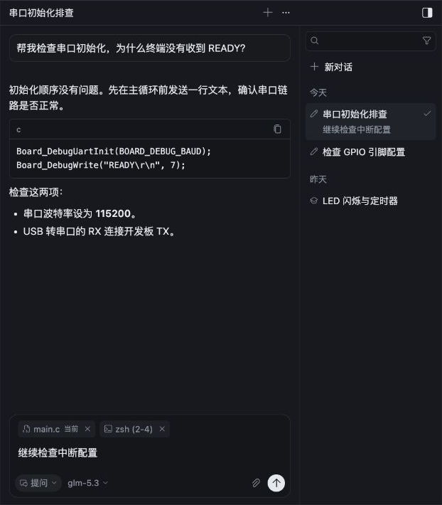
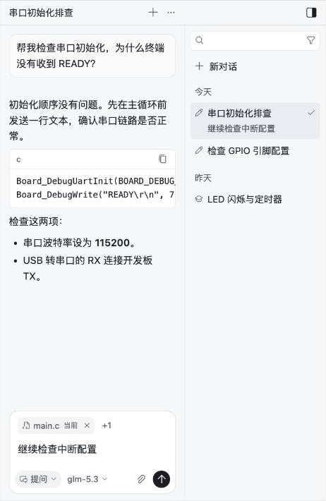
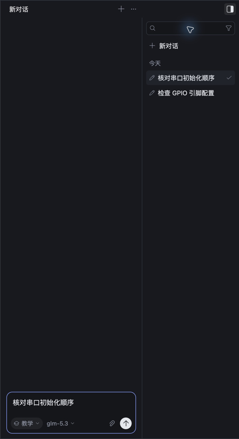

# 右侧常驻会话栏验收

日期：2026-10-25。参照本机 Cursor 3.24.12 IDE 的 `Toggle Agents Side Bar` / `Unified agents sidebar`，落实「当前聊天 + 右侧常驻列表」。

## 本次实现

- 标题栏最右侧提供展开/收起按钮，展开时隐藏历史时钟，收起后恢复紧凑历史浮层。
- 列表固定 200px，聊天区至少 260px。展开给整个 AI 区域增加宽度；快速连续开合保留稳定聊天宽度，手动调宽后收起保留新的宽度。
- 搜索标题及预览、新建、日期分组、图标和名称的模式筛选、草稿识别、当前选中状态，全部使用真实会话记录。
- 搜索框方向键进入列表，行内方向键/Home/End 移动，Enter 选择，Esc 清空检索。列表出现时不抢输入框焦点；选择和新建完成后恢复输入焦点。
- 展开状态独立持久保存；正文与输入保持挂载，沿用既有草稿、引用、阅读位置和会话恢复逻辑。
- 无说明段落和搜索占位文字。仅保留动作名称、分组、实际状态和必要错误。

## 验证

- AI 回归 **332/332**、工作台 **112/112**；TypeScript、Electron 构建、diff-check 通过。
- 新增回归覆盖展开状态持久化、会话生命周期独立性、选择的异步焦点、请求中/切换工作区保护、键盘导航、快速开合动画和手动调宽。
- 独立 Electron 配置及临时项目实测：新建 A/B → 输入不同草稿 → 搜索 → 键盘选择 → 恢复原草稿和输入焦点；重载后重新打开 AI 面板，展开状态、两条草稿和当前会话均恢复；收起后历史浮层可用。
- Electron 发现的全局输入框样式覆盖已修复，最终构建确认搜索框没有重复内边框。
- 使用实际生产 React 组件及工作台样式检查深/浅主题、聊天区 420/260px 配合 200px 列表，未出现整体横向溢出。以下组件图使用本地样例会话，未调用模型。
- 原预览窗口有未保存编辑，保持原状；验证在独立窗口进行。本次没有新增模型请求或使用测试凭据。

## 截图

深色，420px 聊天区 + 200px 会话栏：

浅色，260px 聊天区 + 200px 会话栏：

最终 Electron 构建，重载后恢复两条真实本地草稿（截取右侧区域）：

## 范围

本次实现常驻会话导航。多标签、重命名、置顶、归档、全文检索、并行生成仍在功能对照文档中列为后续工作，不宣称与 Cursor 全功能一致。
