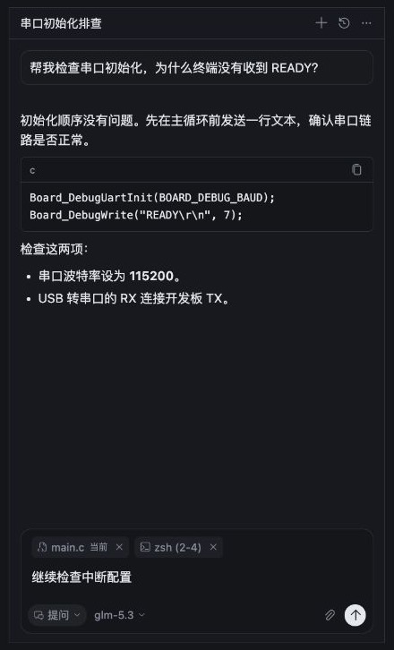
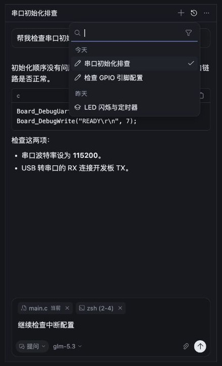
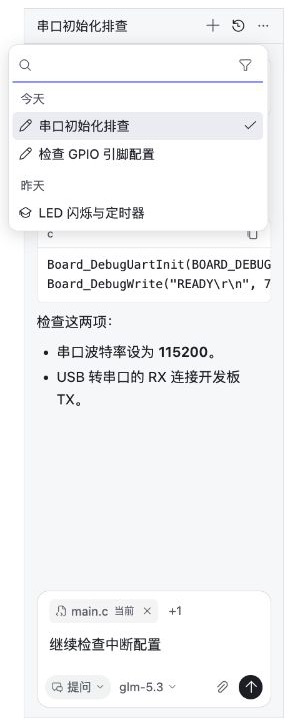

# AI 侧栏视觉对齐 · 2026-10-25

以本机 Cursor 3.24.12 的 IDE 侧栏为参照，保留 Nodu 的工作台主题。接续 [功能对照](../conversation-cursor-comparison-20261025.md)；本轮完成视觉调整及历史浮层，未实现独立聊天标签、置顶归档或消息原位编辑。

## 已落实

- 历史从整页切换改为标题按钮下的 260px 浮层，正文和输入区留在原位。单行显示标题，草稿采用铅笔图标；未命名草稿显示内容。模式筛选按需展开。
- 聊天正文、标题和菜单统一使用系统 UI 字体；正文 14/22，菜单 13/20，底栏标签 12/18。
- 底栏顺序为模式、模型、附件、发送。模式保留图标和名称，宽约 66px；附件及发送为 24px。260px 窄栏下 glm-5.3 完整可见，更多附件收为 +N。
- 用户消息统一全宽轻边框；收紧回复尾部留白。菜单采用中性选中底色，继续以勾标明选中项。
- 保留自实现菜单、键盘操作、草稿及每个对话的滚动位置。没有新增解释性文案或输入占位提示。

## 验证

实际生产 React 组件与主题颜色在独立样例页中渲染，检查深浅主题与 260px / 420px 宽度。下列图片为该页面的裁剪截图，内容为本地样例，不是模型真实返回，也不是生图。

另启动独立 Electron 窗口验证新建后焦点、草稿历史、选择恢复；没有重载含未保存编辑的原预览窗口。无新的模型调用。

- AI 测试：315/315。
- 工作台测试：112/112。
- Electron 构建：前端、后端、主进程均 0 errors。
- `git diff --check` 通过。
