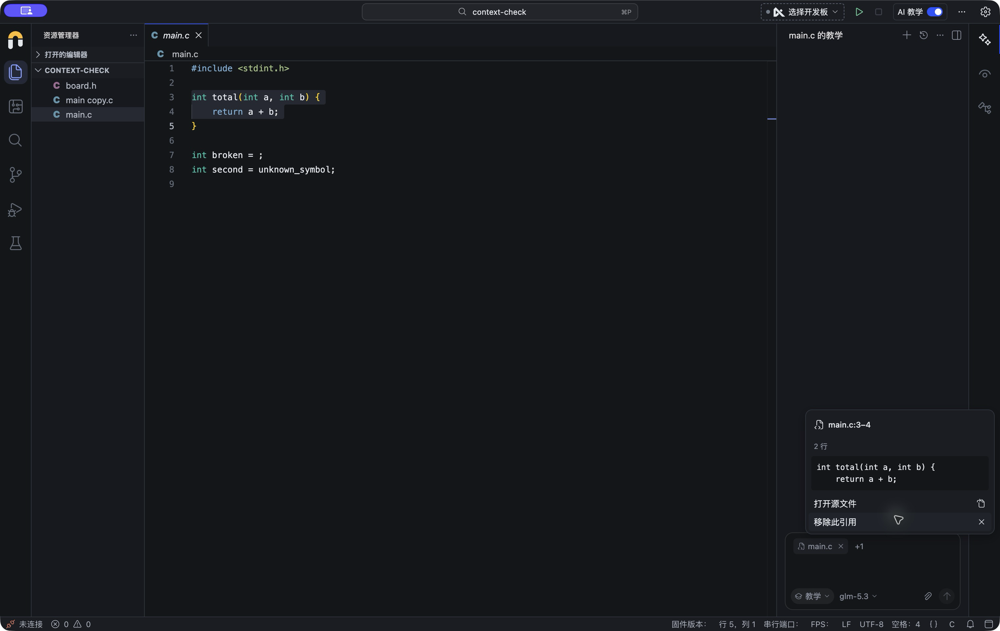
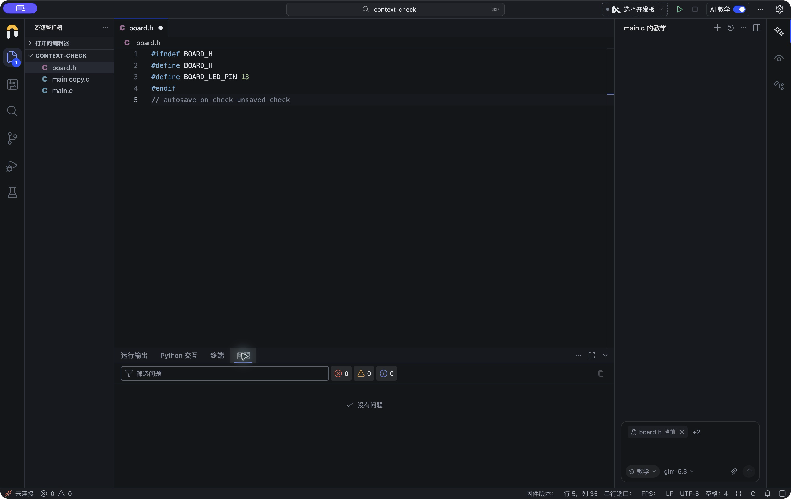
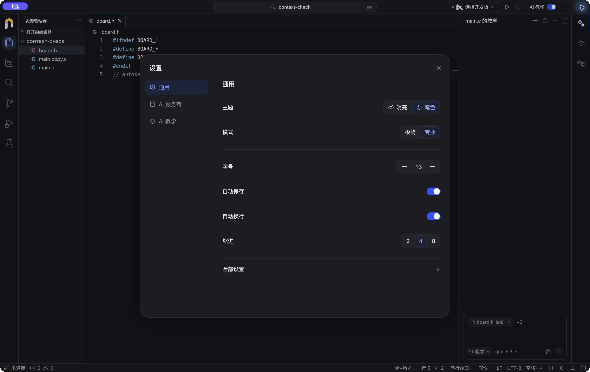
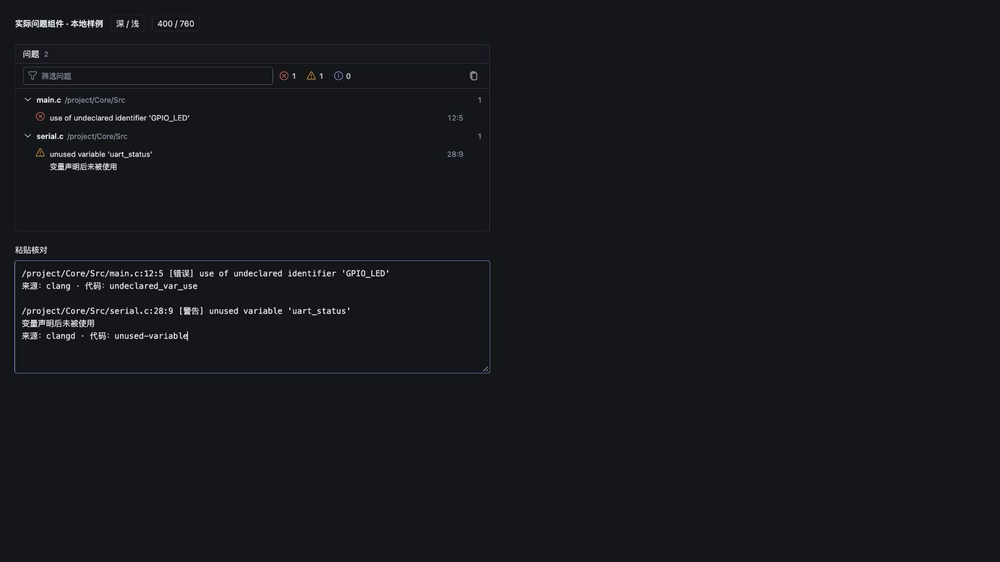

# AI 对话引用、问题复制与自动保存验收

日期：2026-10-26。工作树：`codex/nodu-02-integration`，基线 `ba63cd6` 加当前未提交改动。

延续 [会话 UI 验收报告](conversation-ui-verification-20261026.md) 的结果，保留此前其他 AI 的会话重命名、归档、列表和草稿改动。本次没有提交、推送或打包安装程序。

## 本次实现

- 文件列表复制 → 对话输入框粘贴：识别来自资源管理器的文件 URI，转成可预览、可移除的引用；普通文本仍按文本粘贴。
- 文件拖入输入框：接入 Theia 文件树 URI、URI 列表和 Electron 本地文件路径；去重，优先使用已打开编辑器里的未保存内容。
- 编辑器选区复制 → 粘贴：在复制时记录源文件、内容快照和行号。选区终点在下一行第 1 列时，不把未选中的下一行计入范围；兼容 CRLF。
- 补齐 Electron 原生编辑菜单和快捷键的复制/粘贴路径。Theia 原生粘贴直接插入文本，会绕过 React 的 `onPaste`，因此单独覆盖了输入框聚焦时的命令处理。
- 读取剪贴板、文件和授权引用期间暂时阻止发送，保留草稿；切换工程、模式或会话后，迟到结果不会进入新会话。
- 底部“问题”页签在 K210、STM32 下均常驻，零问题时也保留。
- 每条问题有独立复制按钮，工具栏提供复制全部。复制全部包括被筛选或折叠的条目，内容含文件路径、行列、严重级别、完整消息、来源及诊断代码。
- 极简和专业设置均提供自动保存开关，应用默认值改为 `afterDelay`；已有明确关闭设置仍受尊重。

未新增常驻解释文案；引用继续使用现有紧凑标签和快照预览，复制成功通过图标短暂反馈。

## 真实桌面与组件验收

使用独立临时工程 `/tmp/nodu-context-check-20261026/context-check`、独立配置目录和 Electron 进程（端口 24383），未操作原验收窗口或真实用户工程。没有发送在线模型请求。

| 检查 | 证据与结果 |
|---|---|
| 资源管理器复制 `main.c`，聚焦 AI 输入框后按 ⌘V | 原生 Electron 中生成 `main.c` 引用，输入区没有插入文件 URI |
| 复制 `main.c` 第 3–4 行，选区结束于第 5 行第 1 列 | 原生 Electron 中出现 `main.c:3–4`；快照只包含所选的 2 行 |
| 切换到 `board.h` | 先前 `main.c` 文件和代码快照仍保留，当前文件引用正常更新 |
| 零诊断时打开底部面板 | “问题”页签常驻，可选中，复制全部按钮禁用 |
| 单条问题复制 | 真实 ProblemsPanel 独立组件使用样例诊断，通过剪贴板粘贴到正式 Electron AI 输入框，路径/行列/来源完整 |
| 复制全部 | 真实组件两条诊断复制后在粘贴核对框完整出现，包含第二条多行消息 |
| 自动保存默认开启 | 独立配置首次启动显示开启；编辑 `board.h` 后读取磁盘确认内容已保存 |
| 关闭自动保存 | 编辑后切换面板，磁盘仍保持旧内容；设置再次打开显示关闭 |
| 重新开启自动保存 | 继续编辑后，磁盘包含全部新内容 |

ProblemsPanel 的有内容状态使用真实生产组件、正式 CSS、实际剪贴板与本地诊断样例；没有把样例当作真实语言服务诊断。空问题页签在完整桌面中验证。

文件拖拽处理已通过真实 Theia 源码格式核对及事件测试。原生鼠标拖放自动化未得到可靠的输入框落点，因此**不把桌面鼠标拖放列为人工验收通过**。Windows 驱动器路径、UNC 路径和外部文件桥接属于自动化覆盖，未在 Windows 桌面验收。

## 自动化覆盖

关键新增用例覆盖：复制时的来源快照、行数边界、普通文本回退、无效元数据、文件去重、未保存文档、越界工程路径、Windows/UNC 路径、多文件中途失败、迟到读取/授权/剪贴板失败、跨会话隔离、发送保护、问题单条与全部复制、默认自动保存与用户关闭优先级。

最终结果：AI 回归 **398/398**，工作台回归 **123/123**，均为零失败、零跳过；TypeScript 和 Electron 构建通过，`git diff --check` 通过。计数和构建摘要见 [results.json](composer-context-acceptance-20261026/results.json)。AI 与工作台测试集存在重叠，不相加为独立用例数。

运行环境：Node 24；执行 `test:tutor`、`test:workbench`、工作区 `compile`、Electron 开发构建和 `git diff --check`。日志位于同一证据目录，`*.log` 由仓库原有规则忽略，摘要保留 SHA-256。

## 截图

## 支持边界

- 沿用当前 AI 上下文协议：当前工程内的 C/C++ 文件；提问模式另外支持 Python。最多 6 项、总量 64 KiB。没有扩大为任意二进制附件或跨工程文件上传。
- 后端继续校验真实路径、目录、符号链接和文件类型；拖放不会移动源文件。
- 本次验证的是引用传递、剪贴板、问题面板和保存行为，没有重做模型服务、硬件编译/烧录或发布安装包验收。
