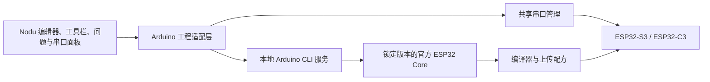

# ESP32-S3 / ESP32-C3 Arduino 开发与烧写方案

日期：2026-10-26。本文保留初始调研；后续实施状态与新增的左侧库管理设计以 [ESP32 全流程方案](esp32-workflow-design-20261026.md) 为准。两芯片已完成真实编译与模拟运行，尚未执行真板烧写。

建议首期采用 **Nodu 界面 + Arduino CLI + Espressif 官方 Arduino Core**。用户写 Arduino 程序，选择板卡和端口，点击“编译”或“上传”，上传结束继续使用底部串口。ESP32-S3、ESP32-C3 均在官方 Arduino Core 的稳定支持范围内。[Arduino-ESP32](https://github.com/espressif/arduino-esp32)

## 可以直接借鉴的开源项目

| 项目 | 对 Nodu 最有价值的部分 | 建议使用方式 | 仓库标示许可证 |
|---|---|---|---|
| [Arduino IDE 2](https://github.com/arduino/arduino-ide) | Theia + Electron 的板卡选择、任务输出、串口与上传协作；编译和上传交给 CLI daemon | 作为交互与架构参照，保留 Nodu 自身界面 | AGPL-3.0 |
| [Arduino CLI](https://github.com/arduino/arduino-cli) | 官方板卡包、库管理、编译、上传、设备发现；命令行和机器接口 | 作为首期执行引擎 | GPL-3.0 |
| [Arduino-ESP32](https://github.com/espressif/arduino-esp32) | S3/C3 板卡定义、Arduino API、示例、上传配置 | 使用经过验收的固定稳定版，读取其板卡配置 | LGPL-2.1 |
| [Arduino Language Server](https://github.com/arduino/arduino-language-server) | Arduino `.ino` 与 C++ 的补全、跳转和源位置映射；基于 clangd | 首期验证接入，避免仅将 `.ino` 粗暴关联为普通 C++ | AGPL-3.0 |
| [esptool](https://github.com/espressif/esptool) | 芯片识别、下载模式、固件写入及复位 | 优先让 Core 的上传配方调用；故障诊断参考 | GPL-2.0-or-later |
| [esptool-js](https://github.com/espressif/esptool-js) | WebSerial 连接、写入进度、浏览器固件烧录 | 后续“现成固件烧录页”候选；不能代替 Arduino 编译器 | Apache-2.0 |
| [PlatformIO Core](https://github.com/platformio/platformio-core) / [Espressif32 platform](https://github.com/platformio/platform-espressif32) | 多板配置、依赖与构建环境组织 | 比较工程结构；本期不同时引入第二套包管理与构建系统 | 两仓库均标示 Apache-2.0 |

最值得先看的组合是 Arduino IDE 2、Arduino CLI、Arduino-ESP32。Arduino IDE 2 与 Nodu 的技术栈接近，官方明确把构建和上传交给独立 CLI 服务；Nodu 无须重新实现 Arduino 的预处理、库解析和芯片下载协议。[IDE 架构说明](https://github.com/arduino/arduino-ide#arduino-ide-2x)、[CLI 集成接口](https://docs.arduino.cc/arduino-cli/integration-options/)

上表记录仓库主许可证；实际分发清单按采用的版本和依赖确认。

## 用户看到的流程

1. **新建工程**：选择 ESP32-S3 或 ESP32-C3，再选择实际开发板；默认 Arduino。模板先提供“串口示例”“空白工程”。板载 LED 模板只对已确认引脚及 LED 类型的板卡开放。
2. **首次准备**：安装本项目需要的 Arduino 工具包，显示真实下载与安装进度；允许重试。此后使用本地缓存，普通编译不强制联网。
3. **编辑**：直接打开与工程同名的 `.ino` 文件。补全、跳转、错误定位与 AI 文件引用使用同一份工程来源。
4. **工具栏**：`开发板 ▾`、`端口 ▾`、`编译`、`上传`。选择器使用 Nodu 自有组件，和现有极简/专业模式保持位置一致。
5. **编译**：保留当前串口连接；错误进入常驻“问题”页签，可跳转、复制单条或全部内容。
6. **上传**：先完成编译；成功后短暂释放目标串口，调用官方上传流程，结束后恢复用户原先打开的串口。上传前没有打开串口时，不自动替用户打开。
7. **恢复**：等待下载口/运行口重新枚举；只有识别到同一块设备才自动恢复。设备无法唯一确认时，让用户选择端口，避免连接到另一块板。

默认界面只展示板卡、端口和操作状态。Flash、PSRAM、分区、上传速度等放在板卡设置的“高级”区域。首次手动下载模式指导仅在实际连接失败或设备确实需要时出现，不作为常驻说明。

## 必须区分芯片、开发板和 USB 接口

“ESP32-S3”是芯片系列，不能单凭名称推断 Flash 容量、PSRAM 类型、LED 引脚和 USB 接法。板卡预设应记录实际型号、硬件版本与端口类型；未知型号可选择通用 Dev Module，但不能冒充已完成板级验收。官方工具菜单也要求板卡、内存和 USB 配置与实际硬件匹配。[板卡参数说明](https://docs.espressif.com/projects/arduino-esp32/en/latest/guides/tools_menu.html)

| 连接方式 | 首期策略 |
|---|---|
| USB 转串口，例如 CP210x / CH340 | 走该板卡的 UART 上传配方；串口输出使用与硬件接法一致的 Arduino Serial 配置 |
| ESP32-C3 原生 USB | 使用硬件 CDC 串口路径，配合对应板卡的 USB CDC On Boot 配置 |
| ESP32-S3 原生 USB | 首期优先验收 UART0 / Hardware CDC 路径；TinyUSB 配置仅对明确需要的板卡另建预设 |
| DFU | 本期不做入口；C3 不支持此路径，S3 的 DFU 也不能代替开发时的串口日志通道 |

上述支持差异来自 Espressif 的 Arduino USB 教程；原生 USB 与外置 USB 转串口的设置不可混用。[USB CDC 与 DFU 官方说明](https://docs.espressif.com/projects/arduino-esp32/en/latest/tutorials/cdc_dfu_flash.html)

官方通用板卡基础 FQBN 为 `esp32:esp32:esp32s3` 和 `esp32:esp32:esp32c3`。它们只是起点，实际选项必须从安装并锁定的 Core 读取。S3 的 `USBMode`、`CDCOnBoot`、`UploadMode`、Flash 和 PSRAM 选项不能在前端凭经验拼接。[官方 boards.txt](https://github.com/espressif/arduino-esp32/blob/master/boards.txt)、[board details 接口](https://arduino.github.io/arduino-cli/1.5/commands/arduino-cli_board_details/)

## 对现有代码的落点

当前代码已经有 ESP32 系列的新建入口，但 `nodu-project-generator.ts` 的 ESP32 分支仍生成 `esp-idf` 工程和相应任务。用户本轮要求的是 Arduino，所以应新增独立的 `esp32-arduino` 类型与模板，使 S3/C3 新工程走 Arduino；已有其他类型工程保持可识别，不做隐式改写。

现有 `NoduEmbeddedService`、`ProjectStatus`、`ChipIdentity`、`FlashResult` 主要服务 STM32，包含 `stlink | uart`、STM32 识别、备份与 BOOT 恢复字段。仅向芯片列表添加 S3/C3 无法复用成完整 Arduino 上传能力。建议分层如下，名称是拟议接口：

适配层先提供 `prepare / listBoards / boardOptions / compile / upload / cancel`，统一输出 Nodu 的任务事件和诊断；不强行复用 STM32 烧写返回结构。串口仍由现有监视服务持有，上传时通过同一占用管理释放与恢复，避免两个组件各自打开端口。

首期可使用 CLI 子进程和 JSON 查询完成端到端验证；需要持续设备发现与细粒度流式状态时，切换到 CLI 的本地 gRPC daemon。两者属于同一执行引擎，无须复制一套构建逻辑。[官方集成方式](https://docs.arduino.cc/arduino-cli/integration-options/)

## 工程与构建约定

- 入口使用标准 `工程名/工程名.ino`，支持同目录 C/C++ 文件；用户仍可把工程直接带到 Arduino 工具中使用。[Sketch 规范](https://docs.arduino.cc/arduino-cli/sketch-specification/)
- `sketch.yaml` 保存目标板 FQBN、Core 版本和库版本。`nodu.json` 只保存 Nodu 类型、模板及 UI 元数据，避免两份板卡配置成为互相冲突的权威来源。[Sketch profile](https://docs.arduino.cc/arduino-cli/sketch-project-file/)
- CLI、Core 和项目库分别固定版本；升级由用户发起并按项目验证。工具数据放入 Nodu 独立目录，不覆盖用户现有 Arduino 环境。
- 板卡菜单根据固定 Core 的 `board details` 输出生成；项目设置同时传给编译、上传与语言服务。
- 编译输出记录源文件摘要、FQBN/选项、Core/库版本及构建目录。只有这些仍与当前工程一致时，才允许“上传上次构建”；默认“上传”总是先编译。
- 上传调用 CLI 的板卡配方，让它选择该 Core 对应的工具、固件片段与地址。不要手写一组通用 Flash 地址，也不要只把 sketch 的一个 `.bin` 当作完整首次烧写产物。`upload` 本身不编译，必须由 Nodu 明确串联流程。[compile](https://arduino.github.io/arduino-cli/1.5/commands/arduino-cli_compile/)、[upload](https://arduino.github.io/arduino-cli/1.5/commands/arduino-cli_upload/)
- Arduino Language Server 与工程板卡配置同步；换板卡后重新建立其上下文。其官方用法要求传入 CLI、clangd 和 FQBN。[语言服务用法](https://github.com/arduino/arduino-language-server#usage)
- 下载来源使用 Espressif 稳定版索引。网络不佳时可提供官方列出的镜像，但区分镜像包版本并校验下载内容，不把镜像包与默认索引版本混用。[官方安装来源](https://docs.espressif.com/projects/arduino-esp32/en/latest/installing.html)

## 实施顺序与验收条件

| 阶段 | 交付 | 完成条件 |
|---|---|---|
| 1. 工程闭环 | Arduino 类型、S3/C3 模板、锁版本工具环境、真实编译和问题定位 | 两种芯片配置均能编译串口示例；错误行可跳转；不用安装 Arduino IDE |
| 2. 真板上传 | 板卡预设、端口选择、上传与串口释放/恢复 | S3、C3 各选一款确定硬件，验证首次上传、再次上传和板上实际输出 |
| 3. 编辑体验 | `.ino` 补全/跳转、库依赖、AI 引用 `.ino` | 未保存内容、错误映射和跨文件引用准确，切换板卡后环境同步 |
| 4. 稳定性 | Windows/macOS、USB-UART/原生 USB、离线缓存与故障恢复 | 拔线、手动 BOOT、错误板型、端口占用、上传取消、复位改端口均有确定结果 |

编译成功只表示产物已生成；上传工具成功只表示写入流程结束。界面分别显示“编译完成”“上传完成”，串口收到目标程序输出后才给出运行中的证据。不得把端口重连或工具退出码直接当作用户代码已运行。

开始硬件实施前需要确定首批 S3/C3 开发板的准确型号、Flash/PSRAM 配置以及连接使用哪个 USB 口。这些信息影响板卡预设，但不阻止先实现工程和编译部分。

本提案的产品流程和分层是结合 Nodu 现状的设计判断；外部项目能力与接口事实以上述官方仓库/文档为依据。
