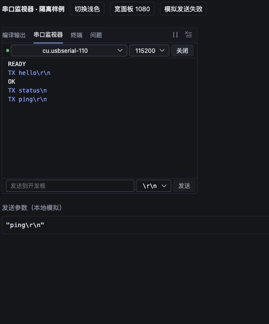
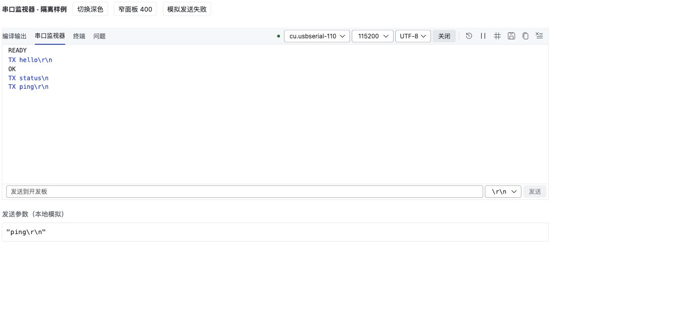

# 串口发送回显与行尾控件

日期：2026-10-26。集成工作树：`codex/nodu-02-integration`。本次保持其他 AI 的未提交改动。

## 行为

- STM32 串口监视器在写入成功后增加独立 `TX` 记录，文本、时间戳、复制和保存日志均可见。发送失败保留输入，不加入成功记录。
- TX 行把实际行尾显示成 `\r`、`\n`，例如 `TX ping\r\n`。这表示向串口写入的数据，不表示目标程序已经应答。
- 十六进制显示区分 RX/TX。TX 字节来自后端实际 UTF-8/GBK 编码结果，原有仅接收的原始字节缓冲保持独立。
- 发送不会截断分片接收中的 UTF-8/GBK 字符。清空、切换工程/端口、断连或重连后，旧发送响应不回填新日志或覆盖新错误。
- 行尾选择是“发送时追加字符”，与自动跟随滚动和视觉换行无关。默认仍为 `\r\n`；选项为 `\r\n`、`\n`、`\r`、`无`。
- 行尾、串口、波特率、编码统一改用已有 `NoduSelect` 自绘下拉，移除该面板原生 select。支持方向键、Enter、Escape；输入法确认不误发送。
- K210 的 Python 交互使用独立实现，原有命令回显保持。

## 验证

真实 `NoduEmbeddedPanel`、`NoduSelect` 和正式 CSS 的隔离组件样例在本地端口 24384 验证；发送服务为本地模拟，没有操作硬件。

- 浅色 1080px、深色 400px：行尾按钮约 72×24px，文字溢出 0，发送行横向溢出 0，原生 select 数量 0。
- 键盘选择 `\n` 后发送 `status`，实际传入服务的字符串为 `"status\n"`，日志显示 `TX status\n`。
- 选择 `\r\n` 后发送 `ping`，参数为 `"ping\r\n"`，日志显示 `TX ping\r\n`。
- 模拟失败时，`retry me` 保留在输入框，未出现该次 TX 成功记录；恢复后可再次发送。
- 底层回归覆盖实际编码后的 UTF-8/GBK 字节、接收分片、成功/失败/过期响应、重复发送、HEX 容量限制。UI 回归覆盖四种行尾、忙态、输入法及异步草稿保护。

最终串口专项 **28/28**、工作台 **123/123** 通过；补充设备上下文/串口底层测试 **32/32**（与专项有重叠，不相加）。TypeScript、Electron 开发构建与 `git diff --check` 通过。结果与日志摘要见 [results.json](serial-monitor-acceptance-20261026/results.json)。可用 `npm --prefix desktop/scope-extension run test:serial` 复跑串口专项测试。

本次未做真板串口回环，也未编译或烧写 ESP32。ESP32-S3/C3 的 Arduino 方案见 [设计提案](esp32-arduino-plan-20261026.md)。
