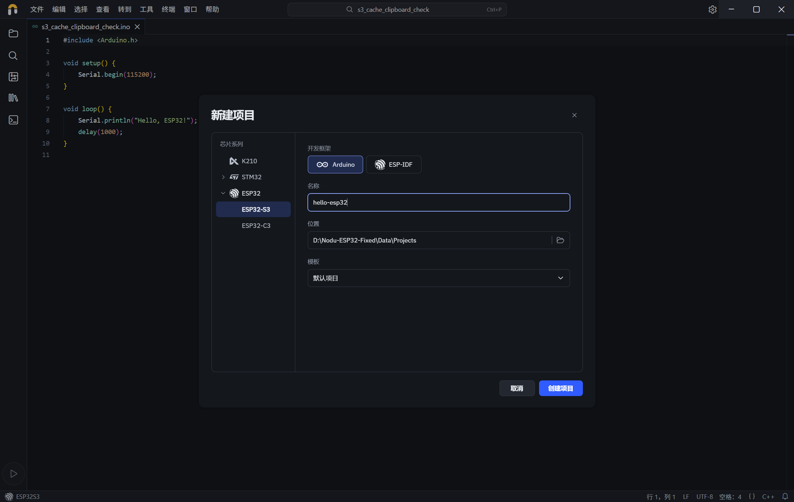
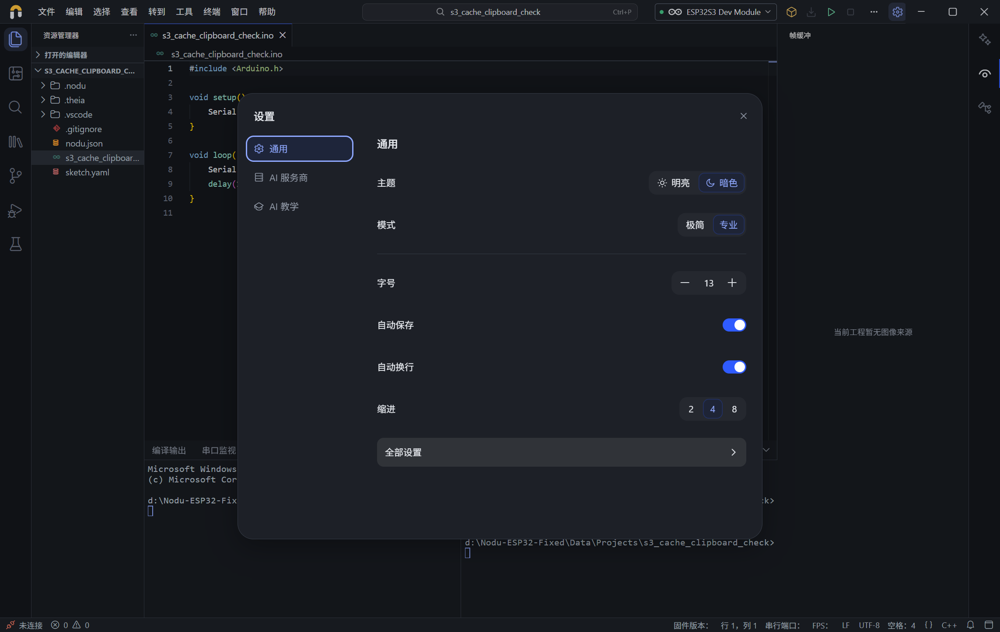
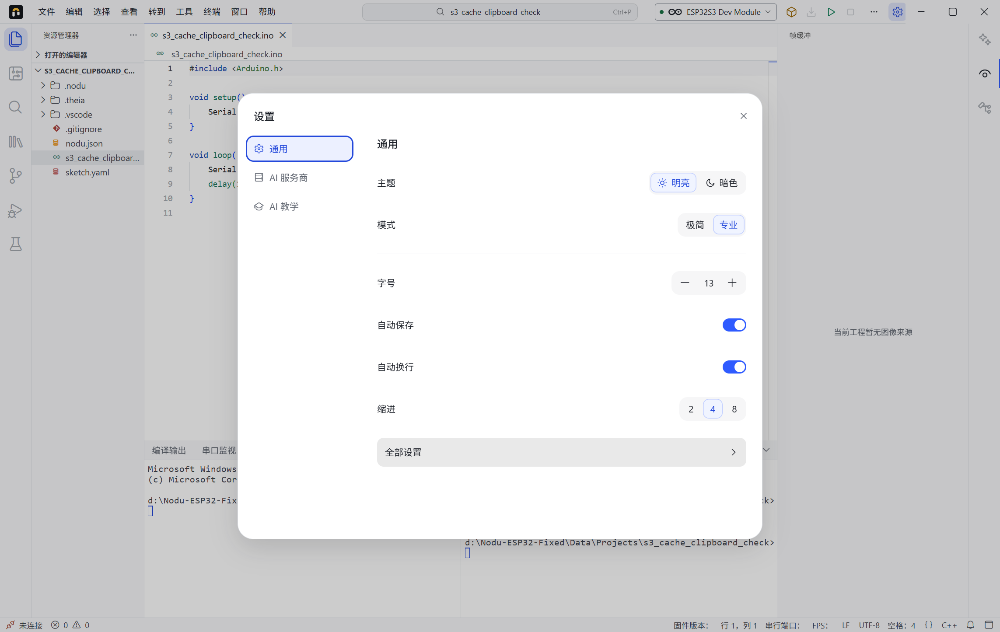
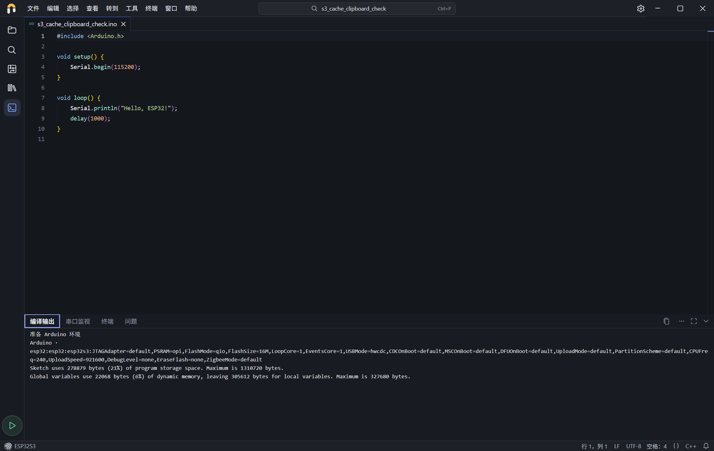

# Windows 环境复用、编译缓存与桌面修复（2026-10-29）

本轮使用同一台 Windows 10 x64，修复重复 Arduino 初始化、核心缓存未复用、剪切失效、终端启动失败，并调整 ESP 新建项目与 Windows 界面。原 `D:\Nodu-ESP32` 窗口及其未保存的 Python 草稿保留；修复版在独立的 `D:\Nodu-ESP32-Fixed` 目录验证。工程、工具链、数据和缓存均在 D 盘，本轮没有烧写实体板。

## 环境与编译

原版每次编译前都会扫描环境，并输出 400 / 2214 等初始化进度，即使没有文件需要安装。修复后只在实际复制或修复输入时显示初始化；目录检查在单轮内去重，Windows 不再执行 POSIX chmod。暖检查从约 2.4–2.7 秒降至约 1 秒；仍保留清单检查、损坏归档修复与路径防护。[原始检查](seed-before.json)、[修复后检查](seed-after.json)。

已成功引导的环境保存带输入身份和工具文件时间戳的就绪记录。重启时核对记录，环境清单、安装路径、编译器或核心元数据改变后会重新准备。原版每次重新打开都运行引导工程，约 12.5 秒；修复后的独立服务实例检查约 1.46 秒。搬到新的验证目录后的第一次安装/准备耗时 107 秒，属于一次性路径迁移与校验，不能和暖启动直接比较。

Arduino CLI 1.5.1 在显式指定 `--build-path` 时不使用共享核心归档。正常编译改用 CLI 标准的 `cache/sketches/<工程路径摘要>`，保留工程隔离、构建输入摘要、固件校验与上传令牌。准备编译数据库时仍可使用独立临时目录；没有启用跳过库发现的隐藏选项。

同机 ESP32-S3，16 MB Flash / OPI PSRAM，串口示例，单次实测如下。耗时包含应用后端准备与真实官方编译过程，不含烧写。

| 场景 | 原版 | 修复版 |
| --- | ---: | ---: |
| 首次编译，尚无共享核心缓存 | 51.0 秒 | 53.2 秒 |
| 同配置另一个新工程，共享核心已存在 | 原版每个新工程不能复用核心 | 24.1 秒 |
| 代码未改再次编译 | 11.3 秒 | 11.2 秒 |
| 修改一行 | 22.9 秒 | 23.4 秒 |
| 新服务实例检查已安装环境 | 12.5 秒 | 1.46 秒 |

这次改善主要在重复环境引导及跨工程核心复用。没有宣称首次冷编译或日常修改达到秒级。修改一行仍约 23 秒，阶段追踪显示依赖预处理约 3.9 秒、原型生成约 4 秒、源文件编译约 4.6 秒、链接约 2.5 秒，其余为准备、官方配方和固件生成。[原版](build-before.json)、[修复版](build-after.json)、[阶段输出](build-phases.json)。

标准缓存目录下的真实固件通过上传计划校验，四段地址为 0、32768、57344、65536；本轮没有执行实体擦写。[上传计划](upload-plan.json)。此前的实体 S3 COM 验收见[真板记录](../windows-esp32-s3-com-20261029/README.md)。

## 编辑器与终端

Theia 1.76 仍使用旧的 `editor.experimentalEditContextEnabled` 选项名，而包内 Monaco 已改为 `editContext`。旧配置被忽略，Windows 原生剪切路径失效。现在由编辑器 provider 映射选项，保留原有用户偏好；菜单复制和剪切交给 Monaco 内置剪贴板动作，避免直接 execCommand 删除选择后未正确写入剪贴板。

实际 Windows 窗口中，中文、emoji、多行注释的 Ctrl+X、Ctrl+V、Ctrl+Z 和命令注册表的菜单剪切均通过。测试后恢复自建样例文件及用户剪贴板，原用户草稿未改动。[剪切](shortcut-cut.json)、[粘贴](shortcut-paste.json)、[撤销](shortcut-undo.json)、[菜单剪切](menu-cut.json)。

Windows 终端原报 `File not found` / `pty process did not start correctly`。后端现在将默认 cmd、PowerShell 和 PATH 中自定义 shell 解析为已存在的绝对路径，再交给 PTY，避免依赖 node-pty 的相对名称查找；保留非 Windows 的原有行为。只保留 Windows 系统目录的 PATH 下，真实窗口成功启动 `C:\Windows\system32\cmd.exe`，执行 echo、新建会话和分屏，收到对应回显；PowerShell `-NoProfile -NoLogo` 的独立回显也通过。[终端结果](terminal.json)、[PowerShell](powershell.json)。

## 项目与界面

- ESP 新项目只列出 ESP32-S3、ESP32-C3。左侧选定芯片后，右侧不再重复选择型号；Arduino / ESP-IDF 框架选择保留。
- 当前工程中打开“新建项目”，默认在该工程的相邻目录创建，ESP 也不会因回退到用户 home 而默认落到 C 盘。
- Windows 两种模式都将现有品牌项目菜单移入文件菜单前的标题栏图标位置；macOS 维持原位置，原生标题栏保留侧边回退。
- 专业设置的“全部设置”改为 44px 高、左右 12px 内边距、10px 圆角。深浅主题实测悬浮背景与文字边距；点击后关闭悬浮设置并打开全部设置。[计算样式](settings.json)、[浅色主题](settings-light.json)、[打开结果](all-settings-open.json)。

成品新建项目界面核对了两种芯片、无重复型号选择器、D 盘默认位置及实际 Logo 坐标。[结果](new-project.json)。

## 回归与交付边界

TypeScript 与 Windows 生产构建通过。Arduino 回归 96 项通过，2 项需要专用仿真种子的集成测试跳过；桌面相关 99 项、剪贴板相关 19 项通过。最后一次目标编译、项目图标、输入兼容和终端回归另有 26 项通过。它们是各自测试集的计数，不是去重后的总数。[Arduino](arduino-tests.txt)、[桌面](desktop-tests.txt)、[剪贴板](clipboard-tests.txt)、[最终目标回归](target-tests.txt)。

Windows 重打包使用 `esp32-validation` 配置，包含原验证版的已校验运行资源、离线工具链与 CH343 驱动。它仍是本地验证目录，`arduinoReleaseReady=false`；既有 20 项对应源码材料缺口未在本轮消除，不生成正式完整版发行压缩包或安装器，也未更新 GitHub Releases。

重打包目录为 `D:\nodu-release-20261029\repo\desktop\dist\Nodu-ESP32-Validation-win32-x64`，源码为 `0ae5e8acdae2156a5623332b787f0fc7b81d96b7`，`sourceDirty=false`。可继续使用的短路径 `D:\Nodu-ESP32-Fixed` 也同步了最终生产代码。安装输入使用原验证目录里的已校验 STM32 toolkit 与 Arduino offline bundle，没有更改正式 `full` 校验门禁。[构建输出](package-build.txt)、[成品身份](package-identity.json)。

成品从空的 `Data` 启动，完成一次包内环境准备；随后经真实前端处理器完成 S3 16 MB / OPI 的冷编译，耗时 **53.3 秒**，返回有效构建令牌与可烧写状态。本轮仍未执行实体烧写。成品原生终端回显再次通过。[成品编译](package-compile.json)、[成品终端](package-terminal.json)。

